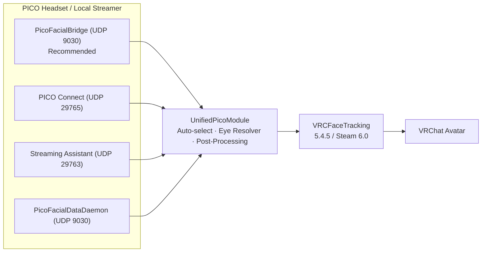

<div align="center">
  <picture>
    <source media="(prefers-color-scheme: dark)" srcset="assets/branding/logo-dark.svg">
    <source media="(prefers-color-scheme: light)" srcset="assets/branding/logo-light.svg">
    
  </picture>

  <h1>UnifiedPicoModule</h1>

  <p>One VRCFaceTracking module for all PICO eye and face tracking senders.</p>

  <p>
    <a href="https://github.com/WolalaQAQ/UnifiedPicoModule/releases"></a>
    
    
    <a href="LICENSE"></a>
  </p>

  <p><strong>English</strong> | <a href="README_zh.md">简体中文</a></p>

  <p>
    <a href="#supported-senders">Senders</a> ·
    <a href="#quick-install">Quick Install</a> ·
    <a href="#verify-its-working">Verify</a> ·
    <a href="#essential-configuration">Configuration</a> ·
    <a href="#pc-expression-post-processing">Post-Processing</a> ·
    <a href="#troubleshooting">Troubleshooting</a> ·
    <a href="#developer-guide">Developer Guide</a> ·
    <a href="#community">Community</a>
  </p>
</div>

---

PICO headsets can send eye and face tracking data through PicoFacialBridge, PICO Connect, Streaming Assistant, or the older PicoFacialDataDaemon. Each sender uses a different UDP port and packet format. UnifiedPicoModule receives all of them, automatically selects the active source, and outputs a single tracking stream to VRCFaceTracking (VRCFT)—so you only need one module installed.

A single DLL (`v0.4.1`, built against the pinned VRCFT 5.4.5 SDK on `.NET 10`) works on both **VRCFaceTracking 5.4.5** and **Steam VRCFaceTracking 6.0.0.0**.

## Supported Senders



| Sender | UDP Port | Eye Tracking | Face Tracking | Notes |
|---|---|---|---|---|
| **[PicoFacialBridge](https://github.com/WolalaQAQ/PicoFacialBridge)** *(Recommended)* | `9030` | Gaze & eyelids from expressions; measured pupil from `E` packets | Supported | Supports channel subscription and independent per-eye `X` packets |
| **PICO Connect** (legacy FT protocol) | `29765` | Gaze & eyelids from expressions | Supported | Runs on the same PC (`StreamingHeader16`) |
| **Streaming Assistant** / headerless stream | `29763` | Gaze & eyelids from expressions | Supported | Exact 892-byte UDP payload (`StreamingBodyOnly`) |
| **PicoFacialDataDaemon** (legacy 536-byte) | `9030` | Gaze & eyelids from expressions; measured pupil when valid | Supported | No remote channel subscription (`DaemonLegacy536`) |

**Sender version requirements for PicoFacialBridge:**

- **Standard mode:** PicoFacialBridge `0.3.0+` (no headset enhancement module required).
- **Independent per-eye expressions (`X` v1):** PicoFacialBridge `0.4.0+` + [PicoET-Enhance](https://github.com/WolalaQAQ/PicoET-Enhance) `2.2.0+`.
- **High-rate independent clocks (`X` v2, separate left-eye / right-eye / mouth clocks):** PicoFacialBridge `0.5.0+` + PicoET-Enhance `2.3.0+`.

Across every sender, gaze is derived from each eye's `EyeLookIn`, `EyeLookOut`, `EyeLookUp`, and `EyeLookDown` shapes, and eyelid openness comes from `1 - EyeBlink`. Native eye packets supply only the measured pupil diameter.

## Quick Install

**Requirements:** Windows 10 or 11, VRCFaceTracking `5.4.5` or Steam VRCFaceTracking `6.0.0.0`, a supported sender on the same local network, and a face-tracking-enabled VRChat avatar.

1. **Disable conflicting PICO modules.** Turn off or uninstall older PICO modules such as `PicoFacialDataModule`, `PicoStreamingAssistantFTUDP` (SAFT), and `VRCFTPicoModule` (lonelyicer / pike forks). They bind ports `9030`, `29765`, and `29763`, and merely toggling tracking off inside VRCFT does not always release the sockets.
2. **Download the release package.** Grab the latest ZIP from the [Releases](https://github.com/WolalaQAQ/UnifiedPicoModule/releases) page (and verify its `.sha256` checksum), or build it yourself under [Build from Source](#build-from-source).
3. **Install in VRCFT and restart.** Open VRCFT's **Module Registry**, choose **Install Module from .zip**, and pick the downloaded package. Once installed, **fully exit and relaunch VRCFT**.
4. **Start your sender.** Launch PicoFacialBridge on the headset (or PICO Connect on PC) and confirm both devices are on the same LAN.

> [!NOTE]
> Seeing **Unified PICO Face Tracking** listed as *Initialized* only confirms that the DLL loaded. Check VRCFT's **Output** log below to verify that tracking frames are actually arriving.

## Verify It's Working

Every 5 seconds, UnifiedPicoModule prints a compact status block to VRCFT's **Output** tab. A healthy PicoFacialBridge connection with PicoET-Enhance looks like this:

```text
Bridge/BridgeSplit: state=Connected session=2 selected=True E/morphology=90.0/24.0Hz ... groupRxHzLRM=90.0/90.0/24.0 modeKnown=True enhance=True independent=True drops=0
Eye origin L/R=blendshape-derived/blendshape-derived; openness L/R=blendshape-blink/blendshape-blink; pupil L/R=measured/measured
```

What to look for:

| Log Field | Healthy Value | Meaning |
|---|---|---|
| `state` | `Connected` | `Connected` = receiving frames; `MissingFrames` = peer online, frames stopped (headset asleep or paused); `Searching` = no peer found yet |
| `selected` | `True` | Confirms this source is the one driving VRCFT (`Streaming/StreamingHeader16` when using PICO Connect) |
| `E/morphology` | Non-zero Hz | Incoming receive rates for native eye packets (`E`) and expression packets |
| `groupRxHzLRM` | Non-zero Hz (`X` v2) | Accepted left-eye / right-eye / mouth update rates; `CONSUMPTION` separately logs internal processing and SDK write latency (not VRChat's OSC rate) |
| `Eye origin` / `openness` | `blendshape-derived` / `blendshape-blink` | Shows expression-driven gaze and `1 - EyeBlink` eyelids; `neutral` means no valid data yet (or expired when timeout neutralization is on) |
| `pupil` | `measured` (Bridge) or `estimated` (Streaming) | `measured` uses the headset's real pupil diameter (1–12 mm); `estimated` uses the fallback when no measurement is available |

VRCFT does not need to stay in the foreground. While tracking is active, the module keeps VRCFT's 1 ms timer-resolution request honored in the background and restores only the `IGNORE_TIMER_RESOLUTION` process policy bits when stopped.

## Essential Configuration

On first launch, the module creates `UnifiedPicoModule.json` next to its DLL:

```text
%APPDATA%\VRCFaceTracking\CustomLibs\8322e16d-c38b-42f0-8d35-68f27227b442\UnifiedPicoModule.json
```

Edit it with any text editor, then **fully restart VRCFT** (hot reloading is not supported). Standard JSON only—no comments, and field names are case-sensitive.

> [!TIP]
> Back up `UnifiedPicoModule.json` before reinstalling or updating the module, because VRCFT may overwrite the entire module folder during installation.

Most users only ever touch these settings:

| Field | Default | When to Change It |
|---|---|---|
| `Bridge.IP` | `null` | Set to your headset's IPv4 address (shown in PicoFacialBridge) if auto-discovery fails, you use VPN/virtual adapters, or multiple headsets share the LAN |
| `Source` | `"Auto"` | Set to `"Bridge"` or `"Streaming"` to lock one source and skip opening the other ports |
| `DisableEyeTracking` / `DisableFaceTracking` | `false` | Disable one side (e.g., set `DisableFaceTracking: true` when mixing PICO eye tracking with Cymple mouth tracking). With Bridge, the headset stops sending the disabled channel |
| `EyeGain` | All `1` | Per-eye multipliers (`LeftX`, `LeftY`, `RightX`, `RightY`, `LeftOpenness`, `RightOpenness`, range `0–10`) |
| `AllowFallback` | `false` | Set `true` (in `Auto` mode) to switch automatically to the other source if the active source goes down |
| `Stale.NeutralizeOnTimeout` | `false` | By default, the module holds the last gaze, eyelids, pupil, and expressions on timeout. Set `true` to reset to neutral after `Stale.EyeMs` / `Stale.FaceMs` (default `250` ms) |

**How `Auto` source selection works:** During the first `1500` ms after startup (`AutoSelectionWindowMs`), the module waits preferentially for Bridge. After that, whichever source delivers usable frames first wins for the rest of the session. Sources are never mixed (e.g., Bridge eyes + PICO Connect mouth). If PICO Connect starts streaming before Bridge, set `Source` to `"Bridge"` or start Bridge first.

See the [Configuration Reference](docs/configuration.md) for every field, valid range, validation rule, and ready-to-paste config recipes.

## PC Expression Post-Processing

Post-processing is an optional PC-side layer between PICO expression decoding and VRCFT output. By default, **only `ChannelGain` is enabled**, applying a `2x` multiplier to `EyeWideLeft` and `EyeWideRight` to compensate for PICO's low eye-widening range. All other channels pass through at `1x`, and the remaining 13 rules are off.

> [!NOTE]
> Headset-side tracking enhancement, filtering, and inference tuning live in [PicoET-Enhance](https://github.com/WolalaQAQ/PicoET-Enhance). UnifiedPicoModule's post-processing only adjusts expression channels on the PC (never gaze, eye openness, or pupil diameter). Its default coefficients have not been calibrated on a real headset—enable rules one at a time and compare on your avatar.

| Rule | Default | What It Does |
|---|---|---|
| `ChannelGain` | **On** | Per-channel output gain (defaults to `EyeWideLeft/Right = 2`, others `1`) |
| `BrowInnerSeparation` | Off | Reduces outer brow lift triggered by raising the inner brow |
| `BrowDownResponse` | Off | Remaps brow lowering with a normalized sigmoid curve and optional single-eye blink attenuation |
| `SquintResponse` | Off | Remaps eye squint with a power curve (`Gamma`) and optional blink coupling |
| `FrownJawAttenuation` | Off | Attenuates unintended mouth frown when opening the jaw |
| `ShrugToFrown` | Off | Uses chin raise (`MouthShrug`) to assist frown, blocked during lip roll, pucker, or funnel |
| `UpperUpPressGate` | Off | Suppresses upper lip raise while pressing the lips together |
| `PuckerFunnelAssist` | Off | Boosts lip funnel during a strong pucker (when lips are not pressed) |
| `SmileRollSuppression` | Off | Suppresses residual smile while rolling the lower lip inward |
| `StretchCompetition` | Off | Suppresses weak smile and upper lip raise during a horizontal mouth stretch |
| `Symmetry` | Off | Blends left/right mouth channels (`Smile`, `Frown`, `Stretch`, `UpperUp`) via `Max` or `Average` |
| `CheekAsymmetry` | Off | Infers single-sided cheek puff from sideways mouth movement |
| `TongueHold` | Off | Holds `TongueOut` briefly when it momentarily drops to zero |
| `TongueJawGate` | Off | Suppresses false tongue triggers when the mouth is barely open |

To turn a rule on, flip its `Enabled` flag in `UnifiedPicoModule.json` and restart VRCFT:

```json
"TongueHold": { "Enabled": true, "HoldMs": 120, "DropThreshold": 0.15 }
```

Rules run in a fixed order. For the pipeline diagram, exact formulas, parameter ranges, and tuning tips, see the [Post-Processing Reference](docs/postprocessing.md).

## Troubleshooting

| Symptom | Likely Cause | Fix |
|---|---|---|
| Module says *Initialized*, avatar does not move, log stays on `state=Searching` | Port conflict with an older PICO module, Windows Firewall blocking VRCFT, different subnets, or VPN/virtual adapters interfering with multicast discovery | Disable/uninstall older PICO modules; allow VRCFT on Private networks in Windows Firewall; set `Bridge.IP` explicitly to the headset's IPv4 address |
| Using PicoFacialBridge, but log shows `Streaming` selected | PICO Connect sent frames before Bridge connected | Start PicoFacialBridge before VRCFT, or set `"Source": "Bridge"` in `UnifiedPicoModule.json` |
| Config edits have no effect | VRCFT was not restarted, or a field name/value failed validation | Fully exit and relaunch VRCFT, then inspect the **Output** log for unknown keys or out-of-range warnings (or run `UnifiedPicoConfigTool validate`) |
| Face expressions move, but eye gaze does not | `DisableEyeTracking` is `true`, or sender is not providing `EyeLook` shapes | Confirm `DisableEyeTracking` is `false` and check `Eye origin` in the Output log |
| Independent left/right inner brows merge into one movement | Avatar uses VRCFT's combined `v2/BrowInnerUp` parameter, which averages left and right | Use an avatar with separate left/right inner brow parameters; UnifiedPicoModule already outputs both channels independently when receiving `X` packets |
| Tongue flickers or triggers with mouth closed | Brief sensor drop-to-zero vs. false trigger at low jaw open | Enable `TongueHold` for drop-outs, or `TongueJawGate` for false triggers with a closed mouth |

---

## Developer Guide

### Migrating from Older Modules

`UnifiedPicoConfigTool` (built from source; not bundled in the release ZIP) validates v1 configs, exports defaults, and converts configs from earlier modules:

- `PicoFacialDataModule.json` (both upstream and split fork)
- `PicoModuleConfig.json` (SAFT)
- `config.ini` (pike branch)

It generates a new JSON config alongside a line-by-line migration report and never overwrites existing files. Review the report and copy the result to `UnifiedPicoModule.json` manually. See the [ConfigTool Guide](tools/ConfigTool/README.md).

### Compatibility & Verification Scope

- **VRCFaceTracking 5.4.5 (PICO 4 Pro):** Verified live with PicoFacialBridge `0.5.0` + PicoET-Enhance `2.3.0` (`X` v2, including Virtual Desktop + Cymple mouth / PICO eye mix, eye-only, and combined PICO tracking), PicoFacialBridge `0.3.0+` (`BridgeSplit`), and PICO Connect `10.6.6` (`faceTrackingTransferProtocol=2`, port `29765`, ~72 Hz). The actual OSC send rate to VRChat depends on the VRCFT host; see [Measured 90 Hz Throughput](https://github.com/WolalaQAQ/PicoET-Enhance#measured-90-hz-throughput) and [VRCFT-Enhance](https://github.com/WolalaQAQ/VRCFT-Enhance).
- **Steam VRCFaceTracking 6.0.0.0 (Build `26384174`, commit `3d36379`):** Verified via isolated component tests covering module loading, native face blobs, legacy avatar parameters, and pupil sentinel encoding. When no measured pupil is available, VRCFT 6 receives `0` (its unavailable-measurement sentinel, avoiding false pupil constriction), while VRCFT 5 retains `Stale.NeutralPupilMillimeters`. Live Cymple + VRCFT 6 mixing, full avatar rendering on VRCFT 6, single-eye quality failure (`state = 0`), and multi-hour sessions have not yet been tested.

### Security & Privacy

UnifiedPicoModule only listens for UDP packets on the local network. It makes no internet requests, includes no telemetry or auto-updater, embeds its module icon directly in the DLL, and never writes tracking frames to disk.

Because UDP has no built-in encryption or authentication, use this module only on trusted local networks and never forward ports `9030`, `29765`, or `29763` to the internet. See [Privacy & Network Security](docs/privacy.md) for source validation details and a pre-sharing log checklist.

### Build from Source

Requires Windows, PowerShell, the **.NET 10 SDK**, and Git. The module builds against a pinned VRCFaceTracking source commit (verified by digest):

```powershell
git clone https://github.com/benaclejames/VRCFaceTracking.git .sdk/source/VRCFaceTracking
git -C .sdk/source/VRCFaceTracking switch --detach 7add14873e398c4095d06913cdeee7a01fc43fab

./tools/build.ps1 -Configuration Release
./tools/package.ps1
```

The release ZIP and `.sha256` checksum are written to `artifacts/`. Host VRCFaceTracking DLLs are never packaged. See the [Development Guide](docs/development.md) for custom SDK paths, compatibility tests, and release packaging.

### Documentation Index

| Document | Contents |
|---|---|
| [Configuration Reference](docs/configuration.md) | Every JSON field, valid ranges, recipes, validation rules, and legacy migration details |
| [Post-Processing Reference](docs/postprocessing.md) | Execution pipeline, all 14 rule formulas, interactions, state reset, and valid channel names |
| [Protocol Reference](docs/protocol.md) | Wire formats for `BridgeSplit`, `X` v1/v2, `DaemonLegacy536`, `StreamingHeader16`, and `StreamingBodyOnly` |
| [Privacy & Network Security](docs/privacy.md) | Local files, log fields, UDP control packets, source checks, and sharing checklist |
| [ConfigTool Guide](tools/ConfigTool/README.md) | CLI syntax, exit codes, and legacy config import instructions |
| [Development Guide](docs/development.md) | Build environment, SDK pinning, compatibility tests, and release workflow |
| [Contributing](CONTRIBUTING.md) | Code standards and PR guidelines |

---

## Pico-Enhance Ecosystem

| Project | Purpose |
|---|---|
| **[VD-PicoEnhance](https://github.com/WolalaQAQ/VD-PicoEnhance)** | Virtual Desktop enhancements for PICO 4 / 4 Pro (hand tracking, passthrough, bitrate/resolution unlock, Index Knuckles auto-switch) |
| **[PicoET-Enhance](https://github.com/WolalaQAQ/PicoET-Enhance)** | Real pupil diameter, independent per-eye expressions, 90/90 Hz tracking, on-headset tuning & LAN camera streaming for PICO 4 Pro |
| **[PicoFacialBridge](https://github.com/WolalaQAQ/PicoFacialBridge)** | Rootless on-headset UDP sender for PICO eye and face tracking with per-channel subscription |
| **[UnifiedPicoModule](https://github.com/WolalaQAQ/UnifiedPicoModule)** | Unified PC VRCFaceTracking receiver module *(this repository)* |
| **[VRCFT-Enhance](https://github.com/WolalaQAQ/VRCFT-Enhance)** | Low-latency polling and snapshot consistency patches for VRCFaceTracking 5.4.5 and Steam 6.0 |
| **[PicoRegionSwitch](https://github.com/WolalaQAQ/PicoRegionSwitch)** | Offline on-headset CN / Global app switcher with isolated dual-region data banks |
| **[PicoUSB-Quiet](https://github.com/WolalaQAQ/PicoUSB-Quiet)** | Suppresses PICO OS app-switch prompts and USB confirmation flashes on USB re-attach |

## Community

Join the Pico-Enhance community for help, discussion, and release announcements.

<a href="https://discord.gg/ueSEydeVD8"></a>

**QQ group:** `1129699813` — scan the QR code below with QQ to join.


## Acknowledgements

This module is an independent implementation built from the public protocol documentation and observable behavior of the following projects (no code is copied from them):

- **thoricelli:** [PicoFacialDataModule](https://github.com/thoricelli/PicoFacialDataModule), PicoFacialDataDaemon, [PICO-documentation](https://github.com/thoricelli/PICO-documentation)
- **WolalaQAQ:** [PicoFacialBridge](https://github.com/WolalaQAQ/PicoFacialBridge)
- **regzo2:** [PicoStreamingAssistantFTUDP](https://github.com/regzo2/PicoStreamingAssistantFTUDP)
- **lonelyicer:** [VRCFTPicoModule](https://github.com/lonelyicer/VRCFTPicoModule)
- **pikepikeid:** [VRCFTPicoModule](https://github.com/pikepikeid/VRCFTPicoModule) (design reference for most post-processing rules)
- **benaclejames** and the [VRCFaceTracking](https://github.com/benaclejames/VRCFaceTracking) contributors
- **crx:** [Pico Wiki](https://pico.crx.moe/)

See [THIRD_PARTY_NOTICES.md](THIRD_PARTY_NOTICES.md) for exact versions and license boundaries.

## License

Original code and documentation in this repository are licensed under [MIT](LICENSE). The referenced VRCFaceTracking SDK / Core remain under Apache-2.0, and this project does not distribute their DLLs. Product names such as PICO and VRCFaceTracking identify interoperable software only and do not imply official endorsement.
