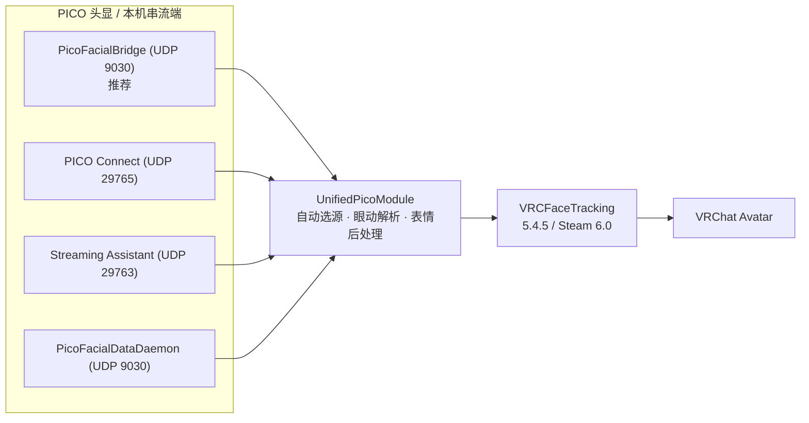
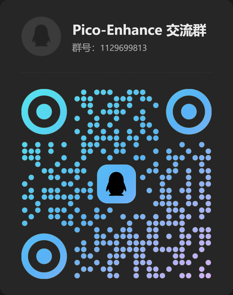

<div align="center">
  <picture>
    <source media="(prefers-color-scheme: dark)" srcset="assets/branding/logo-dark.svg">
    <source media="(prefers-color-scheme: light)" srcset="assets/branding/logo-light.svg">
    
  </picture>

  <h1>UnifiedPicoModule</h1>

  <p>面向 VRCFaceTracking 的统一 PICO 眼动与面部追踪模块，一个 DLL 接入全部常见发送端。</p>

  <p>
    <a href="https://github.com/WolalaQAQ/UnifiedPicoModule/releases"></a>
    
    
    <a href="LICENSE"></a>
  </p>

  <p><a href="README.md">English</a> | <strong>简体中文</strong></p>

  <p>
    <a href="#支持的发送端">发送端</a> ·
    <a href="#快速安装">快速安装</a> ·
    <a href="#确认是否正常工作">连接验证</a> ·
    <a href="#常用配置">常用配置</a> ·
    <a href="#pc-端表情后处理">表情后处理</a> ·
    <a href="#故障排查">故障排查</a> ·
    <a href="#开发者指南">开发者指南</a> ·
    <a href="#社区">社区</a>
  </p>
</div>

---

PICO 头显的眼动与面捕数据可以来自 PicoFacialBridge、PICO Connect、Streaming Assistant 或早期 PicoFacialDataDaemon，各自使用不同的 UDP 端口与数据格式。UnifiedPicoModule 兼容上述全部发送端，自动选择当前可用的来源，再通过单一通道输出到 VRCFaceTracking（VRCFT），不需要按发送端反复切换模块。

当前版本为 `v0.4.1`（基于固定的 VRCFT 5.4.5 SDK 与 `.NET 10` 构建），同一份 DLL 同时支持 **VRCFaceTracking 5.4.5** 与 **Steam VRCFaceTracking 6.0.0.0**。

## 支持的发送端



| 发送端 | UDP 端口 | 眼动追踪 | 面部表情 | 说明 |
|---|---|---|---|---|
| **[PicoFacialBridge](https://github.com/WolalaQAQ/PicoFacialBridge)** *（推荐）* | `9030` | 视线与眼睑由表情推算；`E` 包提供实测瞳孔直径 | 支持 | 支持按需订阅通道及逐眼独立 `X` 包 |
| **PICO Connect**（legacy 面捕协议） | `29765` | 视线与眼睑由表情推算 | 支持 | 运行在本机 PC（`StreamingHeader16`） |
| **Streaming Assistant** / 无头串流格式 | `29763` | 视线与眼睑由表情推算 | 支持 | 固定 892 字节 UDP 负载（`StreamingBodyOnly`） |
| **PicoFacialDataDaemon**（536 字节旧格式） | `9030` | 视线与眼睑由表情推算；有效时提供实测瞳孔直径 | 支持 | 无远端通道订阅（`DaemonLegacy536`） |

**PicoFacialBridge 版本要求：**

- **普通模式：** PicoFacialBridge `0.3.0+`（无需安装头显端增强模块）。
- **逐眼独立表情（`X` v1）：** PicoFacialBridge `0.4.0+` 搭配 [PicoET-Enhance](https://github.com/WolalaQAQ/PicoET-Enhance) `2.2.0+`。
- **高频独立时钟（`X` v2，左眼 / 右眼 / 嘴各自计时）：** PicoFacialBridge `0.5.0+` 搭配 PicoET-Enhance `2.3.0+`。

无论使用哪种发送端，视线都由每只眼的 `EyeLookIn`、`EyeLookOut`、`EyeLookUp`、`EyeLookDown` 推算，睁眼度取 `1 - EyeBlink`；原生眼动包只用来读取实测瞳孔直径。

## 快速安装

**环境要求：** Windows 10 或 11、VRCFaceTracking `5.4.5` 或 Steam VRCFaceTracking `6.0.0.0`、处于同一局域网的发送端，以及支持面捕的 VRChat Avatar。

1. **停用旧版 PICO 模块。** 在 VRCFT 模块列表中停用或卸载 `PicoFacialDataModule`、`PicoStreamingAssistantFTUDP`（SAFT）、`VRCFTPicoModule`（lonelyicer / pike 分支）等旧模块。它们会占用 `9030`、`29765`、`29763` 端口，仅关闭追踪开关不一定释放端口。
2. **下载模块包。** 前往 [Releases](https://github.com/WolalaQAQ/UnifiedPicoModule/releases) 下载最新 ZIP，并对照随附的 `.sha256` 文件校验完整性；也可以按[从源码构建](#从源码构建)自行打包。
3. **在 VRCFT 中安装并重启。** 打开 VRCFT 的 **Module Registry**，选择 **Install Module from .zip** 并选中模块包。安装完成后，**彻底退出并重新启动 VRCFT**。
4. **启动发送端。** 在头显启动 PicoFacialBridge（或在 PC 启动 PICO Connect），确保头显与 PC 位于同一局域网。

> [!NOTE]
> 模块列表显示 **Unified PICO Face Tracking** 且状态为 *Initialized*，只代表 DLL 加载成功，不代表已经收到数据。请按下一节在 Output 日志中确认连接状态。

## 确认是否正常工作

模块每 5 秒会在 VRCFT 的 **Output** 页面打印一次状态摘要。通过 PicoFacialBridge 搭配 PicoET-Enhance 正常连接时，输出类似下面这样：

```text
Bridge/BridgeSplit: state=Connected session=2 selected=True E/morphology=90.0/24.0Hz ... groupRxHzLRM=90.0/90.0/24.0 modeKnown=True enhance=True independent=True drops=0
Eye origin L/R=blendshape-derived/blendshape-derived; openness L/R=blendshape-blink/blendshape-blink; pupil L/R=measured/measured
```

重点看这几项：

| 日志字段 | 正常表现 | 说明 |
|---|---|---|
| `state` | `Connected` | `Connected` 表示正在收帧；`MissingFrames` 表示对端在线但数据暂停（如头显休眠）；`Searching` 表示还没找到发送端 |
| `selected` | `True` | 说明该来源正在驱动 VRCFT（使用 PICO Connect 时显示为 `Streaming/StreamingHeader16`） |
| `E/morphology` | 非零 Hz | 原生眼动包（`E`）与表情包的接收频率 |
| `groupRxHzLRM` | 非零 Hz（`X` v2） | 左眼 / 右眼 / 嘴各自接纳的更新频率；`CONSUMPTION` 行另记内部处理与 SDK 写入耗时，不代表 VRChat 的 OSC 刷新率 |
| `Eye origin` / `openness` | `blendshape-derived` / `blendshape-blink` | 表明视线来自表情模型、眼睑来自 `1 - EyeBlink`；显示 `neutral` 表示尚未收到有效数据，或启用超时中性化后已过期 |
| `pupil` | `measured`（Bridge）或 `estimated`（串流） | `measured` 为头显实测瞳孔直径（1–12 mm）；`estimated` 表示当前无实测值，使用默认回退值 |

VRCFT 不需要一直留在前台。追踪运行期间，模块会让官方 VRCFT 的 1 ms 定时精度请求在后台继续生效；停止或退出时只还原 `IGNORE_TIMER_RESOLUTION` 对应位，不影响进程的其他策略。

## 常用配置

首次启动时，模块会在 DLL 同目录下自动生成 `UnifiedPicoModule.json`：

```text
%APPDATA%\VRCFaceTracking\CustomLibs\8322e16d-c38b-42f0-8d35-68f27227b442\UnifiedPicoModule.json
```

用任意文本编辑器修改后，**完全重启 VRCFT** 才会生效（不支持热加载）。文件必须是标准 JSON，不能写注释，字段名区分大小写。

> [!TIP]
> 更新或重装模块前请先备份 `UnifiedPicoModule.json`，VRCFT 安装新包时可能会替换整个模块目录。

大多数用户只需要用到下面几个配置项：

| 字段 | 默认值 | 什么时候需要修改 |
|---|---|---|
| `Bridge.IP` | `null` | 自动发现失败、PC 装有 VPN / 虚拟网卡，或局域网有多台头显时，填入 PicoFacialBridge 界面显示的头显 IPv4 地址 |
| `Source` | `"Auto"` | 设为 `"Bridge"` 或 `"Streaming"` 可固定单一数据源，且不再监听另一类端口 |
| `DisableEyeTracking` / `DisableFaceTracking` | `false` | 按需关闭眼动或面捕（例如 PICO 眼追 + Cymple 嘴捕混搭时设 `DisableFaceTracking: true`）。配合 Bridge 时头显会同步停发对应通道 |
| `EyeGain` | 均为 `1` | 分别调整左右眼视线（`LeftX`、`LeftY`、`RightX`、`RightY`）与睁眼度（`LeftOpenness`、`RightOpenness`）倍率，范围 `0–10` |
| `AllowFallback` | `false` | 在 `Auto` 模式下设为 `true`，可在当前数据源中断时自动切到另一数据源 |
| `Stale.NeutralizeOnTimeout` | `false` | 默认在数据超时后保留上一帧视线、眼睑、瞳孔和表情；设为 `true` 后，超过 `Stale.EyeMs` / `Stale.FaceMs`（默认 `250` ms）会恢复中性值 |

**`Auto` 选源规则：** 启动后前 `1500` ms（`AutoSelectionWindowMs`）内优先等待 Bridge；超过该窗口后，谁先送来可用帧就锁定谁，直到本次运行结束。模块不会把两个来源拼在一起（例如 Bridge 眼动 + PICO Connect 面捕）。如果 PICO Connect 比 Bridge 先发数据，请先开 Bridge 再开 VRCFT，或者把 `Source` 设为 `"Bridge"`。

完整字段、取值范围、校验逻辑与常见场景配置示例见[配置说明](docs/configuration_zh.md)。

## PC 端表情后处理

后处理是位于表情解码和 VRCFT 输出之间的可选修正层。默认配置**只启用 `ChannelGain` 一条规则**，把 `EyeWideLeft` 与 `EyeWideRight` 放大 2 倍以补偿 PICO 瞪眼幅度偏低的问题；其余通道均为 `1` 倍，另外 13 条规则全部关闭。

> [!NOTE]
> 头显端的眼追 / 面捕增强、滤波和推理调参位于 [PicoET-Enhance](https://github.com/WolalaQAQ/PicoET-Enhance)。UnifiedPicoModule 的后处理只在 PC 端调整表情通道（不影响视线、睁眼度或瞳孔直径）。这些规则的默认系数尚未在真机上标定，建议逐条启用并在 Avatar 上对照效果。

| 规则 | 默认状态 | 作用 |
|---|---|---|
| `ChannelGain` | **开启** | 按通道调整输出倍率（默认 `EyeWideLeft/Right = 2`，其余 `1`） |
| `BrowInnerSeparation` | 关闭 | 抬内眉时扣除外眉联动上抬 |
| `BrowDownResponse` | 关闭 | 用归一化 sigmoid 曲线重塑皱眉响应，可选单眼眨眼差衰减 |
| `SquintResponse` | 关闭 | 用幂曲线（`Gamma`）调整眯眼响应，可选眨眼联动 |
| `FrownJawAttenuation` | 关闭 | 张嘴时削弱联动出现的撇嘴 |
| `ShrugToFrown` | 关闭 | 用下巴上抬（`MouthShrug`）辅助生成撇嘴，卷唇、嘟嘴或圆口时阻断 |
| `UpperUpPressGate` | 关闭 | 抿嘴时抑制上唇被带起 |
| `PuckerFunnelAssist` | 关闭 | 明显嘟嘴且未抿嘴时辅助拉高圆口 |
| `SmileRollSuppression` | 关闭 | 卷下唇时抑制残留笑容 |
| `StretchCompetition` | 关闭 | 横向咧嘴且笑容较弱时抑制笑容和上唇抬起 |
| `Symmetry` | 关闭 | 按 `Max` 或 `Average` 让选定嘴部通道（`Smile`、`Frown`、`Stretch`、`UpperUp`）左右趋同 |
| `CheekAsymmetry` | 关闭 | 根据嘴部左右偏移推测单侧鼓腮 |
| `TongueHold` | 关闭 | 伸舌数值短时掉零时保持输出，减少闪断 |
| `TongueJawGate` | 关闭 | 嘴部张开不足时抑制伸舌误触发 |

启用规则只需在 `UnifiedPicoModule.json` 中把对应规则的 `Enabled` 改为 `true` 并重启 VRCFT：

```json
"TongueHold": { "Enabled": true, "HoldMs": 120, "DropThreshold": 0.15 }
```

全部规则按固定顺序执行。管线流程图、完整公式、参数范围与调参建议见[后处理参考](docs/postprocessing_zh.md)。

## 故障排查

| 现象 | 常见原因 | 处理办法 |
|---|---|---|
| 模块显示 *Initialized*，但 Avatar 没反应，日志一直停在 `state=Searching` | 旧 PICO 模块占着端口、Windows 防火墙拦截 VRCFT、设备不在同一网段，或 VPN / 虚拟网卡干扰了组播发现 | 停用或卸载旧 PICO 模块；在 Windows 防火墙的专用网络中放行 VRCFT；在 `Bridge.IP` 里直接填写头显 IPv4 地址 |
| 想用 PicoFacialBridge，但日志显示选了 `Streaming` | PICO Connect 先于 Bridge 发出了数据 | 先启动 PicoFacialBridge 再启动 VRCFT，或将 `Source` 设为 `"Bridge"` |
| 修改配置后没有生效 | 未重启 VRCFT，或 JSON 中有拼写错误 / 越界值被回退 | 彻底退出并重启 VRCFT，在 Output 日志中查看字段警告，或用 `UnifiedPicoConfigTool validate` 离线检查 |
| 表情正常动，但眼球不转 | 开了 `DisableEyeTracking`，或发送端未输出 `EyeLook` 形态 | 确认 `DisableEyeTracking` 为 `false`，并核对日志里的 `Eye origin` 字段 |
| 左右内眉无法分开抬起 | Avatar 绑定了 VRCFT 的合并参数 `v2/BrowInnerUp`（会对左右取平均） | 换用支持左右独立内眉参数的 Avatar；收到 `X` 包时本模块已分别输出左右内眉 |
| 伸舌频繁闪断，或闭嘴时误吐舌 | 传感器短时掉零 vs. 低张嘴度误触发 | 伸舌闪断启用 `TongueHold`，闭嘴误吐舌启用 `TongueJawGate` |

---

## 开发者指南

### 从旧模块迁移配置

`UnifiedPicoConfigTool`（需从源码构建，不含在发布 ZIP 中）可以校验 v1 配置、导出默认配置，并将旧版配置转换为当前格式：

- `PicoFacialDataModule.json`（上游原版与分流改版）
- `PicoModuleConfig.json`（SAFT）
- `config.ini`（pike 分支）

工具会生成新 JSON 配置与逐项差异报告，不覆盖已有文件，也不会自动替换模块目录中的配置。核对报告后手动复制为 `UnifiedPicoModule.json` 即可。用法见[配置工具说明](tools/ConfigTool/README_zh.md)。

### 兼容性与验证范围

- **VRCFaceTracking 5.4.5（PICO 4 Pro）：** 已实机验证 PicoFacialBridge `0.5.0` + PicoET-Enhance `2.3.0`（`X` v2，包含 Virtual Desktop 下 Cymple 嘴捕 + PICO 眼追混搭、纯眼动与眼面同开）、PicoFacialBridge `0.3.0+`（`BridgeSplit`）以及 PICO Connect `10.6.6`（`faceTrackingTransferProtocol=2`，端口 `29765`，约 72 Hz）。最终到达 VRChat 的 OSC 速率取决于 VRCFT 宿主，参见 [90 Hz 链路实测吞吐](https://github.com/WolalaQAQ/PicoET-Enhance/blob/main/README_zh.md#90-hz-链路实测吞吐) 与 [VRCFT-Enhance](https://github.com/WolalaQAQ/VRCFT-Enhance)。
- **Steam VRCFaceTracking 6.0.0.0（Build `26384174`，提交 `3d36379`）：** 已通过隔离组件测试，覆盖模块加载、原生脸部 blob、旧 Avatar 参数与瞳孔编码。无实测瞳孔时，VRCFT 6 会收到 `0`（SDK 的无测量标记，避免正数占位值被误判为缩瞳），VRCFT 5 则继续使用 `Stale.NeutralPupilMillimeters`。真实 Cymple + VRCFT 6 混搭、VRCFT 6 完整 Avatar 渲染、单眼质量失效（`state = 0`）以及长时间连续运行尚未实测。

### 网络安全与隐私

模块仅在局域网内收发 UDP 数据，不连接互联网，没有遥测、自动更新或联网下载，模块图标直接嵌入在 DLL 内，也不会把追踪帧写入磁盘。

UDP 本身没有加密与身份验证，请仅在可信局域网中使用，不要把 `9030`、`29765`、`29763` 端口映射到公网。来源校验细节与分享日志前的脱敏检查见[隐私与网络安全](docs/privacy_zh.md)。

### 从源码构建

需要 Windows、PowerShell、**.NET 10 SDK** 与 Git。构建依赖固定提交版本的 VRCFaceTracking 源码（脚本会自动校验提交与关键文件摘要）：

```powershell
git clone https://github.com/benaclejames/VRCFaceTracking.git .sdk/source/VRCFaceTracking
git -C .sdk/source/VRCFaceTracking switch --detach 7add14873e398c4095d06913cdeee7a01fc43fab

./tools/build.ps1 -Configuration Release
./tools/package.ps1
```

生成的模块包与 `.sha256` 校验文件输出到 `artifacts/`，不包含宿主 VRCFaceTracking DLL。自定义 SDK 路径、兼容性测试与发布流程见[开发说明](docs/development_zh.md)。

### 文档索引

| 文档 | 内容 |
|---|---|
| [配置说明](docs/configuration_zh.md) | 全部 JSON 字段、取值范围、实用配置示例、校验规则与旧配置迁移 |
| [后处理参考](docs/postprocessing_zh.md) | 管线顺序、全部 14 条规则公式、组合关系、状态重置与可用通道列表 |
| [协议参考](docs/protocol_zh.md) | `BridgeSplit`、`X` v1/v2、`DaemonLegacy536`、`StreamingHeader16` 与 `StreamingBodyOnly` 报文格式 |
| [隐私与网络安全](docs/privacy_zh.md) | 本机文件、日志字段、UDP 控制报文、来源校验与分享前检查清单 |
| [配置工具说明](tools/ConfigTool/README_zh.md) | CLI 命令语法、退出码与旧配置导入说明 |
| [开发说明](docs/development_zh.md) | 构建环境、SDK 固定版本、兼容性测试与打包流程 |
| [参与贡献](CONTRIBUTING_zh.md) | 代码规范与 PR 指南 |

---

## Pico-Enhance 生态

| 项目 | 作用 |
|---|---|
| **[VD-PicoEnhance](https://github.com/WolalaQAQ/VD-PicoEnhance)** | PICO 4 / 4 Pro 的 Virtual Desktop 增强模块（手追、透视、码率与分辨率解锁、Index 指虎自动切换） |
| **[PicoET-Enhance](https://github.com/WolalaQAQ/PicoET-Enhance)** | PICO 4 Pro 真实瞳孔、左右眼独立表情、90/90 Hz 追踪、头显端后处理调节与局域网相机广播 |
| **[PicoFacialBridge](https://github.com/WolalaQAQ/PicoFacialBridge)** | 免 Root 的头显端眼追面捕 UDP 发送端，支持按需订阅通道 |
| **[UnifiedPicoModule](https://github.com/WolalaQAQ/UnifiedPicoModule)** | PC 端统一 VRCFaceTracking 接收模块 *（本仓库）* |
| **[VRCFT-Enhance](https://github.com/WolalaQAQ/VRCFT-Enhance)** | 适用于 VRCFaceTracking 5.4.5 与 Steam 6.0 的低延迟轮询与完整快照补丁 |
| **[PicoRegionSwitch](https://github.com/WolalaQAQ/PicoRegionSwitch)** | PICO 4 Pro 离线国区 / 全球区应用切换与双区数据隔离 |
| **[PicoUSB-Quiet](https://github.com/WolalaQAQ/PicoUSB-Quiet)** | 消除 PICO 扩展坞 USB 重连时的退出应用弹窗与确认框闪烁 |

## 社区

使用求助、交流和版本更新通知，欢迎加入 Pico-Enhance 社区。

<a href="https://discord.gg/ueSEydeVD8"></a>

**QQ 群：** `1129699813`，用 QQ 扫描下方二维码即可加入。



## 致谢

本模块基于以下项目公开的协议资料与可观察行为独立实现，未复制其代码：

- **thoricelli：** [PicoFacialDataModule](https://github.com/thoricelli/PicoFacialDataModule)、PicoFacialDataDaemon、[PICO-documentation](https://github.com/thoricelli/PICO-documentation)
- **WolalaQAQ：** [PicoFacialBridge](https://github.com/WolalaQAQ/PicoFacialBridge)
- **regzo2：** [PicoStreamingAssistantFTUDP](https://github.com/regzo2/PicoStreamingAssistantFTUDP)
- **lonelyicer：** [VRCFTPicoModule](https://github.com/lonelyicer/VRCFTPicoModule)
- **pikepikeid：** [VRCFTPicoModule](https://github.com/pikepikeid/VRCFTPicoModule)（多数后处理规则的设计参考）
- **benaclejames** 及 [VRCFaceTracking](https://github.com/benaclejames/VRCFaceTracking) 贡献者
- **crx：** [Pico Wiki](https://pico.crx.moe/)

各参考来源的具体版本与许可边界见 [THIRD_PARTY_NOTICES_zh.md](THIRD_PARTY_NOTICES_zh.md)。

## 许可证

本仓库的原创代码与文档采用 [MIT](LICENSE) 许可证。所引用的 VRCFaceTracking SDK / Core 仍采用 Apache-2.0 许可证，本项目不分发其 DLL。文中出现的 PICO、VRCFaceTracking 等名称仅用于指明互操作对象，不代表官方认可或赞助。
