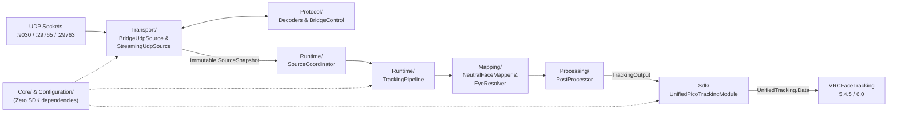

# Development Guide

English | [简体中文](development_zh.md) · [README](../README.md) · [Protocol](protocol.md) · [Contributing](../CONTRIBUTING.md)

This guide covers building, testing, packaging, and releasing UnifiedPicoModule, along with its layered architecture.

## Prerequisites

- Windows with PowerShell (`pwsh` 7+ recommended for compatibility tests)
- [.NET 10 SDK](https://dotnet.microsoft.com/download/dotnet/10.0) (`net10.0`)
- Git
- A local checkout of the pinned VRCFaceTracking source

Building does not require an Android toolchain or any other PICO repository. None of the build, test, or packaging scripts install the module, write to VRCFT's `CustomLibs` folder, or alter device or streaming software settings.

---

## Building from Source

### 1. Check Out the Pinned VRCFT SDK Source

UnifiedPicoModule compiles against VRCFaceTracking commit `7add14873e398c4095d06913cdeee7a01fc43fab` (assembly version `5.4.5.0`, target framework `net10.0`). From the repository root:

```powershell
git clone https://github.com/benaclejames/VRCFaceTracking.git .sdk/source/VRCFaceTracking
git -C .sdk/source/VRCFaceTracking switch --detach 7add14873e398c4095d06913cdeee7a01fc43fab
```

`.sdk/` is a local cache directory excluded by `.gitignore`.

### 2. Run the Build Script

```powershell
./tools/build.ps1 -Configuration Release
```

- `-Configuration` accepts `Debug` or `Release` (default: `Release`).
- The SDK source directory resolves in order: `-SdkSource` parameter → `VRCFT_SDK_SOURCE` environment variable → `.sdk/source/VRCFaceTracking`.
- `tools/build.ps1` never downloads sources automatically; if the checkout is missing, it exits with an error.

### What `tools/build.ps1` Verifies and Builds

Every step is fail-fast:

1. Confirms `HEAD` matches `7add14873e398c4095d06913cdeee7a01fc43fab` and has no tracked modifications (`git status --porcelain --untracked-files=no`).
2. Computes SHA-256 digests (UTF-8 without BOM, CRLF normalized to LF) of four pinned API files and compares them against hardcoded hashes:
   - `Directory.Build.props`
   - `Directory.Packages.props`
   - `VRCFaceTracking.SDK/ExtTrackingModule.cs`
   - `VRCFaceTracking.Core/Params/Expressions/UnifiedExpressions.cs`
3. Builds `VRCFaceTracking.Core` (`Release`) with `--artifacts-path .sdk/build` so the SDK checkout remains untouched.
4. Verifies `5.4.5.0` assembly version on `VRCFaceTracking.Core.dll` and `VRCFaceTracking.SDK.dll`, copies both to `.sdk/`, and writes `.sdk/sdk-provenance.json`.
5. Builds `UnifiedPicoModule.csproj` and `tools/ConfigTool/ConfigTool.csproj`.

### Build Outputs

| Artifact | Path |
|---|---|
| Module assembly | `bin/<Configuration>/net10.0/UnifiedPicoModule.dll` |
| Configuration CLI tool | `tools/ConfigTool/bin/<Configuration>/net10.0/UnifiedPicoConfigTool.dll` |
| Compiled SDK references | `.sdk/VRCFaceTracking.Core.dll`, `.sdk/VRCFaceTracking.SDK.dll` |
| SDK provenance record | `.sdk/sdk-provenance.json` |

> [!NOTE]
> Upgrading the pinned SDK requires updating the commit and four SHA-256 hashes in `tools/build.ps1`, `VRCFT_COMMIT` in `.github/workflows/release.yml`, and the `CheckSdk` version check in `UnifiedPicoModule.csproj` together as a dedicated compatibility change.

---

## Running Host Compatibility Tests

The compatibility suite loads the single 5.4.5-compiled `UnifiedPicoModule.dll` into two separate isolated processes—official VRCFT 5.4.5 and Steam VRCFT 6 (`3d36379253d26961560d84acecd01d509aea467a`)—and exercises decoders, pipelines, IPC, and OSC output without touching the GUI, real tracking ports, or user profiles.

```powershell
git clone https://github.com/benaclejames/VRCFaceTracking.git .sdk/compat/source/vrcft6-steam
git -C .sdk/compat/source/vrcft6-steam switch --detach 3d36379253d26961560d84acecd01d509aea467a
pwsh -NoProfile -File tools/test-compatibility.ps1
```

Use `-ModuleDll` to test a prebuilt DLL or `-InstalledHostDir` to run the Steam 6 suite against installed Steam host binaries inside the isolated test output. See [tools/CompatibilityTests/README.md](../tools/CompatibilityTests/README.md) for full test coverage and options.

---

## Packaging

```powershell
./tools/package.ps1
```

By default, `tools/package.ps1` runs `tools/build.ps1 -Configuration Release` first (and forwards `-SdkSource` / `VRCFT_SDK_SOURCE`). Pass `-SkipBuild` to package an existing Release build directly.

### Pre-Package Validation

- **`ModulePageUrl` guard:** `module.json` must have a non-empty absolute `http`, `https`, or `file` URI in `ModulePageUrl`. VRCFT 5.4.5 binds this field directly to `HyperlinkButton.NavigateUri` and crashes the Module Registry page on empty or `null` values.
- **Fresh default config:** The script runs `UnifiedPicoConfigTool.dll defaults` to export a clean `UnifiedPicoModule.json` and `config/UnifiedPicoModule.example.json`. A developer's local runtime `UnifiedPicoModule.json` is never read or bundled.

### Package Layout

Each run creates `artifacts/stage-<yyyyMMdd-HHmmss-fff>/`, `artifacts/UnifiedPicoModule-<Version>-<timestamp>.zip`, and a matching `.zip.sha256` file without overwriting earlier artifacts. Every entry is copied from an explicit allowlist (no recursive `docs/` copy):

- `UnifiedPicoModule.dll`, `module.json`, `sdk-provenance.json`
- `UnifiedPicoModule.json` and `config/UnifiedPicoModule.example.json`
- Root docs & license: `README.md`, `README_zh.md`, `CHANGELOG.md`, `CHANGELOG_zh.md`, `CONTRIBUTING.md`, `CONTRIBUTING_zh.md`, `THIRD_PARTY_NOTICES.md`, `THIRD_PARTY_NOTICES_zh.md`, `LICENSE`
- Public `docs/` pairs (EN & ZH): `configuration`, `postprocessing`, `protocol`, `development`, `privacy`
- `tools/ConfigTool/README.md` and `tools/ConfigTool/README_zh.md`
- `assets/branding/`: `logo-dark`, `logo-light`, and `module-icon` (SVG and PNG)

VRCFaceTracking DLLs, SDK source, the ConfigTool binary, and PDB files are never included in the module ZIP.

---

## Project Files & Configuration Defaults

### `UnifiedPicoModule.csproj` & `Directory.Build.props`

- Targets `net10.0` with `<Nullable>enable</Nullable>`, `<ImplicitUsings>enable</ImplicitUsings>`, and `<TreatWarningsAsErrors>true</TreatWarningsAsErrors>`.
- References `VRCFaceTracking.SDK.dll` and `VRCFaceTracking.Core.dll` from `$(VrcftSdkDir)` (default `.sdk`) with `Private="false"` so host assemblies are not copied to output. The `CheckSdk` target enforces assembly version `5.4.5.0` before reference resolution.
- References `Microsoft.Extensions.Logging.Abstractions` `10.0.1` (`PrivateAssets="all"`).
- Excludes `tools/`, `.sdk/`, `artifacts/`, `docs/`, and `reference/` from compilation.
- Embeds `assets/branding/module-icon.png` as `UnifiedPicoModule.Branding.ModuleIcon.png` for offline display in VRCFT's module list.
- `Directory.Build.props` sets `<PathMap>$(MSBuildThisFileDirectory)=/_/UnifiedPicoModule/</PathMap>` so local build-machine paths are stripped from compiled outputs for both the module and ConfigTool.

### `tools/ConfigTool/ConfigTool.csproj`

Builds `UnifiedPicoConfigTool` (`net10.0`) with `<EnableDefaultCompileItems>false</EnableDefaultCompileItems>`, compiling `Program.cs` alongside linked `Core/Contracts.cs` and `Configuration/*.cs`. It has zero dependency on VRCFaceTracking and shares the exact configuration reader, validator, and migrator with the runtime module. See the [ConfigTool guide](../tools/ConfigTool/README.md).

After changing any default in `Configuration/ModuleConfig.cs` or `Configuration/PostProcessingSettings.cs`, regenerate and compare `config/UnifiedPicoModule.example.json`:

```powershell
dotnet tools/ConfigTool/bin/Release/net10.0/UnifiedPicoConfigTool.dll defaults <new-output.json>
```

(`defaults` refuses to overwrite an existing file.)

### `module.json`

| Field | Current Value / Role |
|---|---|
| `ModuleId` | `8322e16d-c38b-42f0-8d35-68f27227b442` (determines folder name under `CustomLibs`) |
| `Version` | `0.4.1` (must match `UnifiedPicoModule.csproj` and git tag) |
| `ModuleName` | `Unified PICO Face Tracking` |
| `ModuleDescription` / `UsageInstructions` | Displayed in VRCFT's module registry |
| `DownloadUrl` | Empty string `""` |
| `ModulePageUrl` | `https://github.com/WolalaQAQ/UnifiedPicoModule` |
| `DllFileName` | `UnifiedPicoModule.dll` |

---

## Architecture

### Runtime Pipeline & SDK Boundary



### Repository Map

| Directory | Responsibility |
|---|---|
| `Core/` | Shared enums (`SourceKind`, `InputProtocol`, `PicoShape`, `ExpressionChannel`, etc.), `MonotonicClock`, `RawEye`, `RawFace`, `IndependentEyeExpression`, immutable `SourceSnapshot`, and `TrackingOutput` |
| `Protocol/` | Wire decoders (`BridgeSplitDecoder`, `DaemonLegacyDecoder`, `Header16Decoder`, `BodyOnlyDecoder`), `WireFields`, and Bridge control parser/builder (`BridgeControl`) |
| `Transport/` | `UdpTrackingSource` (exclusive sockets, background worker, per-group timestamp deduplication, drops, rate-limited logging), `BridgeUdpSource` (port `9030` discovery, heartbeat, subscription, peer lock), and `StreamingUdpSource` (ports `29765`/`29763`, `LocalOnly`) |
| `Mapping/` | `NeutralFaceMapper` (PICO shape → `ExpressionChannel`) and `EyeResolver` (`EyeLook` gaze, `1 - EyeBlink` openness, measured pupil) |
| `Processing/` | `PostProcessor` (fixed-order optional rules and temporal state for `CheekAsymmetry` and `TongueHold`) |
| `Configuration/` | `ModuleConfig`, `PostProcessingSettings`, `ConfigStore`, `ConfigValidator`, and read-only `LegacyImporter` |
| `Runtime/` | `SourceCoordinator` (source creation & sticky selection), `TrackingPipeline` (staleness, grouped clocks, mapping/processing orchestration), `DiagnosticReporter` (5 s logs), and `ConsumptionDiagnostics` |
| `Sdk/` | `UnifiedPicoTrackingModule` (`ExtTrackingModule` lifecycle, Windows background timer policy, and the sole `UnifiedTracking.Data` write boundary) |
| `tools/` | `build.ps1`, `package.ps1`, `test-compatibility.ps1`, `ConfigTool/`, and `CompatibilityTests/` |
| `config/` | `UnifiedPicoModule.example.json` |
| `assets/branding/` | Logos and embedded module icon (SVG & PNG) |
| `docs/` | Public EN/ZH documentation |

`reference/` is a local read-only snapshot directory excluded by `.gitignore` and never compiled or packaged.

### Architectural Invariants

- **Strict SDK boundary:** Only `Sdk/` references `VRCFaceTracking.*` and `Microsoft.Extensions.Logging`. All other layers exchange `Core/` types, and `ExpressionChannel` maps by exact name to `UnifiedExpressions` at `Sdk/` load time.
- **Single write boundary:** `UnifiedPicoTrackingModule.Write` is the sole writer to `UnifiedTracking.Data` and writes only channels the module owns (`ownsEye`, `ownsFace`), preserving foreign modules' channels in mixed setups.
- **Non-blocking acquisition:** UDP polling runs on dedicated background threads and publishes immutable `SourceSnapshot` records. `Update()` evaluates the latest snapshot, writes output, updates 5-second diagnostics, and sleeps `2 ms`.

---

## Releasing

Pushing a tag matching `v*` triggers `.github/workflows/release.yml`. Regular branch pushes and pull requests do not run it.

### Release Checklist

1. Set the identical `Version` (no `v` prefix) in `module.json` and `UnifiedPicoModule.csproj`.
2. Update the version string literal in the startup log inside `Sdk/UnifiedPicoTrackingModule.cs`.
3. Add matching `## [<version>]` sections to **both** `CHANGELOG.md` and `CHANGELOG_zh.md` (the publish job fails if either is missing).
4. Confirm `ModulePageUrl` in `module.json` is the repository URL and `config/UnifiedPicoModule.example.json` matches `UnifiedPicoConfigTool.dll defaults`.
5. Run `./tools/package.ps1` and `pwsh -NoProfile -File tools/test-compatibility.ps1` locally.
6. Commit, push, and push an annotated SemVer tag (`vMAJOR.MINOR.PATCH`, optional `-prerelease`, no `+build` metadata, no leading zeros):

```powershell
git tag -a v0.4.1 -m "UnifiedPicoModule 0.4.1"
git push origin v0.4.1
```

### CI Pipeline Summary

1. **`build` job (`windows-latest`, `contents: read`):**
   - Validates tag format and exact version match against `module.json` and `UnifiedPicoModule.csproj`.
   - Checks out pinned VRCFT 5.4.5 source (`VRCFT_COMMIT`) and runs `./tools/package.ps1`.
   - Checks out pinned Steam VRCFT 6 source and runs `./tools/test-compatibility.ps1` against the built DLL.
   - Audits the ZIP: rejects forbidden paths (`agents`, `archive`, `private`, `.sdk`, `bin`, `obj`, `migration`, `current-settings`), forbidden extensions (`.log`, `.pcap`, `.pcapng`, `.har`, `.pdb`), any DLL other than `UnifiedPicoModule.dll`, non-empty `Bridge.IP` / `Streaming.IP` / `Migration`, or any enabled `PostProcessing` rule besides `ChannelGain`.
   - Produces non-timestamped `UnifiedPicoModule-<version>.zip` + `.zip.sha256` and uploads them as workflow artifacts (14-day retention).
2. **`publish` job (`ubuntu-latest`, `contents: write`):**
   - Downloads artifacts, verifies `sha256sum --check --strict`, extracts the matching sections from `CHANGELOG.md` and `CHANGELOG_zh.md`, creates a draft GitHub Release (marked prerelease if the tag has a suffix), attaches assets, and publishes it.
   - Existing releases are never overwritten; all Actions are pinned to full commit SHAs; tags pushed with `GITHUB_TOKEN` do not trigger workflows.
