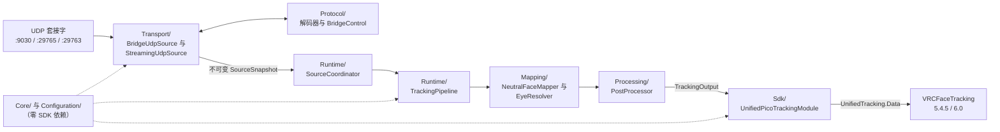

# 开发说明

[English](development.md) | 简体中文 · [README](../README_zh.md) · [协议参考](protocol_zh.md) · [参与贡献](../CONTRIBUTING_zh.md)

本文说明 UnifiedPicoModule 的构建、兼容测试、打包、发布流程以及分层代码结构。

## 环境要求

- Windows 与 PowerShell（运行兼容测试建议使用 `pwsh` 7+）
- [.NET 10 SDK](https://dotnet.microsoft.com/download/dotnet/10.0)（`net10.0`）
- Git
- 本地检出的固定版本 VRCFaceTracking 源码

构建不依赖 Android 工具链或其他 PICO 仓库。所有构建、测试和打包脚本都不会安装模块、不会向 VRCFT 的 `CustomLibs` 写入文件，也不会修改设备或串流软件设置。

---

## 从源码构建

### 1. 检出固定的 VRCFT SDK 源码

UnifiedPicoModule 基于 VRCFaceTracking 提交 `7add14873e398c4095d06913cdeee7a01fc43fab`（程序集版本 `5.4.5.0`，目标框架 `net10.0`）编译。在仓库根目录执行：

```powershell
git clone https://github.com/benaclejames/VRCFaceTracking.git .sdk/source/VRCFaceTracking
git -C .sdk/source/VRCFaceTracking switch --detach 7add14873e398c4095d06913cdeee7a01fc43fab
```

`.sdk/` 为本地缓存目录，已在 `.gitignore` 中排除。

### 2. 运行构建脚本

```powershell
./tools/build.ps1 -Configuration Release
```

- `-Configuration` 可选 `Debug` 或 `Release`（默认 `Release`）。
- SDK 源码目录按以下顺序查找：`-SdkSource` 参数 → 环境变量 `VRCFT_SDK_SOURCE` → `.sdk/source/VRCFaceTracking`。
- `tools/build.ps1` 不会自动下载源码；找不到目录时会直接报错退出。

### `tools/build.ps1` 的校验与构建步骤

任一步失败都会立即中止：

1. 检查 `HEAD` 是否为 `7add14873e398c4095d06913cdeee7a01fc43fab`，且无已跟踪文件改动（`git status --porcelain --untracked-files=no`）。
2. 对四个关键 API 文件归一化（去 UTF-8 BOM、CRLF 转 LF）后计算 SHA-256 并与脚本内置指纹比对：
   - `Directory.Build.props`
   - `Directory.Packages.props`
   - `VRCFaceTracking.SDK/ExtTrackingModule.cs`
   - `VRCFaceTracking.Core/Params/Expressions/UnifiedExpressions.cs`
3. 以 `Release` 配置构建 `VRCFaceTracking.Core`，中间文件与产物输出到 `--artifacts-path .sdk/build`，不污染 SDK 源码树。
4. 校验 `VRCFaceTracking.Core.dll` 与 `VRCFaceTracking.SDK.dll` 的程序集版本为 `5.4.5.0`，复制到 `.sdk/` 并写入 `.sdk/sdk-provenance.json`。
5. 依次构建 `UnifiedPicoModule.csproj` 和 `tools/ConfigTool/ConfigTool.csproj`。

### 构建产物

| 产物 | 路径 |
|---|---|
| 模块程序集 | `bin/<Configuration>/net10.0/UnifiedPicoModule.dll` |
| 配置命令行工具 | `tools/ConfigTool/bin/<Configuration>/net10.0/UnifiedPicoConfigTool.dll` |
| SDK 引用程序集 | `.sdk/VRCFaceTracking.Core.dll`、`.sdk/VRCFaceTracking.SDK.dll` |
| SDK 来源记录 | `.sdk/sdk-provenance.json` |

> [!NOTE]
> 更换固定 SDK 版本时，必须同步更新 `tools/build.ps1` 中的提交号和四项 SHA-256 指纹、`.github/workflows/release.yml` 中的 `VRCFT_COMMIT` 以及 `UnifiedPicoModule.csproj` 的 `CheckSdk` 版本检查，并作为独立的兼容性变更提交。

---

## 运行宿主兼容测试

兼容测试套件将同一份按 5.4.5 SDK 编译的 `UnifiedPicoModule.dll` 加载到两个独立隔离进程——官方 VRCFT 5.4.5 与 Steam VRCFT 6（`3d36379253d26961560d84acecd01d509aea467a`）——检验解码器、管线、IPC 与 OSC 输出，不接触 GUI、正式追踪端口或用户配置。

```powershell
git clone https://github.com/benaclejames/VRCFaceTracking.git .sdk/compat/source/vrcft6-steam
git -C .sdk/compat/source/vrcft6-steam switch --detach 3d36379253d26961560d84acecd01d509aea467a
pwsh -NoProfile -File tools/test-compatibility.ps1
```

可通过 `-ModuleDll` 指定已有 DLL，或通过 `-InstalledHostDir` 在隔离输出中使用匹配的 Steam 安装组件。详细用例与参数见 [tools/CompatibilityTests/README_zh.md](../tools/CompatibilityTests/README_zh.md)。

---

## 打包

```powershell
./tools/package.ps1
```

脚本默认先执行 `tools/build.ps1 -Configuration Release`（支持相同的 `-SdkSource` 参数与 `VRCFT_SDK_SOURCE` 环境变量）。传入 `-SkipBuild` 可跳过构建直接使用已有 Release 产物。

### 打包前校验

- **`ModulePageUrl` 检查：** `module.json` 中的 `ModulePageUrl` 必须为非空的 `http`、`https` 或 `file` 绝对 URI。VRCFT 5.4.5 会将该字段直接绑定到 `HyperlinkButton.NavigateUri`，空字符串或 `null` 会导致 Module Registry 页面崩溃。
- **全新默认配置：** 脚本调用 `UnifiedPicoConfigTool.dll defaults` 导出干净的 `UnifiedPicoModule.json` 与 `config/UnifiedPicoModule.example.json`，绝不读取或打包开发者本机的运行时配置文件。

### 包目录结构

每次打包在 `artifacts/` 下生成不覆盖旧产物的 `stage-<yyyyMMdd-HHmmss-fff>/`、`UnifiedPicoModule-<Version>-<timestamp>.zip` 及对应 `.zip.sha256`。所有文件按显式白名单逐个复制（不递归复制 `docs/`）：

- `UnifiedPicoModule.dll`、`module.json`、`sdk-provenance.json`
- `UnifiedPicoModule.json` 与 `config/UnifiedPicoModule.example.json`
- 根目录文档与许可：`README.md`、`README_zh.md`、`CHANGELOG.md`、`CHANGELOG_zh.md`、`CONTRIBUTING.md`、`CONTRIBUTING_zh.md`、`THIRD_PARTY_NOTICES.md`、`THIRD_PARTY_NOTICES_zh.md`、`LICENSE`
- `docs/` 下五组中英文公开文档：`configuration`、`postprocessing`、`protocol`、`development`、`privacy`
- `tools/ConfigTool/README.md` 与 `tools/ConfigTool/README_zh.md`
- `assets/branding/`：`logo-dark`、`logo-light`、`module-icon`（各含 SVG 与 PNG）

模块 ZIP 不包含 VRCFaceTracking DLL、SDK 源码、ConfigTool 可执行文件或 PDB 调试符号。

---

## 项目文件与默认配置

### `UnifiedPicoModule.csproj` 与 `Directory.Build.props`

- 目标框架 `net10.0`，开启 `<Nullable>enable</Nullable>`、`<ImplicitUsings>enable</ImplicitUsings>` 和 `<TreatWarningsAsErrors>true</TreatWarningsAsErrors>`。
- 从 `$(VrcftSdkDir)`（默认 `.sdk`）引用 `VRCFaceTracking.SDK.dll` 和 `VRCFaceTracking.Core.dll` 并设为 `Private="false"`，不复制到输出目录；`CheckSdk` 目标在解析引用前强制校验程序集版本为 `5.4.5.0`。
- 引用 `Microsoft.Extensions.Logging.Abstractions` `10.0.1`（`PrivateAssets="all"`）。
- 从编译中排除 `tools/`、`.sdk/`、`artifacts/`、`docs/` 和 `reference/`。
- 将 `assets/branding/module-icon.png` 嵌入为 `UnifiedPicoModule.Branding.ModuleIcon.png`，供 VRCFT 模块列表离线显示图标。
- `Directory.Build.props` 通过 `<PathMap>$(MSBuildThisFileDirectory)=/_/UnifiedPicoModule/</PathMap>` 消除模块与配置工具编译产物中的本机路径信息。

### `tools/ConfigTool/ConfigTool.csproj`

独立控制台项目，程序集名 `UnifiedPicoConfigTool`（`net10.0`），关闭默认编译项，仅编译 `Program.cs` 并链接 `Core/Contracts.cs` 与 `Configuration/*.cs`。它不依赖 VRCFaceTracking，与运行时模块共用同一套配置读取、校验和迁移代码。用法见[配置工具说明](../tools/ConfigTool/README_zh.md)。

修改 `Configuration/ModuleConfig.cs` 或 `Configuration/PostProcessingSettings.cs` 的默认值后，使用以下命令导出新默认配置并核对 `config/UnifiedPicoModule.example.json`：

```powershell
dotnet tools/ConfigTool/bin/Release/net10.0/UnifiedPicoConfigTool.dll defaults <新输出路径.json>
```

（`defaults` 不会覆盖已有文件。）

### `module.json`

| 字段 | 当前值与作用 |
|---|---|
| `ModuleId` | `8322e16d-c38b-42f0-8d35-68f27227b442`（决定 `CustomLibs` 下的安装目录名） |
| `Version` | `0.4.1`（必须与 `UnifiedPicoModule.csproj` 及 Git 标签一致） |
| `ModuleName` | `Unified PICO Face Tracking` |
| `ModuleDescription` / `UsageInstructions` | VRCFT 模块注册表中显示的说明文字 |
| `DownloadUrl` | 空字符串 `""` |
| `ModulePageUrl` | `https://github.com/WolalaQAQ/UnifiedPicoModule` |
| `DllFileName` | `UnifiedPicoModule.dll` |

---

## 代码架构

### 运行时管线与 SDK 边界



### 仓库目录职责

| 目录 | 职责 |
|---|---|
| `Core/` | 共享枚举（`SourceKind`、`InputProtocol`、`PicoShape`、`ExpressionChannel` 等）、`MonotonicClock`、`RawEye`、`RawFace`、`IndependentEyeExpression`、不可变 `SourceSnapshot` 与 `TrackingOutput` |
| `Protocol/` | 四种线格式解码器（`BridgeSplitDecoder`、`DaemonLegacyDecoder`、`Header16Decoder`、`BodyOnlyDecoder`）、`WireFields` 与 Bridge 控制报文工具（`BridgeControl`） |
| `Transport/` | `UdpTrackingSource`（排他套接字、后台接收线程、分组时间戳去重、丢包计数与日志限流）、`BridgeUdpSource`（9030 发现/心跳/订阅/锁定）与 `StreamingUdpSource`（29765/29763、`LocalOnly`） |
| `Mapping/` | `NeutralFaceMapper`（PICO 形态 → `ExpressionChannel`）与 `EyeResolver`（`EyeLook` 视线、`1 - EyeBlink` 睁眼度、实测瞳孔） |
| `Processing/` | `PostProcessor`（按固定顺序执行的可选后处理规则，及 `CheekAsymmetry`/`TongueHold` 的时间状态） |
| `Configuration/` | `ModuleConfig`、`PostProcessingSettings`、`ConfigStore`、`ConfigValidator` 及只读迁移器 `LegacyImporter` |
| `Runtime/` | `SourceCoordinator`（数据源创建与粘性选择）、`TrackingPipeline`（过期判定、分组时钟与映射/后处理编排）、`DiagnosticReporter`（每 5 秒日志）与 `ConsumptionDiagnostics` |
| `Sdk/` | `UnifiedPicoTrackingModule`（`ExtTrackingModule` 生命周期、Windows 后台定时策略及唯一的 `UnifiedTracking.Data` 写入边界） |
| `tools/` | `build.ps1`、`package.ps1`、`test-compatibility.ps1`、`ConfigTool/` 与 `CompatibilityTests/` |
| `config/` | `UnifiedPicoModule.example.json` |
| `assets/branding/` | 标志与内嵌模块图标（SVG 与 PNG） |
| `docs/` | 公开中英文文档 |

`reference/` 为本地只读参考快照目录，已由 `.gitignore` 排除，不参与编译与打包。

### 关键架构约束

- **严格 SDK 边界：** 仅 `Sdk/` 目录引用 `VRCFaceTracking.*` 与 `Microsoft.Extensions.Logging`。其他各层仅通过 `Core/` 类型交互，`ExpressionChannel` 在 `Sdk/` 加载时按名称映射为 `UnifiedExpressions`。
- **单一写入边界：** `UnifiedPicoTrackingModule.Write` 是唯一写入 `UnifiedTracking.Data` 的位置，且只写入本模块拥有的通道（`ownsEye`、`ownsFace`），不覆写混搭模式下其他模块的通道。
- **非阻塞采集：** UDP 轮询在独立后台线程运行并发布不可变 `SourceSnapshot`。`Update()` 读取最新快照、计算输出、写入 SDK、每 5 秒输出状态日志，并在末尾休眠 `2 ms`。

---

## 发布流程

向 GitHub 推送 `v*` 标签会触发 `.github/workflows/release.yml`；普通分支推送与 PR 不会触发。

### 发布前检查清单

1. 在 `module.json` 和 `UnifiedPicoModule.csproj` 中将 `Version` 设为相同版本号（不含 `v` 前缀）。
2. 同步更新 `Sdk/UnifiedPicoTrackingModule.cs` 启动日志中的版本号字面量。
3. 在 `CHANGELOG.md` 和 `CHANGELOG_zh.md` 中**同时**添加对应的 `## [<version>]` 段落（缺任一份发布任务都会失败）。
4. 确认 `module.json` 的 `ModulePageUrl` 为仓库地址，且 `config/UnifiedPicoModule.example.json` 与 `UnifiedPicoConfigTool.dll defaults` 输出一致。
5. 在本地执行 `./tools/package.ps1` 与 `pwsh -NoProfile -File tools/test-compatibility.ps1` 并确认通过。
6. 提交、推送后，创建并推送带注释的 SemVer 标签（`vMAJOR.MINOR.PATCH`，可附 `-prerelease`，不接受 `+build` 元数据与前导零）：

```powershell
git tag -a v0.4.1 -m "UnifiedPicoModule 0.4.1"
git push origin v0.4.1
```

### CI 流水线概览

1. **`build` 任务（`windows-latest`，`contents: read`）：**
   - 校验标签格式及与 `module.json`、`UnifiedPicoModule.csproj` 版本的一致性。
   - 检出固定 VRCFT 5.4.5 源码（`VRCFT_COMMIT`）并执行 `./tools/package.ps1`。
   - 检出固定 Steam VRCFT 6 源码，对刚构建的 DLL 运行 `./tools/test-compatibility.ps1`。
   - 审计 ZIP 内容：拦截禁用路径（`agents`、`archive`、`private`、`.sdk`、`bin`、`obj`、`migration`、`current-settings`）、禁用扩展名（`.log`、`.pcap`、`.pcapng`、`.har`、`.pdb`）、除 `UnifiedPicoModule.dll` 外的其他 DLL、非空的 `Bridge.IP` / `Streaming.IP` / `Migration`，以及 `PostProcessing` 下除 `ChannelGain` 外任何 `Enabled = true` 的规则。
   - 生成无时间戳的 `UnifiedPicoModule-<version>.zip` 与 `.zip.sha256` 并上传为工作流产物（保留 14 天）。
2. **`publish` 任务（`ubuntu-latest`，`contents: write`）：**
   - 下载产物并执行 `sha256sum --check --strict`，提取 `CHANGELOG.md` 与 `CHANGELOG_zh.md` 对应版本段落，以草稿创建 GitHub Release（预发布标签自动标记 prerelease）、上传附件后再设为公开。
   - 同名 Release 已存在时不会覆盖；所有 GitHub Actions 均固定到完整提交 SHA；通过 `GITHUB_TOKEN` 推送的标签不会触发工作流。
