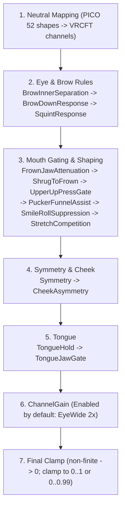

# Post-Processing Reference

**English** | [简体中文](postprocessing_zh.md) · [Back to README](../README.md) · [Configuration](configuration.md)

Post-processing is an optional PC-side expression correction pipeline between PICO neutral mapping and VRCFaceTracking output. It adjusts **expression channels only**—gaze, eye openness, and pupil diameter are handled separately by eye resolution and are never modified here.

By default, only `ChannelGain` is enabled (multiplying `EyeWideLeft` and `EyeWideRight` by `2`); all other channels remain at `1x` and the other 13 rules are disabled.

> [!NOTE]
> Default coefficients (including the `EyeWide` 2x gain derived from offline analysis) have not been calibrated on a real headset. Parameter ranges enforce validation limits only—enable rules one at a time and test them on your avatar. Headset-side eye/face enhancement and temporal filtering live in [PicoET-Enhance](https://github.com/WolalaQAQ/PicoET-Enhance).

## Pipeline & Execution Order

Rules always run in this fixed order (not configurable):



Exact rule order in `Processing/PostProcessor.cs`:

1. Neutral mapping (`Mapping/NeutralFaceMapper.cs`)
2. `BrowInnerSeparation`
3. `BrowDownResponse`
4. `SquintResponse`
5. `FrownJawAttenuation`
6. `ShrugToFrown`
7. `UpperUpPressGate`
8. `PuckerFunnelAssist`
9. `SmileRollSuppression`
10. `StretchCompetition`
11. `Symmetry`
12. `CheekAsymmetry`
13. `TongueHold`
14. `TongueJawGate`
15. `ChannelGain`
16. Final clamp: non-finite values become `0`; all channels clamp to `[0, 1]` (or `[0, 0.99]` if `LegacyExpressionCeiling` is `true`).

Between incoming face frames, the module reuses the cached output; only `TongueHold` expiration can update `TongueOut` between samples. For `X` v2 packets, left-eye, right-eye, and mouth groups are processed on separate clocks—intervening high-rate eye updates never re-run mouth rules, restart a tongue hold, or double-apply mouth gains.

Most rules are independently implemented from the behavioral design of `pikepikeid/VRCFTPicoModule` (pike), with `TongueHold` added to mitigate brief tongue dropouts. Curves and constants differ from upstream; see [THIRD_PARTY_NOTICES.md](../THIRD_PARTY_NOTICES.md).

## Shared Conventions

### Raw (`R`) vs. Output (`O`)

In the formulas below:
- **`R`** is the raw PICO blendshape value. Rule trigger conditions always read `R`, so earlier rules or `ChannelGain` never shift a downstream rule's threshold.
- **`O`** is the current working output channel value. Modifications accumulate across rules and may exceed `1` temporarily until the final clamp.

### Smooth Step Functions

Most gating rules use a threshold `t` and transition width `w` (`TransitionWidth`) to smoothly blend between 0 and 1:

```text
c(x)          = clamp(x, 0, 1)
lerp(a, b, k) = a + (b - a) * k

A(x, t, w):
  w = 0:  x > t ? 1 : 0          (strictly greater; at x == t, A = 0 and B = 1)
  w > 0:  lo = max(0, t - w / 2)
          hi = min(1, t + w / 2)
          u  = c((x - lo) / (hi - lo))
          A  = u * u * (3 - 2u)

B(x, t, w) = 1 - A(x, t, w)
```

Because `lo` and `hi` clamp at `0` and `1`, the transition is asymmetric when `t` sits near either edge.

### Missing Data & Validity

A raw input is treated as **missing** (never as `0`) when absent, non-finite, or part of an invalid region. Depending on the rule, either the affected side is skipped or the rule does not run.

- **Eye region:** brow, squint, eye-wide, and blink shapes. Disabled when `DisableEyeTracking` is `true`.
- **Face region:** cheek, jaw, lip, mouth, nose, and tongue shapes. Disabled when `DisableFaceTracking` is `true`.
- **Ordinary packets:** one eye-validity flag covers both eyes.
- **`X` packets:** each eye has an independent quality state. State `0` marks only that eye's fields (including its inner brow) as missing; `-1` (unknown) and `1` (usable) retain the data.

### Neutral Mapping Reference

Neutral mapping copies raw PICO shapes straight to VRCFT channels (clamped to `[0, 1]`, no compensation). Below are the bindings referenced by post-processing rules (complete table in `Mapping/NeutralFaceMapper.cs`):

| PICO Raw Shape | VRCFT Output Channels |
|---|---|
| `EyeSquintL/R` | `EyeSquintLeft/Right` |
| `EyeWideL/R` | `EyeWideLeft/Right` |
| `BrowDownL/R` | `BrowPinchLeft/Right`, `BrowLowererLeft/Right` |
| `BrowInnerUp` | Ordinary: both `BrowInnerUpLeft` & `BrowInnerUpRight`. `X`: left takes `BrowInnerUp`, right takes independent right inner brow |
| `BrowOuterUpL/R` | `BrowOuterUpLeft/Right` |
| `CheekPuff` | `CheekPuffLeft`, `CheekPuffRight` |
| `JawOpen` | `JawOpen` |
| `MouthRollUpper` / `MouthRollLower` | `LipSuckUpperLeft/Right` / `LipSuckLowerLeft/Right` |
| `MouthFunnel` | All four `LipFunnel*` channels |
| `MouthPucker` | All four `LipPucker*` channels |
| `MouthUpperUpL/R` | `MouthUpperUpLeft/Right`, `MouthUpperDeepenLeft/Right` |
| `MouthLeft` / `MouthRight` | `MouthUpperLeft`, `MouthLowerLeft` / `MouthUpperRight`, `MouthLowerRight` |
| `MouthSmileL/R` | `MouthCornerPullLeft/Right`, `MouthCornerSlantLeft/Right` |
| `MouthFrownL/R` | `MouthFrownLeft/Right` |
| `MouthStretchL/R` | `MouthStretchLeft/Right` |
| `MouthShrugUpper` / `MouthShrugLower` | `MouthRaiserUpper` / `MouthRaiserLower` |
| `MouthPressL/R` | `MouthPressLeft/Right` |
| `TongueOut` | `TongueOut` |

`EyeBlink` is not mapped to an expression channel; rules read it only as a condition.

---

## Eye & Brow Rules

### `BrowInnerSeparation`

**Problem it solves:** Raising the inner brow often lifts the outer brow along with it, washing out worried/sad expressions.

- **Affected channels:** `BrowOuterUpLeft`, `BrowOuterUpRight` (`BrowInnerUp*` is unchanged)
- **Parameters:** `Strength` (default `1`, range `0–1`)

```text
O.BrowOuterUp = max(0, O.BrowOuterUp - R.BrowInnerUp * Strength)   // per side
```

- **Details & tuning:** Uses shared `BrowInnerUp` on ordinary packets and each side's own inner brow on `X` packets. Skips a side if its inner or outer brow is missing. High `Strength` also dampens genuine full-brow raises—try `0.4–0.7` if surprised eyebrows feel flat.

### `BrowDownResponse`

**Problem it solves:** Linear brow-lowering data can jitter during normal blinks or feel overly sensitive to subtle movements.

- **Affected channels:** `BrowLowererLeft/Right`, `BrowPinchLeft/Right` (both receive the same value; overwrites neutral mapping)
- **Parameters:**

| Parameter | Default | Range | Description |
|---|---|---|---|
| `Center` | `0.7` | `0–1` | Sigmoid midpoint |
| `Slope` | `10` | `0.1–40` | Steepness (higher approaches a threshold switch) |
| `Gain` | `1` | `0–10` | Output multiplier |
| `BlinkAsymmetryStrength` | `0` | `0–1` | Attenuates brow drop when the opposite eye is more closed (`0` disables) |

```text
s(z) = 1 / (1 + exp(-z))
N(x) = [s(Slope * (c(x) - Center)) - s(-Slope * Center)]
     / [s(Slope * (1 - Center))    - s(-Slope * Center)]

v = N(R.BrowDown) * Gain
if BlinkAsymmetryStrength > 0:
  v = v * (1 - BlinkAsymmetryStrength * c(R.OtherBlink - R.SameBlink))
O.BrowLowerer = O.BrowPinch = v                                    // per side
```

- **Details & tuning:** `N(0) = 0` and `N(1) = 1`. Skips a side if `BrowDown` is missing. On ordinary packets, if `BlinkAsymmetryStrength > 0` and either `EyeBlink` is missing, the entire rule is skipped. On independent `X` packets, cross-eye `BlinkAsymmetryStrength` is skipped while the per-side sigmoid still runs.

### `SquintResponse`

**Problem it solves:** Reshapes eye squint sensitivity with a power curve and optionally ties squint strength to eyelid closure.

- **Affected channels:** `EyeSquintLeft`, `EyeSquintRight` (does not affect eye openness; overwrites neutral mapping)
- **Parameters:**

| Parameter | Default | Range | Description |
|---|---|---|---|
| `Gain` | `1` | `0–10` | Output multiplier |
| `Gamma` | `1` | `0.1–5` | Curve exponent (`> 1` suppresses small squints; `< 1` boosts them) |
| `BlinkInfluence` | `0` | `0–1` | Reduction when the same eye is open (`0` disables) |

```text
v = c(R.EyeSquint) ^ Gamma * Gain
if BlinkInfluence > 0:
  v = v * (1 - BlinkInfluence * (1 - c(R.EyeBlink)))
O.EyeSquint = v                                                    // per side
```

- **Details & tuning:** When same-side `EyeBlink = 1` there is no attenuation; at `0`, output drops by `BlinkInfluence`. Skips a side if `EyeSquint` is missing, or if `BlinkInfluence > 0` and same-side `EyeBlink` is missing.

---

## Mouth Gating & Shaping Rules

### `FrownJawAttenuation`

**Problem it solves:** Opening your jaw often triggers unwanted mouth frown on PICO tracking.

- **Affected channels:** `MouthFrownLeft`, `MouthFrownRight`
- **Parameters:** `JawThreshold` (`0.1`, `0–1`), `TransitionWidth` (`0.1`, `0–1`), `MaxReduction` (`0.5`, `0–1`)

```text
m = 1 - MaxReduction * A(R.JawOpen, JawThreshold, TransitionWidth)
O.MouthFrown = O.MouthFrown * m                                    // per side
```

- **Details & tuning:** Skips entirely if `JawOpen` is missing; skips a side if its `MouthFrown` is missing. Also softens genuine open-mouth frowns, so raise `JawThreshold` or lower `MaxReduction` if sad open-mouth faces lose expression.

### `ShrugToFrown`

**Problem it solves:** PICO sensors sometimes read a deliberate frown as chin raising (`MouthShrug`). This rule synthesizes a frown candidate from high shrug values unless the lips are rolled, puckered, or funneled.

- **Affected channels:** `MouthFrownLeft/Right`; plus `MouthRaiserUpper/Lower` when `ConsumeShrug` is `true`
- **Parameters:**

| Parameter | Default | Range | Description |
|---|---|---|---|
| `Threshold` | `0.6` | `0–1` | Shrug level where the frown ramp begins |
| `Range` | `0.2` | `> 0`, `Threshold + Range <= 1` | Linear span above `Threshold` to reach full candidate |
| `Gain` | `1` | `0–10` | Candidate multiplier |
| `RollBlockThreshold` | `0.3` | `0–1` | Lip roll threshold that blocks the candidate |
| `PuckerBlockThreshold` | `0.4` | `0–1` | Lip pucker blocking threshold |
| `FunnelBlockThreshold` | `0.1` | `0–1` | Lip funnel blocking threshold |
| `TransitionWidth` | `0.05` | `0–1` | Transition width shared by all three blocking gates |
| `ConsumeShrug` | `false` | boolean | Attenuates `MouthRaiserUpper/Lower` by `1 - c(q)` when active |

```text
h = max(c((R.ShrugUpper - Threshold) / Range),
        c((R.ShrugLower - Threshold) / Range))
r = max(R.RollUpper, R.RollLower)
q = h * Gain
      * B(r,        RollBlockThreshold,   TransitionWidth)
      * B(R.Pucker, PuckerBlockThreshold, TransitionWidth)
      * B(R.Funnel, FunnelBlockThreshold, TransitionWidth)

O.MouthFrownLeft  = max(O.MouthFrownLeft,  q)
O.MouthFrownRight = max(O.MouthFrownRight, q)
if ConsumeShrug:
  O.MouthRaiserUpper *= (1 - c(q))
  O.MouthRaiserLower *= (1 - c(q))
```

- **Details & tuning:** Uses a linear ramp (`h`), applies identically to both sides, and only ever increases frown (`max`). Requires all six raw inputs (`MouthShrugUpper/Lower`, `MouthRollUpper/Lower`, `MouthPucker`, `MouthFunnel`) or it does not run.

### `UpperUpPressGate`

**Problem it solves:** Pressing your lips together can falsely trigger upper lip raising (`MouthUpperUp`), exposing teeth when your mouth should stay closed.

- **Affected channels:** `MouthUpperUpLeft/Right`, `MouthUpperDeepenLeft/Right`
- **Parameters:** `PressThreshold` (`0.1`, `0–1`), `TransitionWidth` (`0.1`, `0–1`), `MaxReduction` (`1`, `0–1`)

```text
m = 1 - MaxReduction * A(R.SamePress, PressThreshold, TransitionWidth)
O.MouthUpperUp     *= m                                            // per side
O.MouthUpperDeepen *= m
```

- **Details & tuning:** Skips a side if its `MouthUpperUp` or `MouthPress` is missing. At defaults, upper lip raise is fully muted once same-side `MouthPress` reaches `0.15`.

### `PuckerFunnelAssist`

**Problem it solves:** Makes kiss/pucker shapes look rounder by boosting `LipFunnel` when puckering strongly without pressing the lips.

- **Affected channels:** `LipFunnelUpperLeft/Right`, `LipFunnelLowerLeft/Right`
- **Parameters:** `PuckerThreshold` (`0.3`, `0–1`), `PressThreshold` (`0.2`, `0–1`), `TransitionWidth` (`0.1`, `0–1`), `Strength` (`1`, `0–1`)

```text
k = Strength * A(R.Pucker, PuckerThreshold, TransitionWidth)
             * B(R.SamePress, PressThreshold, TransitionWidth)
O.LipFunnel = lerp(O.LipFunnel, max(O.LipFunnel, R.Pucker), k)     // per side, upper & lower
```

- **Details & tuning:** Only raises funnel (`max`), never reduces it. Requires `MouthPucker` and `MouthFunnel`; skips a side if its `MouthPress` is missing.

### `SmileRollSuppression`

**Problem it solves:** Rolling the lower lip inward often leaves residual smile weights active.

- **Affected channels:** `MouthCornerPullLeft/Right`, `MouthCornerSlantLeft/Right`
- **Parameters:** `RollThreshold` (`0.2`, `0–1`), `TransitionWidth` (`0.1`, `0–1`), `MaxReduction` (`1`, `0–1`)

```text
m = 1 - MaxReduction * A(R.MouthRollLower, RollThreshold, TransitionWidth)
O.MouthCornerPull  *= m                                            // per side
O.MouthCornerSlant *= m
```

- **Details & tuning:** Skips entirely if `MouthRollLower` is missing; skips a side if its `MouthSmile` is missing. At defaults, smile is completely suppressed once `MouthRollLower` hits `0.25`.

### `StretchCompetition`

**Problem it solves:** Pulling mouth corners sideways (`MouthStretch`) often leaks into weak smile and upper-lip-raise signals. Strong smiles above `SmileCeiling` are left alone.

- **Affected channels:** `MouthCornerPullLeft/Right`, `MouthCornerSlantLeft/Right`, `MouthUpperUpLeft/Right`, `MouthUpperDeepenLeft/Right`
- **Parameters:**

| Parameter | Default | Range | Description |
|---|---|---|---|
| `StretchThreshold` | `0.05` | `0–1` | Horizontal stretch threshold |
| `SmileCeiling` | `0.4` | `0–1` | Smile level above which suppression fades out |
| `TransitionWidth` | `0.1` | `0–1` | Shared transition width |
| `SmileReduction` | `0.5` | `0–1` | Maximum smile reduction |
| `UpperUpReduction` | `0.5` | `0–1` | Maximum upper lip raise reduction |

```text
k = A(R.Stretch, StretchThreshold, TransitionWidth)
  * B(R.Smile,   SmileCeiling,     TransitionWidth)                // per side
O.MouthCornerPull, O.MouthCornerSlant *= 1 - SmileReduction   * k
O.MouthUpperUp,    O.MouthUpperDeepen *= 1 - UpperUpReduction * k  // only if same-side MouthUpperUp present
```

- **Details & tuning:** Skips a side if its `MouthStretch` or `MouthSmile` is missing.

---

## Symmetry & Cheek Rules

### `Symmetry`

**Problem it solves:** Evens out lopsided left/right mouth shapes caused by asymmetrical tracking or headset fit.

- **Parameters:**
  - `Groups` (default `["Smile"]`, valid case-sensitive values: `Smile`, `Frown`, `Stretch`, `UpperUp`; no duplicates; empty array disables effect)
  - `Method` (default `"Max"`, valid case-sensitive values: `"Max"` or `"Average"`)
  - `Strength` (default `1`, range `0–1`)

| Group | Output Channel Pairs | Required Raw Shapes |
|---|---|---|
| `Smile` | `MouthCornerPull`, `MouthCornerSlant` | `MouthSmileL`, `MouthSmileR` |
| `Frown` | `MouthFrown` | `MouthFrownL`, `MouthFrownR` |
| `Stretch` | `MouthStretch` | `MouthStretchL`, `MouthStretchR` |
| `UpperUp` | `MouthUpperUp`, `MouthUpperDeepen` | `MouthUpperUpL`, `MouthUpperUpR` |

```text
q = Method == "Max" ? max(O.Left, O.Right) : (O.Left + O.Right) / 2
O.Left  = lerp(O.Left,  q, Strength)
O.Right = lerp(O.Right, q, Strength)
```

- **Details & tuning:** Operates on the output of earlier rules. Skips a group if either side's raw shape is missing. Never touches gaze, openness, pupil, or brows. Try `Strength: 0.5–0.7` with `"Average"` if you want softer balancing while keeping smirks intact.

### `CheekAsymmetry`

**Problem it solves:** PICO exposes only a single combined `CheekPuff` weight. This rule infers one-sided cheek puff from sideways mouth displacement (moving mouth left boosts right cheek puff, and vice versa).

- **Affected channels:** `CheekPuffLeft`, `CheekPuffRight`
- **Parameters:**

| Parameter | Default | Range | Description |
|---|---|---|---|
| `MouthDifferenceThreshold` | `0.1` | `0–1` | Left-right displacement difference threshold |
| `TransitionWidth` | `0.1` | `0–1` | Transition width |
| `Gain` | `1` | `0–10` | Scale of the added puff |
| `MouthSmoothingMs` | `80` | integer `0–500` | Exponential smoothing time constant (ms) for direction test (`0` disables smoothing) |

```text
alpha = 1 - exp(-Δt / (MouthSmoothingMs / 1000))       // Δt in seconds between arrivals
SL = lerp(SL, R.MouthLeft,  alpha)
SR = lerp(SR, R.MouthRight, alpha)
d  = SL - SR

O.CheekPuffRight += R.MouthLeft  * Gain * A( d, MouthDifferenceThreshold, TransitionWidth)
O.CheekPuffLeft  += R.MouthRight * Gain * A(-d, MouthDifferenceThreshold, TransitionWidth)
```

- **Details & tuning:** Time-constant smoothing is frame-rate independent (resets on first sample, backward time, or `MouthSmoothingMs = 0`). Smoothing affects only the direction test; added puff uses unsmoothed displacement. Requires `MouthLeft`, `MouthRight`, and `CheekPuff` (clears smoothing state if any is missing). Because the added term does not multiply by `R.CheekPuff`, pushing your mouth sideways without puffing your cheeks will still puff one cheek.

---

## Tongue Rules

### `TongueHold`

**Problem it solves:** Prevents `TongueOut` from visibly flickering when the sensor briefly drops to zero while your tongue is still extended.

- **Affected channel:** `TongueOut`
- **Parameters:** `HoldMs` (default `120`, integer `0–500`; `0` disables), `DropThreshold` (default `0.15`, range `0–1`)

```text
if R.TongueOut > DropThreshold:
  high = R.TongueOut; end hold; output unchanged
else (R.TongueOut <= DropThreshold):
  if previous sample was > DropThreshold: deadline = arrival + HoldMs / 1000
  if now < deadline: O.TongueOut = high
  else: output returns to current value
```

- **Details & tuning:** Holds the last raw value above `DropThreshold` (not a rolling maximum). Consecutive low frames never extend the deadline; `TongueOut` must rise above `DropThreshold` again to arm a new hold. Expiration runs on every output tick without waiting for a new UDP packet, substituting the current frame's finalized unheld value (after `TongueJawGate` and `ChannelGain`). Missing/invalid `TongueOut` clears hold state instead of triggering a hold.

### `TongueJawGate`

**Problem it solves:** Stops false tongue pokes when your mouth is closed or barely open. (Addresses false triggers, whereas `TongueHold` addresses dropouts.)

- **Affected channel:** `TongueOut`
- **Parameters:** `JawThreshold` (`0.5`, `0–1`), `TransitionWidth` (`0.1`, `0–1`), `MaxReduction` (`1`, `0–1`)

```text
m = 1 - MaxReduction * B(R.JawOpen, JawThreshold, TransitionWidth)
O.TongueOut *= m
if m == 0: clear TongueHold state
```

- **Details & tuning:** Runs after `TongueHold`, so held tongue values are gated too. When `m == 0`, any active `TongueHold` state is cleared so a blocked hold cannot pop back out once you open your mouth. At defaults, `TongueOut` is completely muted while `JawOpen <= 0.45`. Skips if `JawOpen` or `TongueOut` is missing.

---

## Output Gain

### `ChannelGain` *(Enabled by Default)*

**Problem it solves:** Scales individual expression channels after all other rules have run. Defaults to `EyeWideLeft = 2` and `EyeWideRight = 2` to make wide-eye expressions visible on PICO.

- **Parameters:**
  - `DefaultGain` (default `1`, range `0–10`) — multiplier for channels omitted from `Gains`
  - `Gains` (default `{ "EyeWideLeft": 2, "EyeWideRight": 2, "EyeSquintLeft": 1, "EyeSquintRight": 1, "JawOpen": 1 }`, range `0–10` per entry)

```text
O[ch] = O[ch] * (ch in Gains ? Gains[ch] : DefaultGain)
```

- **Important:** Writing `Gains` in your config replaces the default map completely. If you want to boost `JawOpen` while keeping the default `EyeWide` 2x boost, include `EyeWideLeft` and `EyeWideRight` explicitly:

```json
"ChannelGain": {
  "Enabled": true,
  "DefaultGain": 1,
  "Gains": {
    "EyeWideLeft": 2,
    "EyeWideRight": 2,
    "JawOpen": 1.2
  }
}
```

Channel names are matched case-insensitively against [Available Channels](#available-channels). Gains never turn `0` into non-zero, can clip/saturate outputs, and compound with VRCFT's own adjustments.

---

## Combining Rules: Watch-Outs

- **`Symmetry` after gating:** With `Method: "Max"`, an unmuted residue on one side copies over to the other side, potentially undoing one-sided gating from earlier rules.
- **`FrownJawAttenuation` + `ShrugToFrown`:** Jaw attenuation shrinks `MouthFrown` first, then `ShrugToFrown` applies `max(O.MouthFrown, q)`—so a strong shrug candidate can raise a jaw-attenuated frown back up.
- **Compounding multipliers:** `SmileRollSuppression` and `StretchCompetition` both multiply `MouthCornerPull` / `MouthCornerSlant`. Similarly, `UpperUpPressGate` and `StretchCompetition` both multiply `MouthUpperUp` / `MouthUpperDeepen`.
- **Overwrite rules + `ChannelGain`:** `BrowDownResponse` and `SquintResponse` overwrite their channels; `ChannelGain` still multiplies their results at the end.
- **Downstream VRCFT:** VRCFT calibration, smoothing, and Correctors run after this module and further shape what VRChat receives.

## Validation & State Reset

- **Per-rule isolation:** Any non-finite/out-of-range value, `ShrugToFrown` with `Threshold + Range > 1` (1e-7 tolerance), unknown/duplicate field, wrong type (e.g., decimal `HoldMs`), invalid `Gains` channel or case-insensitive duplicate, or invalid `Symmetry` `Groups`/`Method` disables **only that rule** and logs the reason. If `ChannelGain` fails validation, the default `EyeWide` 2x boost is lost. If `PostProcessing` itself is not a JSON object, all rules are disabled.
- **Confirmed runtime log:** After startup validation, the Output log prints every enabled rule with its effective parameters. You can also test edits offline with `UnifiedPicoConfigTool validate`.
- **Temporal state reset:** Only `CheekAsymmetry` smoothing and `TongueHold` carry state across frames. Both reset on source/session/protocol/mode changes, face data older than `Stale.FaceMs` (default 250 ms), gaps between consecutive face arrivals exceeding `Stale.FaceMs` (or backward clock), invalid face data (eye rules still run on that frame), module deactivation/error, or rule-specific conditions. All timing uses the PC's local monotonic arrival clock.

## Available Channels

`ChannelGain.Gains` accepts only these 61 expression channel names (case-insensitive):

```text
EyeSquintLeft EyeSquintRight EyeWideLeft EyeWideRight
BrowPinchLeft BrowPinchRight BrowLowererLeft BrowLowererRight
BrowInnerUpLeft BrowInnerUpRight BrowOuterUpLeft BrowOuterUpRight
CheekSquintLeft CheekSquintRight CheekPuffLeft CheekPuffRight
JawOpen JawLeft JawRight JawForward MouthClosed
LipSuckUpperLeft LipSuckUpperRight LipSuckLowerLeft LipSuckLowerRight
LipFunnelUpperLeft LipFunnelUpperRight LipFunnelLowerLeft LipFunnelLowerRight
LipPuckerUpperLeft LipPuckerUpperRight LipPuckerLowerLeft LipPuckerLowerRight
MouthUpperUpLeft MouthUpperUpRight MouthUpperDeepenLeft MouthUpperDeepenRight
NoseSneerLeft NoseSneerRight MouthLowerDownLeft MouthLowerDownRight
MouthUpperLeft MouthUpperRight MouthLowerLeft MouthLowerRight
MouthCornerPullLeft MouthCornerPullRight MouthCornerSlantLeft MouthCornerSlantRight
MouthFrownLeft MouthFrownRight MouthStretchLeft MouthStretchRight
MouthDimpleLeft MouthDimpleRight MouthRaiserUpper MouthRaiserLower
MouthPressLeft MouthPressRight TongueOut
```
