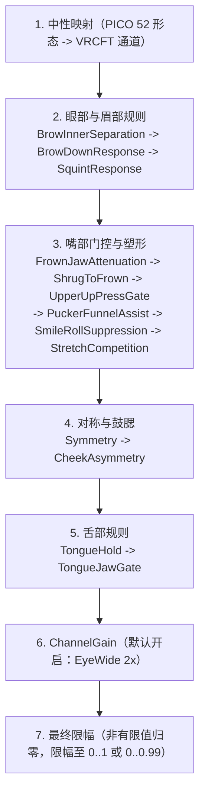

# 后处理参考

[English](postprocessing.md) | **简体中文** · [返回 README](../README_zh.md) · [配置说明](configuration_zh.md)

后处理是位于 PICO 中性映射与 VRCFaceTracking 输出之间的 PC 端可选修正管线。它**只作用于表情通道**，不影响视线、睁眼度或瞳孔直径（这三项由眼动解析单独处理）。

默认配置只开启 `ChannelGain`（将 `EyeWideLeft` 与 `EyeWideRight` 放大 2 倍），其余通道保持 `1` 倍，另外 13 条规则全部关闭。

> [!NOTE]
> 所有规则的默认系数（包括来自离线分析的 `EyeWide` 2 倍增益）都尚未在真机上标定。文档中的取值范围仅代表配置校验边界，请逐条开启并在自己的 Avatar 上对照效果。头显端的眼动 / 面捕增强与时域滤波位于 [PicoET-Enhance](https://github.com/WolalaQAQ/PicoET-Enhance)。

## 管线与执行顺序

全部规则按固定顺序执行，不可调整：



`Processing/PostProcessor.cs` 中的精确顺序：

1. 中性映射（`Mapping/NeutralFaceMapper.cs`）
2. `BrowInnerSeparation`
3. `BrowDownResponse`
4. `SquintResponse`
5. `FrownJawAttenuation`
6. `ShrugToFrown`
7. `UpperUpPressGate`
8. `PuckerFunnelAssist`
9. `SmileRollSuppression`
10. `StretchCompetition`
11. `Symmetry`
12. `CheekAsymmetry`
13. `TongueHold`
14. `TongueJawGate`
15. `ChannelGain`
16. 最终限幅：非有限值归零，所有通道限幅到 `[0, 1]`（启用 `LegacyExpressionCeiling` 时上限为 `0.99`）。

在两帧面部数据之间，模块直接复用上一帧的缓存结果，只有 `TongueHold` 到期会在帧间更新 `TongueOut`。收到 `X` v2 包时，左眼、右眼与嘴按各自时钟独立处理，高频眼动帧不会重复触发嘴部规则、重启舌头保持或重复叠加嘴部倍率。

多数规则参考 `pikepikeid/VRCFTPicoModule`（pike）的可观察行为独立实现，`TongueHold` 为本项目新增，用于缓解伸舌短时掉零。曲线和常量均与上游不同，来源边界见 [THIRD_PARTY_NOTICES_zh.md](../THIRD_PARTY_NOTICES_zh.md)。

## 通用约定

### 原始输入（`R`）与工作输出（`O`）

下文公式中：
- **`R`** 代表 PICO 原始形态值。所有触发条件都读取 `R`，因此前序规则或 `ChannelGain` 不会改变后续规则的阈值判断。
- **`O`** 代表执行到当前规则时的输出通道值。修改逐条累积，中间值允许暂时超过 `1`，直到管线末尾才统一限幅。

### 平滑阶跃函数

多数门控规则通过阈值 `t` 和过渡宽度 `w`（`TransitionWidth`）在 0 与 1 之间平滑过渡：

```text
c(x)          = clamp(x, 0, 1)
lerp(a, b, k) = a + (b - a) * k

A(x, t, w):
  w = 0:  x > t ? 1 : 0          （严格大于；x == t 时 A = 0，B = 1）
  w > 0:  lo = max(0, t - w / 2)
          hi = min(1, t + w / 2)
          u  = c((x - lo) / (hi - lo))
          A  = u * u * (3 - 2u)

B(x, t, w) = 1 - A(x, t, w)
```

由于 `lo` 和 `hi` 会在 `0` 与 `1` 处截断，阈值贴近两端时过渡区不再左右对称。

### 缺失数据与有效性

原始字段不存在、非有限值或所属区域无效时视为**缺失**（不按 `0` 处理）。规则会跳过受影响的一侧或整条跳过。

- **眼部区域：** 眉部、眯眼、瞪眼与眨眼；启用 `DisableEyeTracking` 后全部视为缺失。
- **面部区域：** 脸颊、下颌、嘴唇、嘴部、鼻翼与舌头；启用 `DisableFaceTracking` 后全部视为缺失。
- **普通包：** 一个眼部有效位同时决定双眼。
- **`X` 包：** 左右眼各自带有质量状态。状态为 `0` 时仅该眼的字段（含其内眉）视为缺失，`-1`（未知）与 `1`（可用）保留数据。

### 中性映射对照

中性映射只做直接赋值并限幅到 `[0, 1]`，不加任何补偿。下表列出后处理规则涉及的映射（完整表见 `Mapping/NeutralFaceMapper.cs`）：

| PICO 原始形态 | VRCFT 输出通道 |
|---|---|
| `EyeSquintL/R` | `EyeSquintLeft/Right` |
| `EyeWideL/R` | `EyeWideLeft/Right` |
| `BrowDownL/R` | `BrowPinchLeft/Right`、`BrowLowererLeft/Right` |
| `BrowInnerUp` | 普通包：同时赋给 `BrowInnerUpLeft` 与 `BrowInnerUpRight`；`X` 包：左眼取该值，右眼取独立右内眉 |
| `BrowOuterUpL/R` | `BrowOuterUpLeft/Right` |
| `CheekPuff` | `CheekPuffLeft`、`CheekPuffRight` |
| `JawOpen` | `JawOpen` |
| `MouthRollUpper` / `MouthRollLower` | `LipSuckUpperLeft/Right` / `LipSuckLowerLeft/Right` |
| `MouthFunnel` | 全部 4 个 `LipFunnel*` 通道 |
| `MouthPucker` | 全部 4 个 `LipPucker*` 通道 |
| `MouthUpperUpL/R` | `MouthUpperUpLeft/Right`、`MouthUpperDeepenLeft/Right` |
| `MouthLeft` / `MouthRight` | `MouthUpperLeft`、`MouthLowerLeft` / `MouthUpperRight`、`MouthLowerRight` |
| `MouthSmileL/R` | `MouthCornerPullLeft/Right`、`MouthCornerSlantLeft/Right` |
| `MouthFrownL/R` | `MouthFrownLeft/Right` |
| `MouthStretchL/R` | `MouthStretchLeft/Right` |
| `MouthShrugUpper` / `MouthShrugLower` | `MouthRaiserUpper` / `MouthRaiserLower` |
| `MouthPressL/R` | `MouthPressLeft/Right` |
| `TongueOut` | `TongueOut` |

`EyeBlink` 不映射到表情通道，仅作为部分规则的判断条件。

---

## 眼部与眉部规则

### `BrowInnerSeparation`

**解决的问题：** 抬内眉时外眉经常跟着抬起，导致委屈 / 担心的眉形不够清晰。

- **影响通道：** `BrowOuterUpLeft`、`BrowOuterUpRight`（`BrowInnerUp*` 不变）
- **参数：** `Strength`（默认 `1`，范围 `0–1`）

```text
O.BrowOuterUp = max(0, O.BrowOuterUp - R.BrowInnerUp * Strength)   // 每侧
```

- **细节与调参：** 普通包两侧共用 `BrowInnerUp`，`X` 包使用各自内眉。某侧内眉或外眉缺失时跳过该侧。`Strength` 过高会削弱真实的整眉上抬，如果惊讶表情变平，可降到 `0.4–0.7`。

### `BrowDownResponse`

**解决的问题：** 线性的皱眉数据在单眼眨眼时容易抖动，或对微小变化过于敏感。

- **影响通道：** `BrowLowererLeft/Right`、`BrowPinchLeft/Right`（两者写入同值；覆盖中性映射）
- **参数：**

| 参数 | 默认值 | 范围 | 说明 |
|---|---|---|---|
| `Center` | `0.7` | `0–1` | Sigmoid 曲线中心 |
| `Slope` | `10` | `0.1–40` | 陡峭度（越大越接近开关） |
| `Gain` | `1` | `0–10` | 输出倍率 |
| `BlinkAsymmetryStrength` | `0` | `0–1` | 另一只眼更闭时对本侧皱眉的衰减强度（`0` 关闭） |

```text
s(z) = 1 / (1 + exp(-z))
N(x) = [s(Slope * (c(x) - Center)) - s(-Slope * Center)]
     / [s(Slope * (1 - Center))    - s(-Slope * Center)]

v = N(R.BrowDown) * Gain
if BlinkAsymmetryStrength > 0:
  v = v * (1 - BlinkAsymmetryStrength * c(R.OtherBlink - R.SameBlink))
O.BrowLowerer = O.BrowPinch = v                                    // 每侧
```

- **细节与调参：** `N(0) = 0`、`N(1) = 1`。某侧 `BrowDown` 缺失时跳过该侧。普通包中若 `BlinkAsymmetryStrength > 0` 且任一侧 `EyeBlink` 缺失，整条规则不执行；独立 `X` 包会跳过跨眼 `BlinkAsymmetryStrength`，仍保留本侧曲线。

### `SquintResponse`

**解决的问题：** 用幂曲线重塑眯眼灵敏度，并可选地在眼睛睁开时压低眯眼残留。

- **影响通道：** `EyeSquintLeft`、`EyeSquintRight`（不影响睁眼度；覆盖中性映射）
- **参数：**

| 参数 | 默认值 | 范围 | 说明 |
|---|---|---|---|
| `Gain` | `1` | `0–10` | 输出倍率 |
| `Gamma` | `1` | `0.1–5` | 幂指数（`> 1` 压低小幅眯眼，`< 1` 抬升小幅眯眼） |
| `BlinkInfluence` | `0` | `0–1` | 同侧眼睁开时的衰减比例（`0` 关闭） |

```text
v = c(R.EyeSquint) ^ Gamma * Gain
if BlinkInfluence > 0:
  v = v * (1 - BlinkInfluence * (1 - c(R.EyeBlink)))
O.EyeSquint = v                                                    // 每侧
```

- **细节与调参：** 同侧 `EyeBlink = 1` 时无衰减，为 `0` 时按 `BlinkInfluence` 衰减。某侧 `EyeSquint` 缺失，或 `BlinkInfluence > 0` 且同侧 `EyeBlink` 缺失时跳过该侧。

---

## 嘴部门控与塑形规则

### `FrownJawAttenuation`

**解决的问题：** PICO 面捕在张嘴说话或打哈欠时，嘴角经常联动往下撇。

- **影响通道：** `MouthFrownLeft`、`MouthFrownRight`
- **参数：** `JawThreshold`（`0.1`，`0–1`）、`TransitionWidth`（`0.1`，`0–1`）、`MaxReduction`（`0.5`，`0–1`）

```text
m = 1 - MaxReduction * A(R.JawOpen, JawThreshold, TransitionWidth)
O.MouthFrown = O.MouthFrown * m                                    // 每侧
```

- **细节与调参：** `JawOpen` 缺失时整条跳过，某侧 `MouthFrown` 缺失时跳过该侧。真实的张嘴撇嘴也会被削弱，如果难过张嘴不够明显，可适当提高 `JawThreshold` 或降低 `MaxReduction`。

### `ShrugToFrown`

**解决的问题：** 刻意撇嘴有时会被 PICO 识别成下巴上抬（`MouthShrug`）。该规则在高 shrug 时生成撇嘴候选值，并在卷唇、嘟嘴或圆口时阻断。

- **影响通道：** `MouthFrownLeft/Right`；开启 `ConsumeShrug` 时同步影响 `MouthRaiserUpper/Lower`
- **参数：**

| 参数 | 默认值 | 范围 | 说明 |
|---|---|---|---|
| `Threshold` | `0.6` | `0–1` | 开始生成候选值的 shrug 起点 |
| `Range` | `0.2` | `> 0` 且 `Threshold + Range <= 1` | 线性升至满候选值的跨度 |
| `Gain` | `1` | `0–10` | 候选值倍率 |
| `RollBlockThreshold` | `0.3` | `0–1` | 卷唇阻断阈值 |
| `PuckerBlockThreshold` | `0.4` | `0–1` | 嘟嘴阻断阈值 |
| `FunnelBlockThreshold` | `0.1` | `0–1` | 圆口阻断阈值 |
| `TransitionWidth` | `0.05` | `0–1` | 三个阻断门控共用的过渡宽度 |
| `ConsumeShrug` | `false` | 布尔 | 生效时按 `1 - c(q)` 削弱 `MouthRaiserUpper/Lower` |

```text
h = max(c((R.ShrugUpper - Threshold) / Range),
        c((R.ShrugLower - Threshold) / Range))
r = max(R.RollUpper, R.RollLower)
q = h * Gain
      * B(r,        RollBlockThreshold,   TransitionWidth)
      * B(R.Pucker, PuckerBlockThreshold, TransitionWidth)
      * B(R.Funnel, FunnelBlockThreshold, TransitionWidth)

O.MouthFrownLeft  = max(O.MouthFrownLeft,  q)
O.MouthFrownRight = max(O.MouthFrownRight, q)
if ConsumeShrug:
  O.MouthRaiserUpper *= (1 - c(q))
  O.MouthRaiserLower *= (1 - c(q))
```

- **细节与调参：** `h` 是线性斜坡，左右两侧写入相同候选值，且只增不减（`max`）。`MouthShrugUpper/Lower`、`MouthRollUpper/Lower`、`MouthPucker`、`MouthFunnel` 任一缺失则整条不执行。

### `UpperUpPressGate`

**解决的问题：** 抿嘴时容易误触发上唇抬起（`MouthUpperUp`），导致闭嘴时露出牙齿。

- **影响通道：** `MouthUpperUpLeft/Right`、`MouthUpperDeepenLeft/Right`
- **参数：** `PressThreshold`（`0.1`，`0–1`）、`TransitionWidth`（`0.1`，`0–1`）、`MaxReduction`（`1`，`0–1`）

```text
m = 1 - MaxReduction * A(R.SamePress, PressThreshold, TransitionWidth)
O.MouthUpperUp     *= m                                            // 每侧
O.MouthUpperDeepen *= m
```

- **细节与调参：** 某侧 `MouthUpperUp` 或 `MouthPress` 缺失时跳过该侧。默认参数下，同侧 `MouthPress` 达到 `0.15` 即完全静音上唇抬起。

### `PuckerFunnelAssist`

**解决的问题：** 嘟嘴时圆口不足会显得扁平；在明显嘟嘴且同侧未抿嘴时，将 `LipFunnel` 至少拉高到 `MouthPucker` 水平。

- **影响通道：** `LipFunnelUpperLeft/Right`、`LipFunnelLowerLeft/Right`
- **参数：** `PuckerThreshold`（`0.3`，`0–1`）、`PressThreshold`（`0.2`，`0–1`）、`TransitionWidth`（`0.1`，`0–1`）、`Strength`（`1`，`0–1`）

```text
k = Strength * A(R.Pucker, PuckerThreshold, TransitionWidth)
             * B(R.SamePress, PressThreshold, TransitionWidth)
O.LipFunnel = lerp(O.LipFunnel, max(O.LipFunnel, R.Pucker), k)     // 每侧上下各一次
```

- **细节与调参：** 只会抬高圆口（`max`），不会压低。需要 `MouthPucker` 和 `MouthFunnel`；某侧 `MouthPress` 缺失时跳过该侧。

### `SmileRollSuppression`

**解决的问题：** 向内卷下唇时常常残留笑容数值。

- **影响通道：** `MouthCornerPullLeft/Right`、`MouthCornerSlantLeft/Right`
- **参数：** `RollThreshold`（`0.2`，`0–1`）、`TransitionWidth`（`0.1`，`0–1`）、`MaxReduction`（`1`，`0–1`）

```text
m = 1 - MaxReduction * A(R.MouthRollLower, RollThreshold, TransitionWidth)
O.MouthCornerPull  *= m                                            // 每侧
O.MouthCornerSlant *= m
```

- **细节与调参：** `MouthRollLower` 缺失时整条跳过，某侧 `MouthSmile` 缺失时跳过该侧。默认参数下，`MouthRollLower` 达到 `0.25` 时笑容完全归零。

### `StretchCompetition`

**解决的问题：** 横向咧嘴（`MouthStretch`）时经常带出轻微笑容和上唇抬起。当笑容高于 `SmileCeiling` 时视为真实微笑，停止抑制。

- **影响通道：** `MouthCornerPullLeft/Right`、`MouthCornerSlantLeft/Right`、`MouthUpperUpLeft/Right`、`MouthUpperDeepenLeft/Right`
- **参数：**

| 参数 | 默认值 | 范围 | 说明 |
|---|---|---|---|
| `StretchThreshold` | `0.05` | `0–1` | 横向咧嘴阈值 |
| `SmileCeiling` | `0.4` | `0–1` | 超过该笑容强度后停止抑制 |
| `TransitionWidth` | `0.1` | `0–1` | 两条件共用的过渡宽度 |
| `SmileReduction` | `0.5` | `0–1` | 笑容最大削弱比例 |
| `UpperUpReduction` | `0.5` | `0–1` | 上唇抬起最大削弱比例 |

```text
k = A(R.Stretch, StretchThreshold, TransitionWidth)
  * B(R.Smile,   SmileCeiling,     TransitionWidth)                // 每侧
O.MouthCornerPull, O.MouthCornerSlant *= 1 - SmileReduction   * k
O.MouthUpperUp,    O.MouthUpperDeepen *= 1 - UpperUpReduction * k  // 仅同侧 MouthUpperUp 存在时
```

- **细节与调参：** 某侧 `MouthStretch` 或 `MouthSmile` 缺失时跳过该侧。

---

## 对称与鼓腮规则

### `Symmetry`

**解决的问题：** 修正因头显佩戴偏斜或识别差异造成的左右嘴角不对称。

- **参数：**
  - `Groups`（默认 `["Smile"]`，区分大小写，可选 `Smile`、`Frown`、`Stretch`、`UpperUp`，不可重复；空数组不生效）
  - `Method`（默认 `"Max"`，区分大小写，可选 `"Max"` 或 `"Average"`）
  - `Strength`（默认 `1`，范围 `0–1`）

| 分组 | 输出通道对 | 所需原始形态 |
|---|---|---|
| `Smile` | `MouthCornerPull`、`MouthCornerSlant` | `MouthSmileL`、`MouthSmileR` |
| `Frown` | `MouthFrown` | `MouthFrownL`、`MouthFrownR` |
| `Stretch` | `MouthStretch` | `MouthStretchL`、`MouthStretchR` |
| `UpperUp` | `MouthUpperUp`、`MouthUpperDeepen` | `MouthUpperUpL`、`MouthUpperUpR` |

```text
q = Method == "Max" ? max(O.Left, O.Right) : (O.Left + O.Right) / 2
O.Left  = lerp(O.Left,  q, Strength)
O.Right = lerp(O.Right, q, Strength)
```

- **细节与调参：** 处理前面规则留下的输出。分组所需的左右原始形态缺任意一侧即跳过该分组。不处理视线、睁眼度、瞳孔和眉毛。想保留歪嘴笑但稍微平衡一点，可以改用 `"Average"` 并将 `Strength` 调至 `0.5–0.7`。

### `CheekAsymmetry`

**解决的问题：** PICO 只提供一个合并的 `CheekPuff`。本规则根据嘴部左右偏移推测单侧鼓腮（嘴偏左则抬高右颊，嘴偏右则抬高左颊）。

- **影响通道：** `CheekPuffLeft`、`CheekPuffRight`
- **参数：**

| 参数 | 默认值 | 范围 | 说明 |
|---|---|---|---|
| `MouthDifferenceThreshold` | `0.1` | `0–1` | 左右偏移差阈值 |
| `TransitionWidth` | `0.1` | `0–1` | 过渡宽度 |
| `Gain` | `1` | `0–10` | 追加鼓腮的倍率 |
| `MouthSmoothingMs` | `80` | 整数 `0–500` | 方向判定的指数平滑时间常数（ms，为 `0` 时关闭平滑） |

```text
alpha = 1 - exp(-Δt / (MouthSmoothingMs / 1000))       // Δt 为相邻两帧接收时间差（秒）
SL = lerp(SL, R.MouthLeft,  alpha)
SR = lerp(SR, R.MouthRight, alpha)
d  = SL - SR

O.CheekPuffRight += R.MouthLeft  * Gain * A( d, MouthDifferenceThreshold, TransitionWidth)
O.CheekPuffLeft  += R.MouthRight * Gain * A(-d, MouthDifferenceThreshold, TransitionWidth)
```

- **细节与调参：** 按真实时间常数平滑，与帧率无关（首帧、时间倒退或 `MouthSmoothingMs = 0` 时直接取当前值）。平滑只用于方向判定，实际增加量取未平滑的原始偏移。需要同时存在 `MouthLeft`、`MouthRight`、`CheekPuff`，否则跳过并清空平滑状态。注意追加量不乘 `R.CheekPuff`，不鼓腮只歪嘴也会出现单侧鼓腮。

---

## 舌部规则

### `TongueHold`

**解决的问题：** 伸舌时传感器偶尔闪断掉零，开启后可短时保持掉零前的值。

- **影响通道：** `TongueOut`
- **参数：** `HoldMs`（默认 `120`，整数 `0–500`；`0` 关闭）、`DropThreshold`（默认 `0.15`，范围 `0–1`）

```text
if R.TongueOut > DropThreshold:
  high = R.TongueOut; 结束保持; 输出不变
else (R.TongueOut <= DropThreshold):
  若上一帧 > DropThreshold: deadline = 到达时间 + HoldMs / 1000
  if now < deadline: O.TongueOut = high
  else: 恢复当前帧值
```

- **细节与调参：** 保持的是最后一次高于阈值时的原始值（不是历史最大值）。保持期内连续低值不会顺延截止时间，必须重新超过 `DropThreshold` 才能开始下一次计时。到期检查在每次输出时自动触发，不等下一帧到达，到期后直接替换为当前帧未经保持的最终结果（已通过 `TongueJawGate` 与 `ChannelGain`）。`TongueOut` 缺失或无效时会清空保持状态，不视为掉落。

### `TongueJawGate`

**解决的问题：** 闭嘴或微张嘴时减少误吐舌。（`TongueJawGate` 解决误触发，`TongueHold` 解决伸舌掉零，两者针对不同问题。）

- **影响通道：** `TongueOut`
- **参数：** `JawThreshold`（`0.5`，`0–1`）、`TransitionWidth`（`0.1`，`0–1`）、`MaxReduction`（`1`，`0–1`）

```text
m = 1 - MaxReduction * B(R.JawOpen, JawThreshold, TransitionWidth)
O.TongueOut *= m
if m == 0: 清空 TongueHold 状态
```

- **细节与调参：** 在 `TongueHold` 之后执行，保持值同样受控。当 `m == 0` 时会清空 `TongueHold` 状态，防止张嘴后把已被阻断的旧保持值吐出来。默认参数下 `JawOpen <= 0.45` 时完全静音。`JawOpen` 或 `TongueOut` 缺失时跳过。

---

## 输出增益

### `ChannelGain` *（默认开启）*

**解决的问题：** 在全部规则之后按通道乘以输出倍率。默认给 `EyeWideLeft` 与 `EyeWideRight` 施加 `2` 倍增益，弥补 PICO 瞪眼幅度偏小的问题。

- **参数：**
  - `DefaultGain`（默认 `1`，范围 `0–10`）— `Gains` 中未列出通道的倍率
  - `Gains`（默认 `{ "EyeWideLeft": 2, "EyeWideRight": 2, "EyeSquintLeft": 1, "EyeSquintRight": 1, "JawOpen": 1 }`，每项 `0–10`）

```text
O[ch] = O[ch] * (ch in Gains ? Gains[ch] : DefaultGain)
```

- **注意：** 只要在配置文件里写了 `Gains`，就会整体替换默认表。如果想提高 `JawOpen` 同时保留 `EyeWide` 的 2 倍增益，请一并写明：

```json
"ChannelGain": {
  "Enabled": true,
  "DefaultGain": 1,
  "Gains": {
    "EyeWideLeft": 2,
    "EyeWideRight": 2,
    "JawOpen": 1.2
  }
}
```

通道名不区分大小写，必须出自下方[可用通道](#可用通道)。倍率不会把 `0` 变成非零，过高会饱和裁切，且会与 VRCFT 自身的参数缩放叠加。

---

## 组合使用注意事项

- **`Symmetry` 位于单侧门控之后：** 使用 `Method: "Max"` 时，一侧残留的数值会复制到另一侧，可能抵消前序规则的单侧抑制效果。
- **`FrownJawAttenuation` 与 `ShrugToFrown`：** 张嘴衰减先压低 `MouthFrown`，随后 `ShrugToFrown` 再取 `max(O.MouthFrown, q)`，强 shrug 候选值会把被削弱的撇嘴重新抬起。
- **倍率叠加：** `SmileRollSuppression` 与 `StretchCompetition` 同时削弱 `MouthCornerPull` / `MouthCornerSlant`；`UpperUpPressGate` 与 `StretchCompetition` 同时削弱 `MouthUpperUp` / `MouthUpperDeepen`，两者系数相乘。
- **覆盖型规则与 `ChannelGain`：** `BrowDownResponse` 与 `SquintResponse` 会覆写对应通道，末尾的 `ChannelGain` 仍会在其结果上再乘一次。
- **VRCFT 下游处理：** VRCFT 自身的标定、平滑和 Correctors 在本模块之后运行，仍会改变最终进入 VRChat 的数值。

## 配置校验与状态重置

- **单规则隔离：** 出现非有限值或越界值、`ShrugToFrown` 满足 `Threshold + Range > 1`（容差 `1e-7`）、未知或重复键、类型错误（如小数 `HoldMs`）、未知或大小写重复的 `Gains` 通道名，或非法 `Symmetry` `Groups` / `Method` 时，**仅禁用该规则**并在日志写明原因。若出错的是 `ChannelGain`，默认的 EyeWide 2 倍补偿也会失效。若 `PostProcessing` 本身不是 JSON 对象，则全部规则关闭。
- **启动核对：** 校验完成后，Output 日志会打印每条已启用规则的生效参数；也可以先用 `UnifiedPicoConfigTool validate` 离线检查。
- **跨帧状态重置：** 只有 `CheekAsymmetry` 平滑值与 `TongueHold` 保持状态跨帧保存。遇到切换数据源 / 会话 / 协议 / 模式、面部数据超期（`Stale.FaceMs`，默认 250 ms）、相邻两帧接收间隔超过 `Stale.FaceMs` 或时钟倒退、面部数据无效（该帧眼部规则仍运行）、模块停用或异常，以及规则自身触发清空条件时，状态都会归零。所有计时均以 PC 本地单调时钟为准。

## 可用通道

`ChannelGain.Gains` 只接受以下 61 个表情通道名（不区分大小写）：

```text
EyeSquintLeft EyeSquintRight EyeWideLeft EyeWideRight
BrowPinchLeft BrowPinchRight BrowLowererLeft BrowLowererRight
BrowInnerUpLeft BrowInnerUpRight BrowOuterUpLeft BrowOuterUpRight
CheekSquintLeft CheekSquintRight CheekPuffLeft CheekPuffRight
JawOpen JawLeft JawRight JawForward MouthClosed
LipSuckUpperLeft LipSuckUpperRight LipSuckLowerLeft LipSuckLowerRight
LipFunnelUpperLeft LipFunnelUpperRight LipFunnelLowerLeft LipFunnelLowerRight
LipPuckerUpperLeft LipPuckerUpperRight LipPuckerLowerLeft LipPuckerLowerRight
MouthUpperUpLeft MouthUpperUpRight MouthUpperDeepenLeft MouthUpperDeepenRight
NoseSneerLeft NoseSneerRight MouthLowerDownLeft MouthLowerDownRight
MouthUpperLeft MouthUpperRight MouthLowerLeft MouthLowerRight
MouthCornerPullLeft MouthCornerPullRight MouthCornerSlantLeft MouthCornerSlantRight
MouthFrownLeft MouthFrownRight MouthStretchLeft MouthStretchRight
MouthDimpleLeft MouthDimpleRight MouthRaiserUpper MouthRaiserLower
MouthPressLeft MouthPressRight TongueOut
```
