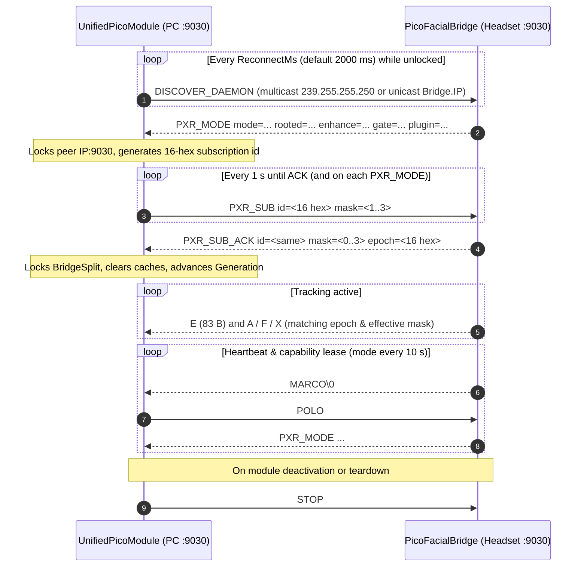

# Protocol Reference

English | [简体中文](protocol_zh.md) · [README](../README.md) · [Configuration](configuration.md)

This reference specifies the four UDP wire formats decoded by UnifiedPicoModule, the Bridge control handshake, eye/pupil resolution, and source-selection rules. The authoritative implementation lives in `Protocol/`, `Transport/`, `Mapping/`, `Runtime/`, and `Sdk/` (source files are not bundled in the release ZIP).

All four formats are implemented independently; reference origins and license boundaries are documented in [THIRD_PARTY_NOTICES.md](../THIRD_PARTY_NOTICES.md).

## Protocol Overview

| Format (`InputProtocol`) | Sender | Local Port | Discovery / Session | Datagram Length | Capabilities |
|---|---|---:|---|---|---|
| `BridgeSplit` | PicoFacialBridge 0.3.0+ | `9030` | Multicast/unicast discovery, `PXR_MODE`, `PXR_SUB` / `PXR_SUB_ACK`, `MARCO\0` / `POLO` | `83`, `95`, `151`, `227`; `X` v1: `111`/`243`; `X` v2: `131`/`263` | Channel subscription, measured pupil (`E`), independent per-eye expressions (`X` v1/v2) |
| `DaemonLegacy536` | PicoFacialDataDaemon | `9030` | Multicast/unicast discovery, `MARCO\0` / `POLO` | `536` | 384-byte face prefix + 152-byte eye prefix; measured pupil when valid |
| `StreamingHeader16` | PICO Connect (legacy face tracking protocol) | `29765` | Passive receive (optional `MARCO\0` → `POLO`), locks on first usable frame | `>= 908` (trailing bytes ignored) | 16-byte header + 892-byte face body; expression-derived gaze/eyelids |
| `StreamingBodyOnly` | Headerless streaming sender | `29763` | Passive receive (optional `MARCO\0` → `POLO`), locks on first usable frame | `892` | 892-byte face body only; expression-derived gaze/eyelids |

### Wire Conventions

- **Offsets and byte order:** All offsets are zero-based from byte 0 of the UDP datagram. Multi-byte integers are read explicitly as little-endian; floats are little-endian IEEE 754 binary32. No native struct marshalling is used.
- **Length checks:** Lengths must match exactly, except `StreamingHeader16`, where `908` is a lower bound.
- **Port binding:** Ports are fixed and bound with `ExclusiveAddressUse = true`. If another PICO module still holds a port, socket binding fails and logs the port and error.
- **Receive buffer:** `2048` bytes (larger than every supported datagram). Oversized datagrams are dropped.

---

## Bridge Connection Flow

`BridgeSplit` and `DaemonLegacy536` share UDP port `9030` and the same discovery and peer-locking flow. Bridge operates as a single-client session, not a multi-client relay.



### Control Messages

All control messages are exact-match ASCII with no line terminator; only `MARCO\0` includes a single trailing NUL byte.

| Message | Bytes | Direction | Purpose |
|---|---:|---|---|
| `DISCOVER_DAEMON` | 15 | PC → Headset | Discover sender and request a session |
| `MARCO\0` | 6 | Headset → PC | Heartbeat probe |
| `POLO` | 4 | PC → Headset | Heartbeat reply |
| `PXR_MODE ...` | 10–256 | Headset → PC | Capability announcement (`BridgeSplit` only) |
| `PXR_SUB id=... mask=...` | 34 | PC → Headset | Channel subscription request |
| `PXR_SUB_ACK id=... mask=... epoch=...` | 61 | Headset → PC | Subscription acknowledgement and epoch assignment |
| `STOP` | 4 | PC → Headset | End the currently locked session |

### Discovery

While unlocked, the module sends `DISCOVER_DAEMON` every `Bridge.ReconnectMs` (default `2000` ms, range `100`–`60000` ms):

- **Automatic discovery (`Bridge.IP` unset):** Sends to multicast `239.255.255.250:9030` with TTL `1` once per eligible adapter. An adapter is eligible when it is `Up`, supports multicast, is Ethernet or Wi-Fi (`Wireless80211`), has a non-loopback IPv4 address, and its name and description contain none of `virtual`, `vpn`, `tunnel`, `wireguard`, `zerotier`, `tailscale`, `tap-`, `hyper-v`, `vmware`, or `virtualbox`. When `Bridge.ListenAddress` is not `0.0.0.0`, only the matching adapter is used. If no adapter qualifies, the log advises setting `Bridge.IP`.
- **Direct unicast (`Bridge.IP` set):** Sends unicast to `<Bridge.IP>:9030`, bypassing adapter filtering.

### Peer Locking

Only IPv4 unicast datagrams from source port `9030` are accepted. While unlocked, three additional checks apply:

1. If `Bridge.IP` is set, the source IP must match it; otherwise, the source IP must lie on the same IPv4 subnet as an active discovery adapter and must not equal that adapter's own IP.
2. The datagram must arrive within the discovery response window: `max(1 s, Bridge.ReconnectMs)`.
3. A `MARCO\0`, a valid `PXR_MODE`, or a tracking datagram with at least one usable field locks the peer's full `IP:9030` endpoint.

Locking generates a fresh 16-character lowercase hex `subscriptionId`, sets the state to `MissingFrames` until tracking data arrives, and rejects all other endpoints until the session ends. Every `MARCO\0` from an allowed peer receives `POLO`.

### Mode Announcement (`PXR_MODE`)

A `BridgeSplit` sender emits `PXR_MODE` immediately upon locking, every 10 seconds thereafter, and whenever mode state changes:

```text
PXR_MODE mode=<normal|enhance> rooted=<0|1> enhance=<0|1> gate=<0|1> plugin=<off|left|right|dual>
```

Parsing rules (`Protocol/BridgeControl.cs`):

- Printable ASCII only (`0x20`–`0x7E`), 10–256 bytes, space-separated tokens.
- Must contain **exactly** the five unique keys `mode`, `rooted`, `enhance`, `gate`, and `plugin`. `mode` must be `normal` or `enhance`; `rooted`, `enhance`, and `gate` must be `0` or `1`.
- Enhanced mode (`Enhanced = true`) requires `mode=enhance` **and** `rooted=1`, `enhance=1`, `gate=1`.
- Independent per-eye gaze (`IndependentPerEye = true`) requires enhanced mode **and** `plugin=dual`. Unrecognized `plugin` values normalize to `off`; `left` and `right` do not set `IndependentPerEye`.

A malformed `PXR_MODE` is discarded and clears previously recorded capabilities. Any capability change advances `Generation` and clears cached eye/expression data. If no valid `PXR_MODE` arrives within `min(20000 ms, ControlTimeoutMs)`, capabilities downgrade to unknown (`Mode advertisement expired; capabilities downgraded`). Sessions locked to `DaemonLegacy536` ignore `PXR_MODE` capability grants.

### Subscription & Acknowledgement

The module only sends `PXR_SUB` after receiving a valid `PXR_MODE` (and never when `Bridge.Protocol` is pinned to `DaemonLegacy536`), because the legacy daemon treats any non-`POLO` response during heartbeats as a heartbeat failure.

```text
PXR_SUB id=<16 lowercase hex> mask=<1|2|3>
PXR_SUB_ACK id=<same 16 hex> mask=<0|1|2|3> epoch=<16 lowercase hex>
```

- **Mask bits:** `1` = eye, `2` = face, `3` = both. Requested mask is the intersection of VRCFT host channel grants and module config (`!DisableEyeTracking`, `!DisableFaceTracking`). If the requested mask is `0`, no tracking sources are started.
- **Retry cadence:** Before acknowledgement, `PXR_SUB` is resent every `1` second and on every `PXR_MODE` announcement. Subscription requests are idempotent.
- **Acknowledgement validation:** Must be **exactly 61 bytes** matching the exact single-space grammar above, come from the locked peer, match the current `subscriptionId`, have an effective `mask` in `0..3` that is a subset of `requestedMask`, and carry a positive signed 64-bit `epoch` (`1..Int64.MaxValue`). Once subscribed, `epoch` cannot decrease, and `mask` cannot change while `epoch` stays the same.

Effective mask is the intersection of headset local switches and PC requested channels. When `epoch` or `mask` changes on acknowledgement, the module locks `BridgeSplit`, clears cached frames and post-processing timing state, and advances `Generation`. When effective `mask` is `0`, the headset pauses tracking packets while heartbeats and `PXR_MODE` continue, and state remains `MissingFrames`.

### Data Filtering, Timeouts, and Teardown

No `BridgeSplit` tracking packet is accepted before subscription acknowledgement. Every `BridgeSplit` packet must match the latest acknowledged `epoch` and `effectiveMask`; mismatches are dropped and trigger a `PXR_SUB` resend so in-flight packets from an older epoch cannot revive a disabled channel. Once the session protocol is established (`BridgeSplit` or `DaemonLegacy536`), packets of the other format are dropped until the next session.

| Condition | Module Behavior |
|---|---|
| No data for `> 250 ms` while control traffic continues | State switches to `MissingFrames`; peer lock and subscription remain intact |
| No heartbeat, mode announcement, ACK, or data for `>= ControlTimeoutMs` (default `30000 ms`) | Clears peer lock and subscription without sending `STOP`, switches to `Searching`, and restarts discovery immediately |
| Subscribed session receives a lower-epoch ACK with no fresh data for `> 1 s` | Releases peer lock and restarts discovery with a fresh `subscriptionId` |
| Module deactivation or `Teardown()` | Sends a single `STOP` to the locked peer (skipped if the state lock cannot be acquired within `200 ms`, in which case sockets close immediately) |

> [!NOTE]
> When the Bridge app restarts on the headset, it forgets its locked PC peer and stays silent until it receives a new `DISCOVER_DAEMON`. PC recovery therefore waits for `ControlTimeoutMs` (30 s by default). In hardware testing, the headset returned to running state in ~6 s and the PC re-subscribed after ~33 s.

---

## BridgeSplit Packet Formats

### Common Header (19 Bytes)

| Offset | Size | Type | Field | Notes |
|---:|---:|---|---|---|
| 0 | 1 | `uint8` | `tag` | ASCII `'E'`, `'A'`, `'F'`, or `'X'` |
| 1 | 1 | `uint8` | `channelMask` | Effective mask (`1`–`3`) |
| 2 | 1 | `uint8` | `validityFlags` | Morphology validity: bit 0 (`1`) eye, bit 1 (`2`) face; must be a subset of `channelMask` and `0` for `'E'` |
| 3 | 8 | `int64` | `epoch` | Stream epoch; must be `> 0` |
| 11 | 8 | `int64` | `sourceTimestamp` | Positive source clock (`> 0`). Used as face clock for `A`/`F`/`X` v1, eye clock for `E`, and left-eye clock for `X` v2 (`0` allowed in `X` v2 only when left-eye update bit is `0`) |

### Datagram Types

| Tag | Length | Effective Mask | Payload |
|---|---:|---|---|
| `E` | 83 | `1` or `3` | Native eye data (module consumes measured pupil diameter only) |
| `A` | 95 | `1` | 19 eye-region expression shapes |
| `F` | 151 | `2` | 33 non-eye expression shapes |
| `F` | 227 | `3` | All 52 PICO expression shapes (slots `0`–`51`) |
| `X` (v1) | 111 | `1` | Same 19 eye-region shapes as `A` + 16-byte v1 independent-eye extension |
| `X` (v1) | 243 | `3` | Same 52 shapes as `F` + 16-byte v1 independent-eye extension |
| `X` (v2) | 131 | `1` | Same 19 eye-region shapes as `A` + 36-byte v2 grouped-clock extension |
| `X` (v2) | 263 | `3` | Same 52 shapes as `F` + 36-byte v2 grouped-clock extension |

Standard senders emit `E` + `A` for mask `1`, `F` (151 B) for mask `2`, and `E` + `F` (227 B) for mask `3` (without `A`). Independent-expression senders replace `A` or 227-byte `F` with `X`; mask `2` stays `F` (151 B) and `E` is unchanged.

### `X`: independent eye expressions

The extension begins immediately after the shape payload: at byte offset **95** for mask `1`, or byte offset **227** for mask `3`.

#### Extension v1 (16 bytes; total 111 B / 243 B)

| Rel. Offset | Size | Type | Field | Notes |
|---:|---:|---|---|---|
| +0 | 4 | `int32` | `version` | `1` or `2` (other values rejected) |
| +4 | 4 | `float32` | `rightInnerBrow` | Filtered right inner brow (must be finite); standard slot `3` holds left inner brow |
| +8 | 4 | `int32` | `leftQualityState` | `-1` = unknown, `0` = unusable, `1` = usable |
| +12 | 4 | `int32` | `rightQualityState` | `-1` = unknown, `0` = unusable, `1` = usable |

#### Extension v2 Additional Fields (+20 bytes; total 36-byte extension, 131 B / 263 B)

| Rel. Offset | Size | Type | Field | Notes |
|---:|---:|---|---|---|
| +16 | 4 | `uint32` | `groupUpdated` | Bitmask: bit 0 (`1`) = left eye, bit 1 (`2`) = right eye, bit 2 (`4`) = mouth. Mask `1` allows only bits 0–1; mask `3` allows bits 0–2 |
| +20 | 8 | `int64` | `mouthSourceTimestamp` | Non-negative; must be `> 0` when bit 2 is set |
| +28 | 8 | `int64` | `rightSourceTimestamp` | Non-negative; must be `> 0` when bit 1 is set |

(In `X` v2, the left-eye source timestamp is stored in common header offset `11`: non-negative, and must be `> 0` when bit 0 is set.)

#### Semantics of `X` v1 and v2

- **Per-eye availability:** Eye-region shapes use their own side's `leftQualityState` / `rightQualityState` instead of the combined header eye-validity bit. State `1` and `-1` retain the data (`-1` means unclassified, not known-good); state `0` marks that eye unusable. Non-eye shapes still follow the header face-validity bit (bit 1 of byte 2).
- **No cross-eye borrowing:** Gaze and openness are derived from `EyeLook` and `1 - EyeBlink` per side. An unusable eye (`state == 0`) holds its own last usable output (subject to `Stale.NeutralizeOnTimeout`) and never copies the opposite eye. `BrowInnerSeparation` runs independently per side, and cross-eye `BlinkAsymmetry` in `BrowDownResponse` is skipped.
- **v1 vs. v2 clocks:** `X` v1 uses a single source timestamp and face sequence. `X` v2 shares one `epoch` across three independent streams (`Face` = left eye, `RightFace` = right eye, `Mouth` = mouth):
  - A duplicate or backward timestamp rejects **only that group**; other updated groups in the same datagram still advance.
  - A group whose `groupUpdated` bit is `0` neither publishes nor consumes its deduplication clock. A packet with `groupUpdated == 0` is a valid no-op.
  - Only accepted groups advance their sequence, monotonic arrival time, and post-processing. High-rate eye updates never refresh or reprocess cached mouth output (and never reset or extend `TongueHold`).
  - A new unusable-eye observation (`state == 0`) advances that eye's source identity/sequence, but does **not** refresh the freshness timestamp of its last usable gaze, openness, or eye expressions. When `Stale.NeutralizeOnTimeout = true`, that eye still expires relative to its last usable sample.
  - A new invalid mouth observation (`faceValid == false`) still passes into mouth processing so mouth output clears immediately, even when timeout holding is enabled.
  - Switching between grouped (`X` v2) and ungrouped (`F` / `A` / `X` v1) mode resets cached input and output state.

### `E`: native eye data (83 bytes)

| Offset | Size | Type | Field | Notes |
|---:|---:|---|---|---|
| 19 | 4 | `uint32` | `leftStatus` | Allowed bits: `0x002`, `0x004`, `0x100`, `0x800` |
| 23 | 4 | `uint32` | `rightStatus` | Same allowed bits |
| 27 | 4 | `uint32` | `combinedStatus` | Same allowed bits |
| 31 | 12 | `float32[3]` | `leftGaze` | Direction vector `(X, Y, Z)` |
| 43 | 12 | `float32[3]` | `rightGaze` | Direction vector `(X, Y, Z)` |
| 55 | 12 | `float32[3]` | `combinedGaze` | Direction vector `(X, Y, Z)` |
| 67 | 4 | `float32` | `leftOpenness` | Native openness (`[0, 1]`) |
| 71 | 4 | `float32` | `rightOpenness` | Native openness (`[0, 1]`) |
| 75 | 4 | `float32` | `leftPupilRaw` | Raw pupil value; divide by `10` for millimeters |
| 79 | 4 | `float32` | `rightPupilRaw` | Raw pupil value; divide by `10` for millimeters |

Any status bit outside `0x906` (`0x002 | 0x004 | 0x100 | 0x800`) or any non-finite float from offset `31` onward rejects the entire datagram. See [Status bits and units](#status-bits-and-units) for bit meanings.

In normal mode, Bridge clears per-eye gaze validity bits and retains only combined gaze; per-eye gaze validity is retained only in enhanced mode with `plugin=dual`. Regardless of mode, UnifiedPicoModule consumes only the measured pupil diameter from `E` packets—gaze and openness always come from the expression shapes.

### `A`: eye-region shapes (95 bytes)

Offset `19` through `94` carries 19 `float32` values mapped to the following `PicoShape` slots (in wire order):

| Wire Index | Slot | Name | Wire Index | Slot | Name |
|---:|---:|---|---:|---:|---|
| 0 | 0 | `EyeLookDownL` | 10 | 31 | `EyeLookUpL` |
| 1 | 2 | `EyeLookInL` | 11 | 35 | `EyeLookUpR` |
| 2 | 3 | `BrowInnerUp` | 12 | 36 | `BrowOuterUpR` |
| 3 | 4 | `BrowDownR` | 13 | 38 | `EyeBlinkR` |
| 4 | 11 | `EyeLookInR` | 14 | 41 | `EyeSquintR` |
| 5 | 12 | `EyeLookDownR` | 15 | 44 | `EyeLookOutL` |
| 6 | 16 | `BrowDownL` | 16 | 45 | `EyeLookOutR` |
| 7 | 26 | `EyeSquintL` | 17 | 46 | `EyeWideR` |
| 8 | 28 | `EyeBlinkL` | 18 | 47 | `EyeWideL` |
| 9 | 30 | `BrowOuterUpL` | | | |

All other slots are marked absent. Because `channelMask` is `1`, the face validity bit is always `0`.

### `F`: expression shapes (151 or 227 bytes)

- **151-byte (`channelMask == 2`, face only):** 33 `float32` values from offset `19`, in ascending slot order for all slots outside the `A` table above: `1, 5, 6, 7, 8, 9, 10, 13, 14, 15, 17, 18, 19, 20, 21, 22, 23, 24, 25, 27, 29, 32, 33, 34, 37, 39, 40, 42, 43, 48, 49, 50, 51`. Eye-region slots are marked absent.
- **227-byte (`channelMask == 3`, eye + face):** 52 `float32` values from offset `19`, in PICO slot order `0` through `51` (see `PicoShape` in `Core/Contracts.cs`).

### Shape Validation Rules

Any non-finite shape value (`NaN` or `±Infinity`) causes the entire `BridgeSplit` datagram to be discarded. Shapes have no per-slot presence bit on the wire: Bridge replaces an individual non-finite sensor value with `0` before sending without clearing the group validity bit, so the receiver cannot distinguish a measured `0` from a sanitized non-finite value.

For `A` and `F`, the 19 eye-region slots are governed by the header eye-validity bit and the remaining 33 slots by the header face-validity bit; valid eye shapes remain usable even when `faceValid` is `0`. For `X`, eye-region slots use each eye's quality state instead.

---

## DaemonLegacy536 (536 Bytes, Port 9030)

Fixed 536-byte datagram combining a 384-byte face prefix and a 152-byte eye prefix.

| Offset | Size | Type | Field | Notes |
|---:|---:|---|---|---|
| 0 | 8 | `int64` | `faceTimestamp` | Positive = reliable clock; `<= 0` falls back to arrival order |
| 8 | 288 | `float32[72]` | `shapes` | Slots `0`–`51` mapped; slots `52`–`71` kept as `ExtraVisemes` (not output) |
| 296 | 4 | `float32` | `eyeValid` | Valid only when exactly `1.0f` |
| 300 | 4 | `float32` | `faceValid` | Valid only when exactly `1.0f` |
| 304 | 76 | — | *(unmapped)* | Ignored |
| 380 | 4 | — | `padding` | Padding, **not** an eye timestamp |
| 384 | 4 | `uint32` | `leftStatus` | Left eye status bits |
| 388 | 4 | `uint32` | `rightStatus` | Right eye status bits |
| 392 | 4 | `uint32` | `combinedStatus` | Combined gaze status bits |
| 396 | 36 | — | *(unmapped)* | Ignored |
| 432 | 12 | `float32[3]` | `leftGaze` | Direction vector `(X, Y, Z)` |
| 444 | 12 | `float32[3]` | `rightGaze` | Direction vector `(X, Y, Z)` |
| 456 | 12 | `float32[3]` | `combinedGaze` | Direction vector `(X, Y, Z)` |
| 468 | 4 | `float32` | `leftOpenness` | Native openness |
| 472 | 4 | `float32` | `rightOpenness` | Native openness |
| 476 | 4 | `float32` | `leftPupilRaw` | Raw pupil value (`÷ 10` = mm) |
| 480 | 4 | `float32` | `rightPupilRaw` | Raw pupil value (`÷ 10` = mm) |
| 484 | 52 | — | *(unmapped)* | Ignored |

Non-finite shape values mark only that individual slot as absent rather than rejecting the whole datagram. The eye section carries no reliable source clock and is ordered by arrival. As with `BridgeSplit`, only the measured pupil diameter is consumed from the native eye section; gaze and openness come from the expression shapes.

---

## Streaming Formats (Ports 29765 & 29763)

Streaming senders deliver face expressions only (no native eye or pupil data). Gaze and openness are derived from `EyeLook` and `EyeBlink`.

### `StreamingHeader16` Header (Port 29765, `>= 908` Bytes)

| Offset | Size | Type | Field | Notes |
|---:|---:|---|---|---|
| 0 | 1 | `uint8` | `startCode1` | Checked only when `Streaming.HeaderProfile` is set |
| 1 | 1 | `uint8` | `startCode2` | Checked only when `Streaming.HeaderProfile` is set |
| 2 | 1 | `uint8` | `trackingType` | Must equal `2` (face data) |
| 3 | 1 | `uint8` | `subType` | Checked only when `Streaming.HeaderProfile` is set |
| 4 | 1 | `uint8` | `multiPack` | Checked only when `Streaming.HeaderProfile` is set |
| 5 | 1 | `uint8` | `currentIndex` | Checked only when `Streaming.HeaderProfile` is set |
| 6 | 2 | `uint16` | `version` | Checked only when `Streaming.HeaderProfile` is set |
| 8 | 8 | `uint64` | `transportTimestamp` | Transport metadata; **not** used as the face clock |
| 16 | 892 | `byte[892]` | `body` | Shared 892-byte body layout below; bytes after offset `907` are ignored |

Measured PICO Connect 10.6.6 (`faceTrackingTransferProtocol=2`) sends **912-byte** datagrams (16-byte header + 896-byte body, i.e., 4 trailing bytes beyond 908) with leading header bytes `00 33 02 01 00 01 01 00`.

### Shared Body Layout (892 Bytes)

Starts at offset `16` in `StreamingHeader16` (port `29765`) or offset `0` in `StreamingBodyOnly` (port `29763`, exact length `892` bytes).

| Body Offset | Size | Type | Field | Notes |
|---:|---:|---|---|---|
| 0 | 8 | `int64` | `faceTimestamp` | Positive = reliable clock; `<= 0` falls back to arrival order |
| 8 | 288 | `float32[72]` | `shapes` | Slots `0`–`51` mapped; slots `52`–`71` kept as `ExtraVisemes`. Finite = present, non-finite = absent |
| 296 | 40 | `float32[10]` | `validity` | Ignored (measured PICO Connect 10.6.6 never sets these to `1.0f`) |
| 336 | 4 | `float32` | `laughing` | Ignored |
| 340 | 40 | `float32[10]` | `emotion` | Ignored |
| 380 | 512 | `byte[512]` | `reserved` | Ignored |

### Streaming Receive Rules

- **Port 29765 (`StreamingHeader16`):** Default mode accepts any datagram with length `>= 908` and `trackingType == 2`, matching SAFT and pike. Setting `Streaming.HeaderProfile` enables strict matching of all six fields (`StartCode1`, `StartCode2`, `SubType`, `MultiPack`, `CurrentIndex` in `0..255`; `Version` in `0..65535`). Missing or out-of-range fields fall back to default mode; strict mode does not reassemble fragments.
- **Port 29763 (`StreamingBodyOnly`):** Requires exact length `892` bytes.
- **Port binding & source checks:** Both ports are monitored unless `Streaming.Protocol` pins one. Only IPv4 unicast sources are accepted. `Streaming.LocalOnly` defaults to `true`, restricting packets to loopback or active local adapter IPv4 addresses. If `Streaming.IP` is set while `LocalOnly` is `true`, that IP must be local or startup fails.
- **Locking & heartbeats:** The first datagram containing usable fields locks the source `IP:port` and protocol. Subsequent structurally valid packets with invalid fields are still committed to promptly invalidate output. Exact `MARCO\0` from an allowed sender receives `POLO` without locking the source.
- **Timeouts:** Missing frames after `> 250 ms` sets `MissingFrames`. After `Streaming.SessionTimeoutMs` (default `2000` ms), the lock and caches clear, state returns to `Searching`, and local adapter addresses are refreshed. Streaming senders never receive `STOP`, and `DisableEyeTracking` / `DisableFaceTracking` only suppress local output.

---

## Eye Resolution & Pupil Encoding

### Status bits and units

Applies to `BridgeSplit` `E` packets and the `DaemonLegacy536` eye section (`Protocol/DecodedPacket.cs`):

| Bit | Status Word | Meaning | Additional Validity Requirement |
|---:|---|---|---|
| `0x002` | Combined | Combined gaze valid | All 3 vector components finite |
| `0x004` | Per eye | Native openness valid | Finite and in `[0, 1]` |
| `0x100` | Per eye | Per-eye gaze valid | All 3 vector components finite |
| `0x800` | Per eye | Pupil diameter valid | `raw / 10` is finite and `> 0` (output further requires `[1, 12]` mm) |

### Gaze and Openness Derivation

For every sender, gaze is derived from the `EyeLook` shapes and eyelid openness from `EyeBlink` (`Mapping/EyeResolver.cs`):

- **Gaze (`blendshape-derived`):** Requires all four shapes (`EyeLookIn`, `EyeLookOut`, `EyeLookUp`, `EyeLookDown`) for that eye to be present and valid:
  - `Left.GazeX = EyeLookInL - EyeLookOutL`
  - `Right.GazeX = EyeLookOutR - EyeLookInR`
  - `GazeY = EyeLookUp - EyeLookDown` (per side)
- **Openness (`blendshape-blink`):** `Openness = 1 - EyeBlink` (per side). VRCFT derives closure as `EyeClosed = 1 - Openness`.
- **Gain and clamping:** Each axis is multiplied by its `EyeGain` factor, then clamped to `[-1, 1]` for gaze and `[0, 1]` for openness.
- **Missing or invalid samples:** Retain that eye's last valid value without substituting another source. Before the first valid sample, or after expiry when `Stale.NeutralizeOnTimeout = true`, origin is `neutral` (`Gaze = (0, 0)`, `Openness = 1`). When transitioning into independent `X` expressions, an initial unusable eye resets to `neutral` rather than inheriting prior non-independent history.

### Pupil Measurement & VRCFT 6 Encoding

A measured pupil diameter is accepted only when status bit `0x800` is set, `raw / 10` is finite and within `[1, 12]` mm, and the native `E` / legacy packet is within `Stale.EyeMs` (default `250` ms). The module never estimates pupil size from openness or shapes.

When a valid measurement is available (`RealPupil = true`), the millimeter diameter is written directly to `PupilDiameter_MM` on both VRCFT 5 and VRCFT 6. When no valid measurement is available (before the first sample, after teardown/reset, or after expiry with `Stale.NeutralizeOnTimeout = true`), the SDK boundary (`Sdk/UnifiedPicoTrackingModule.cs`) encodes unavailability according to the host major version:

| Host Version | `PupilDiameter_MM` When `RealPupil == false` | Log Origin | Reason |
|---|---|---|---|
| **VRCFT 6 (`>= 6.0`)** | `0` | `estimated` | VRCFT 6 treats `0` as "no measurement"; a positive placeholder would serialize as physical pupil constriction/dilation |
| **VRCFT 5 (`5.x`)** | `Stale.NeutralPupilMillimeters` (default `3.5` mm) | `estimated` | Preserves legacy VRCFT 5 neutral diameter behavior |

---

## Timestamps, expiry and neutral output

- **Clock monotonicity:** A signed `int64` source timestamp is treated as a reliable clock only when `> 0`. Legacy/streaming formats fall back to arrival order when `<= 0`. `BridgeSplit` requires `> 0` except for unmarked groups in `X` v2, which may pass `0`.
- **Independent sequences:** Within a `Generation`, native eye (`E`) and expression timestamps are checked separately. `A`, `F`, and `X` v1 share one face sequence; `X` v2 maintains independent left-eye, right-eye, and mouth sequences. Duplicate or backward samples do not advance the affected group's arrival time, sequence, or post-processing state.
- **Freshness:** Evaluated against local monotonic arrival time (`Stopwatch`), never extended by control packets. The module does not interpolate or synthesize frames; between new group arrivals, SDK updates reuse processed output (only a pending `TongueHold` deadline can change mouth output without a new mouth packet).

### Stale Data Behavior

By default, `Stale.NeutralizeOnTimeout` is `false`: expired gaze, openness, pupil diameter, and expressions hold their last output while freshness checks and post-processing temporal resets still run.

When `Stale.NeutralizeOnTimeout = true`:

| Data | Expiry Threshold | Output After Expiry |
|---|---|---|
| Expressions | `Stale.FaceMs` (default `250` ms) | All expired channels return to `0`; post-processing temporal state resets |
| Gaze & openness | `Stale.FaceMs` (default `250` ms) | Gaze returns to `(0, 0)`, openness to `1` (`neutral`) |
| Pupil | `Stale.EyeMs` (default `250` ms) | `0` on VRCFT 6, `Stale.NeutralPupilMillimeters` on VRCFT 5 |

When no source is selected, output is fully neutral. A new session, source switch, or mode change advances `OutputGeneration` and clears eye resolution and post-processing state unconditionally. A `Generation` increment caused solely by a connection or mode-announcement timeout keeps `OutputGeneration` unchanged, preserving held output when `NeutralizeOnTimeout = false` while still clearing transport caches and post-processing timing state. Module deactivation, teardown, and update exceptions always reset output to neutral.

Expression shapes map to `ExpressionChannel` via `Mapping/NeutralFaceMapper.cs`, clamped to `[0, 1]` with no implicit gain (or `[0, 0.99]` when `LegacyExpressionCeiling = true`). See the [post-processing reference](postprocessing.md) for optional rules applied after mapping.

---

## Source Selection & Runtime Timing

### Source Selection

`Source` controls which receivers start: `Bridge`, `Streaming`, or `Auto` (both). A source in `Faulted` or `Stopped` state is never usable. Otherwise, a source is usable when either:

- Eye tracking is enabled, a fresh native eye packet is present, and it carries a valid measured pupil (`[1, 12]` mm); or
- Fresh shape data contains consumable expressions or (with eye tracking enabled) derivable gaze/openness.

In `Auto` mode, only `Bridge` can be selected during the initial `AutoSelectionWindowMs` (`1500` ms default). Afterward, the first usable source wins, with `Bridge` preferred if both are ready simultaneously. Selection is sticky for the session; when `AllowFallback = true`, an unusable active source triggers a whole-source switch to the other usable source. Data from two sources is never mixed.

### SDK Consumption & Background Timer Policy

- **Diagnostics:** `groupRxHzLRM` reports accepted left-eye/right-eye/mouth packet rates. `CONSUMPTION` reports processed vs. coalesced group updates, new vs. repeated SDK writes, and timing histograms (`receiveToProcessMs`, `processMs`, `receiveToWriteMs`, `sdkWriteMs`) inside the module—excluding host IPC, OSC, or Avatar rendering.
- **Background timer resolution:** Official VRCFT 5.4.5 requests a 1 ms timer period in its module process. While active, the module snapshots the process `PROCESS_POWER_THROTTLING_STATE` and clears only `PROCESS_POWER_THROTTLING_IGNORE_TIMER_RESOLUTION` (`0x4`) so the timer request remains honored in the background. On deactivation, teardown, or source fault, it re-reads the current policy and restores only that bit's original control/state settings, leaving all other bits untouched.

---

## Verification Status

Hardware verification was performed on a PICO 4 Pro:

| Path | Verified Setup | Scope Covered |
|---|---|---|
| `BridgeSplit` `X` v2 | PicoFacialBridge 0.5.0 + PicoET-Enhance 2.3.0, official VRCFT 5.4.5 | 84 s worn Virtual Desktop session (Cymple mouth + PICO eyes; PICO eyes + face); ~89.7 `X` pkt/s with distinct eye sources |
| `BridgeSplit` `X` v1 | PicoFacialBridge 0.4.0 + PicoET-Enhance 2.2.0, official VRCFT 5.4.5 | Recorded ~23.7 Hz eye images replayed through native inference in an accelerated loop; `E` + dual-channel `X` values, per-eye validity |
| `BridgeSplit` (`E`/`A`/`F`) | PicoFacialBridge 0.3.0 | Discovery, `PXR_MODE`, `PXR_SUB`/`PXR_SUB_ACK`, all 4 channel masks, epoch agreement, cache clearing, neutral fallback, app restart & full headset reboot recovery |
| `StreamingHeader16` (29765) | PICO Connect 10.6.6 (`faceTrackingTransferProtocol=2`) | 912-byte datagrams (16 B header + 896 B body), ~72 Hz, zero loss |

Not yet verified on hardware: strict `Streaming.HeaderProfile` mode, port `29763` (`StreamingBodyOnly`; setting `faceTrackingTransferProtocol=1` in PICO Connect 10.6.6 produced no UDP traffic on `29763` or `29765`), `DaemonLegacy536`, PicoFacialBridge normal mode, single-eye quality failure (`state == 0`), and long-duration stability.

---

## Network Security

UDP carries neither encryption nor authentication. Source IP checks, peer locking, and strict length/field validation prevent accidental cross-talk but cannot block forged packets on a compromised LAN. Use this module only on trusted local networks and never expose ports `9030`, `29765`, or `29763` to the internet. See [Privacy and Network Security](privacy.md).

## Reference Sources

The links below were consulted to verify wire offsets and protocol behavior; no implementation code was copied from them:

- thoricelli: [PicoFacialDataModule.cs](https://github.com/thoricelli/PicoFacialDataModule/blob/0ab66348bf970763322fe261b54445bcc5a2b23e/PicoFacialDataModule/PicoFacialDataModule.cs) and [PxrEyePoseDataV2.cs](https://github.com/thoricelli/PicoFacialDataModule/blob/0ab66348bf970763322fe261b54445bcc5a2b23e/PicoFacialDataModule/Models/PxrEyePoseDataV2.cs) (`0ab6634`) — 536-byte layout, eye status bits, and units.
- regzo2: [LegacyConnector.cs](https://github.com/regzo2/PicoStreamingAssistantFTUDP/blob/ab500f0355cd8bbf8f9f5b4e6bcfe43d16499cb7/PicoStreamingAssistantFTUDP/PicoStreamingAssistantFTUDP/PicoConnectors/LegacyConnector.cs) (`ab500f0`) — port 29765 `trackingType` acceptance check.
- pikepikeid: [DataPacket.cs](https://github.com/pikepikeid/VRCFTPicoModule/blob/c026aa455da60dd50492b3d36c9d360d0c343b8e/VRCFTPicoModule/Data/DataPacket.cs), [LegacyDataPacket.cs](https://github.com/pikepikeid/VRCFTPicoModule/blob/c026aa455da60dd50492b3d36c9d360d0c343b8e/VRCFTPicoModule/Data/LegacyDataPacket.cs), and [Updater.cs](https://github.com/pikepikeid/VRCFTPicoModule/blob/c026aa455da60dd50492b3d36c9d360d0c343b8e/VRCFTPicoModule/Utils/Updater.cs) (`c026aa4`) — 16 + 892 layout, minimum length / `trackingType` check, and port 29763.
- WolalaQAQ: [TrackingData.java](https://github.com/WolalaQAQ/PicoFacialBridge/blob/836101c27feffccfbf7df6d94af9e98093f96057/shared/src/main/java/dev/pico/facialprobe/TrackingData.java) and [PeerProtocol.java](https://github.com/WolalaQAQ/PicoFacialBridge/blob/836101c27feffccfbf7df6d94af9e98093f96057/bridge/src/main/java/dev/pico/facialprobe/PeerProtocol.java) (`836101c`) — legacy 536-byte origin and control messages.
- PicoFacialBridge 0.3.0+ (`TrackingData.java`, `TrackingMode.java`, `PeerProtocol.java`, `BridgeService.java`) — `BridgeSplit` offsets, `PXR_SUB` / `PXR_MODE` semantics, and `X` v1/v2 extensions.
