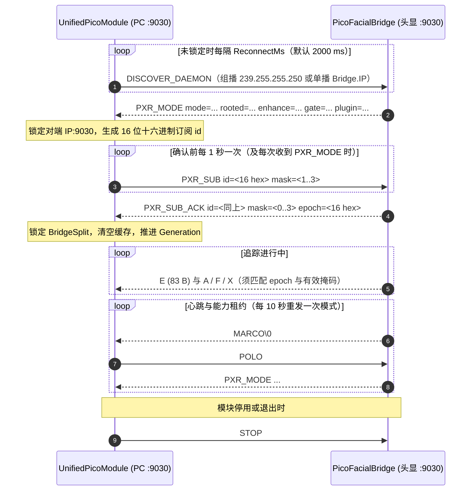

# 协议参考

[English](protocol.md) | 简体中文 · [README](../README_zh.md) · [配置说明](configuration_zh.md)

本文档说明 UnifiedPicoModule 解码的四种 UDP 线格式、Bridge 控制握手、眼动与瞳孔解析以及数据源选择规则。实现以 `Protocol/`、`Transport/`、`Mapping/`、`Runtime/` 和 `Sdk/` 中的源码为准（源码不随发布 ZIP 分发）。

上述四种格式均由本模块独立实现，参考来源与许可边界见[第三方声明](../THIRD_PARTY_NOTICES_zh.md)。

## 协议概览

| 格式（`InputProtocol`） | 发送端 | 本地端口 | 发现与会话机制 | 数据报长度 | 支持能力 |
|---|---|---:|---|---|---|
| `BridgeSplit` | PicoFacialBridge 0.3.0 及以上 | `9030` | 组播/单播发现、`PXR_MODE`、`PXR_SUB` / `PXR_SUB_ACK`、`MARCO\0` / `POLO` | `83`、`95`、`151`、`227`；`X` v1：`111`/`243`；`X` v2：`131`/`263` | 通道订阅、实测瞳孔直径（`E`）、分眼独立表情（`X` v1/v2） |
| `DaemonLegacy536` | PicoFacialDataDaemon | `9030` | 组播/单播发现、`MARCO\0` / `POLO` | `536` | 384 字节面部前缀 + 152 字节眼动前缀；有效时提供实测瞳孔 |
| `StreamingHeader16` | PICO Connect（legacy 面捕协议） | `29765` | 被动接收（可选 `MARCO\0` → `POLO`），首帧可用即锁定 | `>= 908`（忽略尾部多余字节） | 16 字节头 + 892 字节面部 body；表情推算视线与睁眼度 |
| `StreamingBodyOnly` | 无头串流发送端 | `29763` | 被动接收（可选 `MARCO\0` → `POLO`），首帧可用即锁定 | `892` | 仅 892 字节面部 body；表情推算视线与睁眼度 |

### 通用线格式约定

- **偏移与字节序：** 所有偏移均为从数据报第 0 字节起算的零基字节偏移。多字节整数显式按 little-endian 读取，浮点数为 little-endian IEEE 754 binary32，不使用本机结构体封送。
- **长度校验：** 除 `StreamingHeader16` 以 `908` 字节为下界外，其余格式均要求长度精确相等。
- **端口绑定：** 端口固定且以排他模式（`ExclusiveAddressUse = true`）绑定。若旧 PICO 模块仍占用端口，绑定会失败并在日志中输出端口与错误信息。
- **接收缓冲区：** `2048` 字节（大于所有受支持格式），超长数据报会被丢弃。

---

## Bridge 连接流程

`BridgeSplit` 与 `DaemonLegacy536` 共用 UDP `9030` 端口以及同一套发现和对端锁定逻辑。Bridge 为单客户端会话，不是多端转发中继。



### 控制报文

控制报文为精确匹配的 ASCII 文本，不含换行符；仅 `MARCO\0` 末尾带有一个 NUL 零字节。

| 报文 | 字节数 | 方向 | 作用 |
|---|---:|---|---|
| `DISCOVER_DAEMON` | 15 | PC → 头显 | 发现发送端并申请会话 |
| `MARCO\0` | 6 | 头显 → PC | 心跳探测 |
| `POLO` | 4 | PC → 头显 | 心跳应答 |
| `PXR_MODE ...` | 10–256 | 头显 → PC | 能力通告（仅 `BridgeSplit`） |
| `PXR_SUB id=... mask=...` | 34 | PC → 头显 | 通道订阅请求 |
| `PXR_SUB_ACK id=... mask=... epoch=...` | 61 | 头显 → PC | 订阅确认与 epoch 分配 |
| `STOP` | 4 | PC → 头显 | 结束当前已锁定会话 |

### 发现

未锁定对端时，模块每隔 `Bridge.ReconnectMs`（默认 `2000` ms，范围 `100`–`60000` ms）发送一次 `DISCOVER_DAEMON`：

- **自动发现（未设置 `Bridge.IP`）：** 向组播地址 `239.255.255.250:9030` 发送（TTL = `1`），每个符合条件的网卡各发一次。网卡须处于 `Up` 状态、支持组播、类型为 Ethernet 或 Wi-Fi（`Wireless80211`）、具有非回环 IPv4 地址，且名称与描述不含 `virtual`、`vpn`、`tunnel`、`wireguard`、`zerotier`、`tailscale`、`tap-`、`hyper-v`、`vmware`、`virtualbox`。当 `Bridge.ListenAddress` 不为 `0.0.0.0` 时，只使用对应地址的网卡。若无可用网卡，日志会提示显式设置 `Bridge.IP`。
- **单播直连（已设置 `Bridge.IP`）：** 直接单播至 `<Bridge.IP>:9030`，跳过网卡筛选。

### 对端锁定

模块仅接受源端口为 `9030` 的 IPv4 单播数据报。未锁定时还须同时满足三项条件：

1. 若设置了 `Bridge.IP`，来源 IP 必须与之相同；否则来源 IP 必须与某个活动发现网卡同子网，且不是该网卡自身地址。
2. 报文到达时间位于最近一次发现请求的响应窗口内，窗口长度为 `max(1 s, Bridge.ReconnectMs)`。
3. 收到 `MARCO\0`、合法的 `PXR_MODE` 或至少含有一个可用字段的追踪数据报时，锁定对端完整的 `IP:9030`。

锁定后生成新的 16 位小写十六进制 `subscriptionId`，状态置为 `MissingFrames` 直至收到数据，并拒绝其他端点报文直至会话结束。来自允许对端的每次 `MARCO\0` 都会回复 `POLO`。

### 模式通告（`PXR_MODE`）

`BridgeSplit` 发送端在锁定后立即发出 `PXR_MODE`，之后每 10 秒以及模式变化时重发：

```text
PXR_MODE mode=<normal|enhance> rooted=<0|1> enhance=<0|1> gate=<0|1> plugin=<off|left|right|dual>
```

解析规则（`Protocol/BridgeControl.cs`）：

- 仅允许可打印 ASCII（`0x20`–`0x7E`），长度 10–256 字节，以空格分隔键值。
- 必须**恰好**包含五个不重复的键：`mode`、`rooted`、`enhance`、`gate`、`plugin`。`mode` 须为 `normal` 或 `enhance`，三个标志位须为 `0` 或 `1`。
- 增强模式（`Enhanced = true`）要求 `mode=enhance` **且** `rooted=1`、`enhance=1`、`gate=1`。
- 分眼独立视线（`IndependentPerEye = true`）要求处于增强模式**且** `plugin=dual`。未识别的 `plugin` 值按 `off` 处理；`left` 与 `right` 不代表分眼独立。

格式非法的 `PXR_MODE` 会被丢弃并清除先前记录的能力。能力变化时模块推进 `Generation` 并清空眼动与表情缓存。若超过 `min(20000 ms, ControlTimeoutMs)` 未收到新的通告，能力降级为未知（日志输出 `Mode advertisement expired; capabilities downgraded`）。会话一旦锁定为 `DaemonLegacy536`，`PXR_MODE` 不会赋予任何能力。

### 订阅与确认

只有收到合法的 `PXR_MODE` 且 `Bridge.Protocol` 未固定为 `DaemonLegacy536` 时，模块才会发送 `PXR_SUB`。旧版 daemon 在心跳期间收到 `POLO` 以外的应答会判定心跳失败，因此模块绝不向未通告模式的对端发送订阅。

```text
PXR_SUB id=<16 位小写十六进制> mask=<1|2|3>
PXR_SUB_ACK id=<同上 16 位> mask=<0|1|2|3> epoch=<16 位小写十六进制>
```

- **通道掩码：** `1` = 眼动，`2` = 面部，`3` = 眼动与面部。请求掩码为 VRCFT 宿主分配通道与模块配置（`!DisableEyeTracking`、`!DisableFaceTracking`）的交集；若请求掩码为 `0`，模块不启动数据源。
- **重发节奏：** 收到确认前每 `1` 秒重发一次，每次收到 `PXR_MODE` 也会重发。订阅请求具备幂等性。
- **确认校验：** 必须**恰为 61 字节**且完全符合上述单空格格式，来自已锁定对端，`id` 与当前 `subscriptionId` 一致，有效 `mask` 在 `0..3` 且为 `requestedMask` 的子集，`epoch` 为正的 signed int64（`1..Int64.MaxValue`）。已订阅后 `epoch` 不得倒退，同一 `epoch` 下 `mask` 不得改变。

有效掩码等于头显本地开关与 PC 请求通道的交集。确认中的 `epoch` 或 `mask` 变化时，模块锁定 `BridgeSplit`、清空缓存帧和后处理时间状态并推进 `Generation`。有效掩码为 `0` 时，头显暂停追踪数据而保持心跳与模式通告，模块状态停留在 `MissingFrames`。

### 数据过滤、超时与停止

订阅确认前不接受任何 `BridgeSplit` 数据报。每条 `BridgeSplit` 数据报必须匹配最近一次确认的 `epoch` 与 `effectiveMask`，否则丢弃并触发重发 `PXR_SUB`，防止旧 epoch 的在途包恢复已关闭通道。会话内首个通过校验的格式会锁定本次会话协议，另一种格式的数据报在下次会话前均被丢弃。

| 情况 | 模块行为 |
|---|---|
| 超过 `250 ms` 未收到数据，但控制报文正常 | 状态切换为 `MissingFrames`，保持对端锁定与订阅 |
| 超过 `ControlTimeoutMs`（默认 `30000 ms`）未收到心跳、模式通告、确认或数据 | 不发送 `STOP`，清除锁定与订阅，切换为 `Searching` 并立即重新发现 |
| 已订阅时收到 `epoch` 倒退的确认，且超过 `1 s` 未接受新数据 | 释放锁定，生成新 `subscriptionId` 重新发现 |
| 模块停用或调用 `Teardown()` | 仅向当前锁定对端发送一次 `STOP`（若 `200 ms` 内无法获取状态锁，则直接关闭 socket） |

> [!NOTE]
> 头显端 Bridge 应用重启后会丢失已锁定的 PC 地址，在收到新的 `DISCOVER_DAEMON` 前不会主动发包，因此 PC 端需要等待 `ControlTimeoutMs`（默认 30 秒）超时后再重新发现。实机测试中头显界面约 6 秒恢复运行，PC 端约 33 秒完成重新订阅。

---

## BridgeSplit 包格式

### 公共头（19 字节）

| 偏移 | 大小 | 类型 | 字段 | 说明 |
|---:|---:|---|---|---|
| 0 | 1 | `uint8` | `tag` | ASCII `'E'`、`'A'`、`'F'` 或 `'X'` |
| 1 | 1 | `uint8` | `channelMask` | 有效通道掩码（`1`–`3`） |
| 2 | 1 | `uint8` | `validityFlags` | 形态有效位：bit 0（`1`）眼部，bit 1（`2`）面部；须为 `channelMask` 的子集，`'E'` 包必须为 `0` |
| 3 | 8 | `int64` | `epoch` | 流 epoch，必须 `> 0` |
| 11 | 8 | `int64` | `sourceTimestamp` | 正源时间戳（`> 0`）。`A`/`F`/`X` v1 为面部时钟，`E` 为眼动时钟，`X` v2 为左眼时钟（仅当左眼更新位为 `0` 时允许为 `0`） |

### 数据报类型

| 标签 | 长度 | 有效掩码 | 载荷内容 |
|---|---:|---|---|
| `E` | 83 | `1` 或 `3` | 原生眼动（模块仅消费其中的实测瞳孔直径） |
| `A` | 95 | `1` | 19 个眼周表情形态 |
| `F` | 151 | `2` | 33 个非眼周表情形态 |
| `F` | 227 | `3` | 全部 52 个 PICO 表情形态（槽 `0`–`51`） |
| `X` (v1) | 111 | `1` | 与 `A` 相同的 19 个眼周形态 + 16 字节 v1 独立眼部扩展 |
| `X` (v1) | 243 | `3` | 与 `F` 相同的 52 个形态 + 16 字节 v1 独立眼部扩展 |
| `X` (v2) | 131 | `1` | 与 `A` 相同的 19 个眼周形态 + 36 字节 v2 分组时钟扩展 |
| `X` (v2) | 263 | `3` | 与 `F` 相同的 52 个形态 + 36 字节 v2 分组时钟扩展 |

普通发送端按掩码发送：掩码 `1` 发 `E` + `A`，掩码 `2` 只发 `F`（151 B），掩码 `3` 发 `E` + `F`（227 B，不发 `A`）。独立表情发送端用 `X` 替换 `A` 或 227 字节的 `F`；掩码 `2` 仍发 `F`（151 B），`E` 包不变。

### `X`：独立眼部表情

扩展区紧接形态载荷之后：掩码 `1` 从字节偏移 **95** 开始，掩码 `3` 从字节偏移 **227** 开始。

#### v1 扩展（16 字节；总长 111 B / 243 B）

| 相对偏移 | 大小 | 类型 | 字段 | 说明 |
|---:|---:|---|---|---|
| +0 | 4 | `int32` | `version` | `1` 或 `2`（其他值拒绝） |
| +4 | 4 | `float32` | `rightInnerBrow` | 已滤波右内眉（须为有限值）；标准槽 `3` 为左内眉 |
| +8 | 4 | `int32` | `leftQualityState` | `-1` = 未知，`0` = 不可用，`1` = 可用 |
| +12 | 4 | `int32` | `rightQualityState` | `-1` = 未知，`0` = 不可用，`1` = 可用 |

#### v2 扩展追加字段（+20 字节；扩展总长 36 字节，包总长 131 B / 263 B）

| 相对偏移 | 大小 | 类型 | 字段 | 说明 |
|---:|---:|---|---|---|
| +16 | 4 | `uint32` | `groupUpdated` | 更新组位掩码：bit 0（`1`）= 左眼，bit 1（`2`）= 右眼，bit 2（`4`）= 嘴。掩码 `1` 仅允许 bit 0–1；掩码 `3` 允许 bit 0–2 |
| +20 | 8 | `int64` | `mouthSourceTimestamp` | 非负；bit 2 置位时必须 `> 0` |
| +28 | 8 | `int64` | `rightSourceTimestamp` | 非负；bit 1 置位时必须 `> 0` |

（`X` v2 的左眼源时间戳位于公共头偏移 `11`：非负，bit 0 置位时必须 `> 0`。）

#### `X` v1 与 v2 处理语义

- **分眼可用性：** 眼周形态依据本侧的 `leftQualityState` / `rightQualityState` 判断可用性，不使用公共头中合并的眼部有效位。状态 `1` 与 `-1` 保留数据（`-1` 表示未分类，不等同于已确认良好），状态 `0` 表示本眼不可用。非眼周形态仍受公共头面部有效位（字节 2 的 bit 1）控制。
- **不跨眼借用：** 视线与睁眼度按单眼分别由 `EyeLook` 和 `1 - EyeBlink` 推算。某眼不可用（`state == 0`）时，按 `Stale.NeutralizeOnTimeout` 保持本眼最近可用输出，不借用对侧眼睛。`BrowInnerSeparation` 分侧执行，`BrowDownResponse` 中的跨眼 `BlinkAsymmetry` 自动跳过。
- **v1 与 v2 时钟差异：** `X` v1 共用单一源时间戳与面部序号。`X` v2 在同一 `epoch` 下维护三条独立流（`Face` = 左眼、`RightFace` = 右眼、`Mouth` = 嘴）：
  - 重复或倒退的源时间戳**只拒绝对应分组**，同一包内其余更新组仍正常推进。
  - `groupUpdated` 未置位的组既不发布，也不消耗其去重时钟；`groupUpdated == 0` 的包是合法空操作。
  - 只有被接纳的组才推进序号、本机到达时间与后处理。高频眼部更新不会刷新或重算缓存嘴部数据，也不会重置或延长 `TongueHold`。
  - 新的不可用眼观测（`state == 0`）会推进该眼的源身份与序号，但**不会**刷新其最近可用视线、睁眼度或眼周表情的新鲜度时间戳；启用 `Stale.NeutralizeOnTimeout = true` 时，该眼仍按最近一次可用样本的时间过期。
  - 新的无效嘴观测（`faceValid == false`）仍送入嘴部处理层，即使开启超时保持也会立即清除嘴部输出。
  - 在分组模式（`X` v2）与非分组模式（`F` / `A` / `X` v1）间切换时，清空输入缓存与输出状态。

### `E`：原生眼动（83 字节）

| 偏移 | 大小 | 类型 | 字段 | 说明 |
|---:|---:|---|---|---|
| 19 | 4 | `uint32` | `leftStatus` | 仅允许位：`0x002`、`0x004`、`0x100`、`0x800` |
| 23 | 4 | `uint32` | `rightStatus` | 同上 |
| 27 | 4 | `uint32` | `combinedStatus` | 同上 |
| 31 | 12 | `float32[3]` | `leftGaze` | 方向向量 `(X, Y, Z)` |
| 43 | 12 | `float32[3]` | `rightGaze` | 方向向量 `(X, Y, Z)` |
| 55 | 12 | `float32[3]` | `combinedGaze` | 方向向量 `(X, Y, Z)` |
| 67 | 4 | `float32` | `leftOpenness` | 原生睁眼度（`[0, 1]`） |
| 71 | 4 | `float32` | `rightOpenness` | 原生睁眼度（`[0, 1]`） |
| 75 | 4 | `float32` | `leftPupilRaw` | 瞳孔原始值（除以 `10` 得毫米） |
| 79 | 4 | `float32` | `rightPupilRaw` | 瞳孔原始值（除以 `10` 得毫米） |

三个状态字中出现 `0x906`（`0x002 | 0x004 | 0x100 | 0x800`）之外的任意位，或偏移 `31` 起出现非有限浮点数，整包丢弃。状态位含义见[状态位与单位](#状态位与单位)。

普通模式下，Bridge 会清除单眼视线有效位而只保留合并视线；仅在增强模式且 `plugin=dual` 时保留单眼视线有效位。无论何种模式，本模块只消费 `E` 包中的实测瞳孔直径，视线与睁眼度始终取自表情形态。

### `A`：眼周形态（95 字节）

偏移 `19` 至 `94` 包含 19 个 `float32`，按线序对应以下 `PicoShape` 槽位：

| 线序索引 | 槽位 | 名称 | 线序索引 | 槽位 | 名称 |
|---:|---:|---|---:|---:|---|
| 0 | 0 | `EyeLookDownL` | 10 | 31 | `EyeLookUpL` |
| 1 | 2 | `EyeLookInL` | 11 | 35 | `EyeLookUpR` |
| 2 | 3 | `BrowInnerUp` | 12 | 36 | `BrowOuterUpR` |
| 3 | 4 | `BrowDownR` | 13 | 38 | `EyeBlinkR` |
| 4 | 11 | `EyeLookInR` | 14 | 41 | `EyeSquintR` |
| 5 | 12 | `EyeLookDownR` | 15 | 44 | `EyeLookOutL` |
| 6 | 16 | `BrowDownL` | 16 | 45 | `EyeLookOutR` |
| 7 | 26 | `EyeSquintL` | 17 | 46 | `EyeWideR` |
| 8 | 28 | `EyeBlinkL` | 18 | 47 | `EyeWideL` |
| 9 | 30 | `BrowOuterUpL` | | | |

未列出的槽位视为缺失。由于 `channelMask` 为 `1`，面部有效位恒为 `0`。

### `F`：表情形态（151 或 227 字节）

- **151 字节（`channelMask == 2`，仅面部）：** 自偏移 `19` 起 33 个 `float32`，按升序对应上表以外的全部槽位：`1, 5, 6, 7, 8, 9, 10, 13, 14, 15, 17, 18, 19, 20, 21, 22, 23, 24, 25, 27, 29, 32, 33, 34, 37, 39, 40, 42, 43, 48, 49, 50, 51`。眼周槽视为缺失。
- **227 字节（`channelMask == 3`，眼动与面部）：** 自偏移 `19` 起 52 个 `float32`，按 PICO 槽位 `0` 至 `51` 顺序排列（完整枚举见 `Core/Contracts.cs` 中的 `PicoShape`）。

### 形态校验规则

任一形态值为非有限浮点数（`NaN` 或 `±Infinity`）时，整条 `BridgeSplit` 数据报被丢弃。线格式不含逐槽存在位：Bridge 发送前会将单个非有限值置 `0` 而不清除整组有效位，因此接收端无法区分实测 `0` 与被替换的非有限值。

对 `A` 和 `F`，19 个眼周槽受公共头眼部有效位控制，其余 33 个槽受面部有效位控制；即使 `faceValid` 为 `0`，有效的眼周形态仍可单独使用。对 `X`，眼周槽改由各眼自身的质量状态控制。

---

## DaemonLegacy536（536 字节，9030 端口）

固定 536 字节数据报，由 384 字节面部前缀与 152 字节眼动前缀组成。

| 偏移 | 大小 | 类型 | 字段 | 说明 |
|---:|---:|---|---|---|
| 0 | 8 | `int64` | `faceTimestamp` | `> 0` 视为可靠时钟，`<= 0` 按到达顺序处理 |
| 8 | 288 | `float32[72]` | `shapes` | 槽 `0`–`51` 参与映射，槽 `52`–`71` 保留为 `ExtraVisemes`（不输出） |
| 296 | 4 | `float32` | `eyeValid` | 值恰为 `1.0f` 时有效 |
| 300 | 4 | `float32` | `faceValid` | 值恰为 `1.0f` 时有效 |
| 304 | 76 | — | *（未映射）* | 忽略 |
| 380 | 4 | — | `padding` | 填充字段，**不是**眼动时间戳 |
| 384 | 4 | `uint32` | `leftStatus` | 左眼状态位 |
| 388 | 4 | `uint32` | `rightStatus` | 右眼状态位 |
| 392 | 4 | `uint32` | `combinedStatus` | 合并视线状态位 |
| 396 | 36 | — | *（未映射）* | 忽略 |
| 432 | 12 | `float32[3]` | `leftGaze` | 方向向量 `(X, Y, Z)` |
| 444 | 12 | `float32[3]` | `rightGaze` | 方向向量 `(X, Y, Z)` |
| 456 | 12 | `float32[3]` | `combinedGaze` | 方向向量 `(X, Y, Z)` |
| 468 | 4 | `float32` | `leftOpenness` | 原生睁眼度 |
| 472 | 4 | `float32` | `rightOpenness` | 原生睁眼度 |
| 476 | 4 | `float32` | `leftPupilRaw` | 瞳孔原始值（`÷ 10` = 毫米） |
| 480 | 4 | `float32` | `rightPupilRaw` | 瞳孔原始值（`÷ 10` = 毫米） |
| 484 | 52 | — | *（未映射）* | 忽略 |

形态中出现非有限值时，仅将该槽记为缺失而不丢弃整包。眼动部分无可靠源时钟，按到达顺序处理。与 `BridgeSplit` 相同，模块只消费其中的实测瞳孔直径，视线与睁眼度取自表情形态。

---

## Streaming 格式（29765 与 29763 端口）

Streaming 发送端仅传输面部表情（不含原生眼动与瞳孔），视线与睁眼度由 `EyeLook` 和 `EyeBlink` 推算。

### `StreamingHeader16` 头部（29765 端口，`>= 908` 字节）

| 偏移 | 大小 | 类型 | 字段 | 说明 |
|---:|---:|---|---|---|
| 0 | 1 | `uint8` | `startCode1` | 仅在设置 `Streaming.HeaderProfile` 时校验 |
| 1 | 1 | `uint8` | `startCode2` | 仅在设置 `Streaming.HeaderProfile` 时校验 |
| 2 | 1 | `uint8` | `trackingType` | 必须为 `2`（面部数据） |
| 3 | 1 | `uint8` | `subType` | 仅在设置 `Streaming.HeaderProfile` 时校验 |
| 4 | 1 | `uint8` | `multiPack` | 仅在设置 `Streaming.HeaderProfile` 时校验 |
| 5 | 1 | `uint8` | `currentIndex` | 仅在设置 `Streaming.HeaderProfile` 时校验 |
| 6 | 2 | `uint16` | `version` | 仅在设置 `Streaming.HeaderProfile` 时校验 |
| 8 | 8 | `uint64` | `transportTimestamp` | 传输层元数据，**不用作**面部时钟 |
| 16 | 892 | `byte[892]` | `body` | 见下方 892 字节通用 Body；偏移 `907` 之后的字节忽略 |

实测 PICO Connect 10.6.6（`faceTrackingTransferProtocol=2`）发出 **912 字节**数据报（16 字节头 + 896 字节 body，即超出 908 字节 4 个尾部字节），头部前 8 字节为 `00 33 02 01 00 01 01 00`。

### 通用 Body 布局（892 字节）

在 `StreamingHeader16`（29765 端口）中位于偏移 `16`，在 `StreamingBodyOnly`（29763 端口，要求恰为 `892` 字节）中位于偏移 `0`。

| Body 偏移 | 大小 | 类型 | 字段 | 说明 |
|---:|---:|---|---|---|
| 0 | 8 | `int64` | `faceTimestamp` | `> 0` 视为可靠时钟，`<= 0` 按到达顺序处理 |
| 8 | 288 | `float32[72]` | `shapes` | 槽 `0`–`51` 参与映射，槽 `52`–`71` 保留为 `ExtraVisemes`；有限值即存在，非有限值视为缺失 |
| 296 | 40 | `float32[10]` | `validity` | 忽略（实测 PICO Connect 10.6.6 从不将其置为 `1.0f`） |
| 336 | 4 | `float32` | `laughing` | 忽略 |
| 340 | 40 | `float32[10]` | `emotion` | 忽略 |
| 380 | 512 | `byte[512]` | `reserved` | 忽略 |

### Streaming 接收规则

- **29765 端口（`StreamingHeader16`）：** 默认模式接受长度 `>= 908` 且 `trackingType == 2` 的数据报（与 SAFT、pike 一致）。设置 `Streaming.HeaderProfile` 后启用严格模式，额外校验六个字段（`StartCode1`、`StartCode2`、`SubType`、`MultiPack`、`CurrentIndex` 范围 `0..255`；`Version` 范围 `0..65535`）。任一字段缺失或越界时整体回退为默认模式；严格模式不重组分片。
- **29763 端口（`StreamingBodyOnly`）：** 长度必须恰为 `892` 字节。
- **监听与来源校验：** 默认同时监听两个端口，指定 `Streaming.Protocol` 后仅绑定对应端口。仅接受 IPv4 单播来源；`Streaming.LocalOnly` 默认为 `true`，要求来源为回环地址或本机活动网卡的 IPv4 地址。若同时指定了 `Streaming.IP`，该地址也必须为本机地址，否则启动报错。
- **锁定与心跳：** 首个包含可用字段的数据报锁定来源 `IP:端口` 与协议。锁定后，结构合法但字段全无效的包仍会被提交，使输出及时失效。来自允许发送端的精确 `MARCO\0` 会回复 `POLO`，但不触发锁定。
- **超时：** 超过 `250 ms` 无数据进入 `MissingFrames`。超过 `Streaming.SessionTimeoutMs`（默认 `2000` ms）后清除锁定与缓存、状态回到 `Searching` 并重新读取本机地址。模块不向 Streaming 发送端发送 `STOP`，`DisableEyeTracking` 与 `DisableFaceTracking` 仅控制本模块输出。

---

## 眼动解析与瞳孔编码

### 状态位与单位

适用于 `BridgeSplit` 的 `E` 包和 `DaemonLegacy536` 的眼动区（`Protocol/DecodedPacket.cs`）：

| 状态位 | 所在状态字 | 含义 | 附加有效条件 |
|---:|---|---|---|
| `0x002` | 合并视线 | 合并视线有效 | 向量 3 个分量均为有限值 |
| `0x004` | 每眼 | 原生睁眼度有效 | 有限值且在 `[0, 1]` |
| `0x100` | 每眼 | 每眼视线有效 | 向量 3 个分量均为有限值 |
| `0x800` | 每眼 | 瞳孔直径有效 | `raw / 10` 为正有限值（输出还要求落在 `[1, 12]` mm） |

### 视线与睁眼度推算

对所有发送端，视线均由 `EyeLook` 形态推算，睁眼度均取 `1 - EyeBlink`（`Mapping/EyeResolver.cs`）：

- **视线（`blendshape-derived`）：** 要求该眼的 `EyeLookIn`、`EyeLookOut`、`EyeLookUp`、`EyeLookDown` 四个形态全部存在且有效：
  - `Left.GazeX = EyeLookInL - EyeLookOutL`
  - `Right.GazeX = EyeLookOutR - EyeLookInR`
  - `GazeY = EyeLookUp - EyeLookDown`（左右各自计算）
- **睁眼度（`blendshape-blink`）：** `Openness = 1 - EyeBlink`（左右各自计算）。VRCFT 输出闭眼度为 `EyeClosed = 1 - Openness`。
- **增益与限幅：** 乘以对应 `EyeGain` 系数后，视线限幅至 `[-1, 1]`，睁眼度限幅至 `[0, 1]`。
- **缺失或无效样本：** 保持本眼最近有效值，不用其他来源补齐。尚无有效样本，或启用 `Stale.NeutralizeOnTimeout = true` 且已过期时，来源为 `neutral`（视线 `(0, 0)`、睁眼度 `1`）。切入独立 `X` 表情模式时，若首帧某眼不可用，会重置为 `neutral`，不继承先前的非独立历史。

### 瞳孔测量与 VRCFT 6 编码

仅当状态位 `0x800` 置位、`raw / 10` 为有限值且位于 `[1, 12]` mm、且对应眼动包未超过 `Stale.EyeMs`（默认 `250` ms）时，才采用实测瞳孔直径。模块不从睁眼度或表情推算瞳孔。

有实测值时（`RealPupil = true`），VRCFT 5 与 VRCFT 6 均直接写入毫米直径。无实测值时（尚无测量、重置/退出后，或启用 `Stale.NeutralizeOnTimeout = true` 过期后），SDK 边界（`Sdk/UnifiedPicoTrackingModule.cs`）按宿主主版本分别编码：

| 宿主版本 | `RealPupil == false` 时写入的 `PupilDiameter_MM` | 日志来源 | 原因 |
|---|---|---|---|
| **VRCFT 6（`>= 6.0`）** | `0` | `estimated` | VRCFT 6 将 `0` 视为“无瞳孔测量”；若写入正数占位值，会被编码为实际缩瞳/扩瞳 |
| **VRCFT 5（`5.x`）** | `Stale.NeutralPupilMillimeters`（默认 `3.5` mm） | `estimated` | 保持 VRCFT 5 原有的中性直径约定 |

---

## 时间戳、过期与中性输出

- **单调时钟规则：** signed `int64` 源时间戳为正（`> 0`）时才作为可靠时钟。旧格式/串流格式将 `<= 0` 按到达顺序处理；`BridgeSplit` 要求正时间戳，仅 `X` v2 未置更新位的组允许为 `0`。
- **独立序列去重：** 同一 `Generation` 内，原生眼动（`E`）与表情分别校验时间戳。`A`、`F`、`X` v1 共用面部序列，`X` v2 分别维护左眼、右眼和嘴三条序列。重复或倒退的样本不推进本组的到达时间、序号或后处理状态。
- **新鲜度：** 按本机单调时钟（`Stopwatch`）到达时间判断，控制报文不延长数据新鲜度。模块不做插值或帧合成；无新组观测时，SDK 更新直接复用已处理输出（仅待到期的 `TongueHold` 会在无新嘴包时改变嘴部输出）。

### 过期策略

`Stale.NeutralizeOnTimeout` 默认为 `false`：数据过期后保持最近有效的视线、睁眼度、瞳孔和表情输出，新鲜度检查与后处理时间状态重置照常生效。

设为 `Stale.NeutralizeOnTimeout = true` 时：

| 数据 | 过期阈值 | 过期后输出 |
|---|---|---|
| 表情 | `Stale.FaceMs`（默认 `250` ms） | 过期通道归 `0`，重置后处理时间状态 |
| 视线与睁眼度 | `Stale.FaceMs`（默认 `250` ms） | 视线回正 `(0, 0)`，睁眼度为 `1`（`neutral`） |
| 瞳孔 | `Stale.EyeMs`（默认 `250` ms） | VRCFT 6 写入 `0`，VRCFT 5 写入 `Stale.NeutralPupilMillimeters` |

未选定数据源时输出完全中性。新会话、切换数据源或模式变化会推进 `OutputGeneration`，无条件清空眼动解析与后处理状态。仅因连接或模式通告超时引起的 `Generation` 递增不改变 `OutputGeneration`，在 `NeutralizeOnTimeout = false` 时保留已保持输出，同时清除传输缓存和后处理时间状态。停用、退出及更新异常始终重置为中性输出。

表情形态由 `Mapping/NeutralFaceMapper.cs` 按固定表映射至 `ExpressionChannel`，不施加隐式增益并限幅到 `[0, 1]`（启用 `LegacyExpressionCeiling = true` 时上限为 `0.99`）。映射后的可选规则见[后处理参考](postprocessing_zh.md)。

---

## 来源选择与运行时定时

### 来源选择

`Source` 决定启动哪些接收源：`Bridge`、`Streaming` 或 `Auto`（同时启动两者）。处于 `Faulted` 或 `Stopped` 状态的数据源不可用；其余数据源满足以下任一条件即视为可用：

- 未禁用眼动、存在新鲜的原生眼动包，且包含有效实测瞳孔（`[1, 12]` mm）；或
- 存在新鲜的形态数据，且包含可映射表情或（未禁用眼动时）可推算的视线/睁眼度。

`Auto` 模式下，启动后 `AutoSelectionWindowMs`（默认 `1500` ms）内只选用 `Bridge`；超时后采用最先可用的来源，两者同时可用时优先 `Bridge`。选定后本次运行保持不变；启用 `AllowFallback = true` 时，当前源不可用且另一源可用会整源切换。模块绝不混合两个来源的数据。

### SDK 消费统计与后台定时策略

- **诊断统计：** `groupRxHzLRM` 报告接纳的左眼/右眼/嘴频率。`CONSUMPTION` 区分已处理组数、被最新快照合并的中间观测、含新组的 SDK 写入与重复写入，并统计模块内部耗时分位（`receiveToProcessMs`、`processMs`、`receiveToWriteMs`、`sdkWriteMs`），不涵盖宿主 IPC、OSC 或 Avatar 渲染。
- **后台定时精度：** 官方 VRCFT 5.4.5 在模块进程中请求 1 ms 定时周期。追踪激活期间，模块记录当前进程的 `PROCESS_POWER_THROTTLING_STATE`，仅清除 `PROCESS_POWER_THROTTLING_IGNORE_TIMER_RESOLUTION`（`0x4`）位，使该定时请求在后台继续生效；停用、退出或源故障时重新读取当前策略，只还原该位原先的控制/状态设置，保留其余位不变。

---

## 验证状态

实机验证均在 PICO 4 Pro 上完成：

| 路径 | 已验证环境 | 覆盖范围 |
|---|---|---|
| `BridgeSplit` `X` v2 | PicoFacialBridge 0.5.0 + PicoET-Enhance 2.3.0，官方 VRCFT 5.4.5 | 84 秒真人佩戴 Virtual Desktop 会话（Cymple 嘴 + PICO 眼；PICO 眼 + 面）；约 89.7 `X` 包/秒，每包含新眼部源 |
| `BridgeSplit` `X` v1 | PicoFacialBridge 0.4.0 + PicoET-Enhance 2.2.0，官方 VRCFT 5.4.5 | 录制眼图（~23.7 Hz 加速循环回放）经原生推理；`E` 与双通道 `X` 数值、逐眼有效性 |
| `BridgeSplit`（`E`/`A`/`F`） | PicoFacialBridge 0.3.0 | 发现、`PXR_MODE`、`PXR_SUB`/`PXR_SUB_ACK`、四种通道掩码、epoch 一致性、缓存清理、超时回中性、应用重启与整机重启恢复 |
| `StreamingHeader16`（29765） | PICO Connect 10.6.6（`faceTrackingTransferProtocol=2`） | 912 字节数据报（16 B 头 + 896 B body），约 72 Hz，零丢包 |

以下路径尚未实机验证：严格 `Streaming.HeaderProfile` 模式、29763 端口（`StreamingBodyOnly`；在 PICO Connect 10.6.6 上将 `faceTrackingTransferProtocol` 设为 `1` 时，29763 与 29765 均未抓到 UDP 流量）、`DaemonLegacy536`、PicoFacialBridge 普通模式、单眼质量失效（`state == 0`），以及长时间运行稳定性。

---

## 网络安全

UDP 不提供加密与身份验证。来源地址校验、端点锁定与长度/字段检查可以防止误接收，但无法防御已被入侵局域网内的伪造包。请仅在可信局域网中使用本模块，勿将 `9030`、`29765`、`29763` 端口暴露至公网。详见[隐私与网络安全](privacy_zh.md)。

## 参考来源

以下链接仅用于核对线偏移与协议行为，本项目未复制其中的实现代码：

- thoricelli：[PicoFacialDataModule.cs](https://github.com/thoricelli/PicoFacialDataModule/blob/0ab66348bf970763322fe261b54445bcc5a2b23e/PicoFacialDataModule/PicoFacialDataModule.cs) 与 [PxrEyePoseDataV2.cs](https://github.com/thoricelli/PicoFacialDataModule/blob/0ab66348bf970763322fe261b54445bcc5a2b23e/PicoFacialDataModule/Models/PxrEyePoseDataV2.cs)（`0ab6634`）—— 536 字节布局、眼动状态位与单位。
- regzo2：[LegacyConnector.cs](https://github.com/regzo2/PicoStreamingAssistantFTUDP/blob/ab500f0355cd8bbf8f9f5b4e6bcfe43d16499cb7/PicoStreamingAssistantFTUDP/PicoStreamingAssistantFTUDP/PicoConnectors/LegacyConnector.cs)（`ab500f0`）—— 29765 端口 `trackingType` 接收判定。
- pikepikeid：[DataPacket.cs](https://github.com/pikepikeid/VRCFTPicoModule/blob/c026aa455da60dd50492b3d36c9d360d0c343b8e/VRCFTPicoModule/Data/DataPacket.cs)、[LegacyDataPacket.cs](https://github.com/pikepikeid/VRCFTPicoModule/blob/c026aa455da60dd50492b3d36c9d360d0c343b8e/VRCFTPicoModule/Data/LegacyDataPacket.cs) 与 [Updater.cs](https://github.com/pikepikeid/VRCFTPicoModule/blob/c026aa455da60dd50492b3d36c9d360d0c343b8e/VRCFTPicoModule/Utils/Updater.cs)（`c026aa4`）—— 16 + 892 布局、长度下界与 `trackingType` 判定，以及 29763 端口。
- WolalaQAQ：[TrackingData.java](https://github.com/WolalaQAQ/PicoFacialBridge/blob/836101c27feffccfbf7df6d94af9e98093f96057/shared/src/main/java/dev/pico/facialprobe/TrackingData.java) 与 [PeerProtocol.java](https://github.com/WolalaQAQ/PicoFacialBridge/blob/836101c27feffccfbf7df6d94af9e98093f96057/bridge/src/main/java/dev/pico/facialprobe/PeerProtocol.java)（`836101c`）—— 旧版 536 字节包与控制报文来源。
- PicoFacialBridge 0.3.0+（`TrackingData.java`、`TrackingMode.java`、`PeerProtocol.java`、`BridgeService.java`）—— `BridgeSplit` 偏移、`PXR_SUB` / `PXR_MODE` 语义与 `X` v1/v2 扩展。
